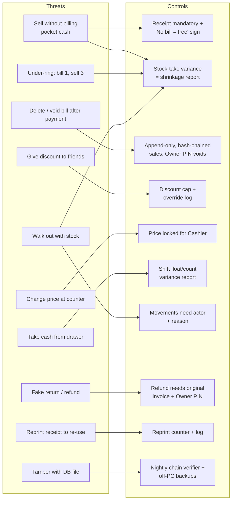

# 02 — Requirements & Anti-Theft Analysis

## 1. Interpreting the brief

The owner's requirements, restated precisely, with design implications:

| # | Owner said | Interpretation / decision |
|---|-----------|---------------------------|
| R1 | "No money can be stolen by staff" | Cannot be *physically* guaranteed by software; we make theft **detectable the same day** and **inconvenient** (see §4). |
| R2 | "Every sale must be tracked; scan before sell" | Sale is the **only** path that reduces stock for cashiers. **Scanner is mandatory** (`billing.require_scan`): cashiers add lines only by scanning; damaged labels and uncatalogued items go through F3 Find / Open item (policy ALLOW / PIN / BLOCK), always marked and reported. Scanner paired once (VID:PID) so the doctor can detect it. |
| R3 | "Receipt with qty, price, name, VAT, SAT, date, time, shop name…" | India uses **GST**, split into **CGST + SGST** for intra-state sales (VAT was replaced in 2017). Tax engine is label-configurable so the receipt can read "CGST/SGST", "VAT", or be tax-free (unregistered / composition dealer). Receipt auto-prints when a POS printer is connected; **a printer is not required to run the app or to sell** — receipts are archived as PDF and queued until a printer is set up (`billing.require_printer` is an Owner opt-in). |
| R4 | "Current quantity, price, image" | Product master with image upload, stock derived from movements (never a bare editable number for cashiers). |
| R5 | "SQLite or similar, not Postgres" | **SQLite** in WAL mode via SQLAlchemy; schema kept ANSI-ish so a later move to MySQL/MariaDB is possible. |
| R6 | "History of item sell" | Item-wise and bill-wise history with filters & export. |
| R7 | "Professional, commercial frontend + chatbot with local Ollama" | NiceGUI (Quasar/Material look), floating bottom-right chat widget, Ollama LLM + embeddings. **Chatbot is the owner's analyst**: current sales, low/out-of-stock, high/no demand, **forecasts** — numbers always from tools / a statistical `ForecastService`, never LLM guesses. |
| R8 | "Python only" | NiceGUI + FastAPI + SQLAlchemy + ollama-python; no JS build step. |
| R13 | "Owner can monitor from home — PDF report by mail/WhatsApp (nice-to-have)" | Opt-in `ReportPublisher`: daily/weekly PDF digest to synced folder, SMTP, Telegram, WhatsApp (official APIs). Queued with retry; shop works without internet. |
| R14 | "Discount column; shelf ₹10 → 1 % → ₹9; print it on the receipt" | Owner-defined **offers** auto-applied + capped ad-hoc discounts; cart and receipt show shelf price → discount → final, offer name, "You saved". |
| R15 | "Manual add when there is no barcode: name, detail, qty, price, discount" | **F3 Find / Manual** dialog (Find item by name / code / ID, or open item); flagged, starred on receipt, reported, reviewable; policy ALLOW/PIN/BLOCK. |
| R16 | "Dev PC is a company machine — nothing runs here; target is the personal shop PC" | Code authored here, **executed and verified only on the shop PC** via `main.py` → doctor → selftest; installer adapts models/settings to detected hardware. |
| R17 | "Chatbot guardrails: no passwords, bank/card details, codebase, owner details, nuisance; stock-specific; Hindi option" | Six-layer guardrails incl. data isolation and pre-LLM intent filter; flagged attempts reported to owner; EN/HI/Hinglish selector. |
| R18 | "Generate barcode for new items; each item has an ID tied to name and barcode" | Permanent Product ID → auto internal EAN-13 (derived from ID) + code; multiple barcodes per product; labels carry all three. |
| R19 | "Damaged / tampered label: staff fetch the barcode by name, code or ID" | **F3 Find item** → product card with barcode → add as `LOOKUP` line (counted) → *Print replacement label* on the POS printer. |
| R20 | "New barcodes and receipts must print on the POS printing machine" | ESC/POS renderers for both labels (native `GS k` barcode, cut) and receipts (48/32-col layout, native QR/barcode, raster Hindi, cut, drawer). |
| R21 | "Two users: billing staff (limited: selling) and owner (bank details, prices, discounts, purchases, daily sales, history, profit, app admin, AI system prompt…)" | Exactly two roles `OWNER` / `STAFF`, password login, Owner PIN for on-counter overrides; full capability matrix in [05 §5](05-billing-and-anti-theft.md#5-roles--permissions-matrix); Owner-only *Payments*, *Profit & margin*, *Purchases* reports and an **AI instructions editor** with locked guardrail core, versioning and rollback. |
| R22 | "Bill items by weight/volume: 100 g ghee, 200 ml oil" | `sale_mode` PIECE / WEIGHT / VOLUME, price per pricing unit, stock in base units, quantity pad with presets, by-amount, optional weighing scale, weight-embedded barcodes ([05 §8d](05-billing-and-anti-theft.md#8d-weighed-and-measured-items-ghee-by-grams-oil-by-millilitres)). |
| R23 | "OS-independent (Windows, macOS, Ubuntu); the application installs all binaries/packages itself, asking for the system admin password first; system check before run; human-readable errors for the end user" | Stdlib-only `main.py` + `platform/` adapters; elevation only for system-level installs with explanation; doctor with plain-language EN/HI messages and "What to do" hints; app starts only after checks pass ([07](07-startup-and-health-checks.md)). |
| R24 | "Expose the log console for every operation — from one-time installation to daily use — viewable in a separate browser over HTTP/REST (e.g. `http://192.168.1.1/system/logs`)" | `/system/logs` live console + `/api/v1/system/logs…` REST + SSE, Owner login / API token, optional HTTPS, LAN opt-in with QR; stdlib **mini log server** on `:8081` during installation and when the app fails to start ([08 §9](08-logging-and-troubleshooting.md#9-log-console-over-http--rest)). |
| R25 | "Database must be protected, survive daily restarts without corruption, be backed up automatically to a secondary location chosen at install; copying the backup back to primary must work" | SQLite with WAL + `synchronous=FULL`, clean checkpoint on shutdown, integrity check at every start, single-writer lock; **installer asks for primary and secondary locations**; verified snapshots via the SQLite backup API on start / shift close / nightly / before updates; in-app Restore wizard **and** manual copy-back supported — the app detects a restored copy via `db_identity`, migrates, verifies the chain and tells the owner which period is missing ([14](14-database-backup-and-recovery.md)). |
| R26 | "Printing must not be a mandatory check; staff must be able to sell without a printer; app must notice when a printer is installed and let me choose it" | `billing.require_printer` default **off**; printer is an INFO/WARN doctor item, never a blocker; receipts PDF-archived and queued; hot-plug detection with "New printer detected" toast; *Settings → Hardware → Printer* lists detected printers with Test print and *Print pending receipts* ([05 §10](05-billing-and-anti-theft.md#10-strict-billing-mode--scanner-mandatory-printer-optional-configurable)). |
| R27 | "Track price history per item — last 30 days, 6 months, 1 year" | Append-only `price_history` (price / MRP / cost / tax rate; old → new, who, when, why, source); per-product *Price history* pop-up window (chart + table, 1 month / 6 months / 1 year / custom From–To) and *Reports → Price history*, export; AI tool `price_history` ([05 §9a](05-billing-and-anti-theft.md#9a-price-history)). |
| R28 | "Inventory may change only via a successful sale under a staff login; the Owner may update stock manually; staff must not be able to tamper or sell without a bill" | Explicit stock-mutation matrix; `SALE` is the only movement a staff session can create and only inside a committed sale; all other types Owner-only; enforced in the service layer **and** by DB triggers; movements append-only; reconciliation + shrinkage reports ([05 §5a](05-billing-and-anti-theft.md#5a-who-can-change-stock--the-mutation-rules-enforced-twice)). |
| R29 | "AI: staff login limited to inventory/price; owner login can ask anything about the billing application" | Role profiles in the system prompt + role-filtered tool sets + `OWNER_ONLY` refusal category for staff; owner gets sales/purchases/profit/forecast/audit/backup/doctor/settings-help tools ([06 §1a](06-ai-assistant.md#1a-two-assistants-in-one--what-each-login-can-ask)). |
| R30 | "Trace login time (e.g. 9:30 after opening at 9:00); staff can't just close the window — a popup must record the exit time; owner sees work history" | `work_session` per login with server-clock times; **End work popup**; window-X interception (browser prompt + beacon) and **heartbeat** so the exit time is always captured within a minute; unclean exits confirmed at next login; `app_run` records app/PC start; *Reports → Staff work history* + live panel + digest line ([05 §6a](05-billing-and-anti-theft.md#6a-attendance--login-logout-and-work-history)). |
| R31 | "One root `main.py` that takes care of everything — OS check (Mac/Windows/Linux), libraries, packages, components, install if required, set up the application — start to bottom; plus a markdown that tells how to install and run" | `main.py` is the **only** program ever run (wrappers just call it): stdlib-only, ordered idempotent stages 0–12 (survey → Python → venv → packages → system components → AI provider [Ollama + models · API key · none] → locations → DB → backup → autostart → doctor → start), resumable, hands over to `python -m vaishnavi` inside the venv; every flag (`--install-only --doctor --fix --offline --update --restore --reset-owner-password --selftest --logs --where …`) documented in **[17 — How to Install and Run](17-install-and-run.md)**; offline bundle for shops without internet. |
| R32 | "Not sure the shop PC will have the GPU/RAM for Ollama — at install, ask whether to use **OpenAI API**, **Hugging Face API**, or **local Ollama**; the installation must be **user-interactive**" | **Pluggable AI provider** chosen in an interactive installer question (`ollama` · `openai` · `huggingface` · `none`), with a hardware-based recommendation, plain-language privacy/cost notes, API key entered once and stored encrypted (`secure_setting`/keyring), live test call before accepting; switchable later in *Settings → Assistant → Provider*. One `LLMProvider` interface; guardrails, tools, fast path and role rules are identical for every provider ([06 §2](06-ai-assistant.md#2-ai-provider-and-model-selection), [ADR-041](12-tech-stack-decisions.md#adr-041-pluggable-ai-provider-ollama-local--openai-api--hugging-face-api--none)). The installer is a **step-by-step interactive wizard** (numbered choices, defaults, back/skip, EN/HI) with an answers file for unattended re-installs ([ADR-042](12-tech-stack-decisions.md#adr-042-interactive-installer-with-an-answers-file), [17 §3](17-install-and-run.md#3-first-run--installation-1020-minutes-mostly-waiting)). |
| R9 | "Check env/libs/packages first, then next phase" | stdlib-only `main.py` (installs everything on Windows/macOS/Ubuntu) + `vaishnavi doctor` pre-flight with hard gates and plain-language output. |
| R10 | "PC shut down daily; DB, Ollama, models must be up" | `main.py` at OS logon → start Ollama → pre-flight → app → browser; degraded mode if AI unavailable. |
| R11 | "Extensive debug logging" | Stdlib `logging`, module loggers, `TimedRotatingFileHandler`, correlation IDs, JSON lines option, in-app viewer. |
| R12 | "Neat, modular, commercial" | Layered package, typed service interfaces, tests, ADRs. |

## 2. Functional requirements

### FR-A Users & Access
- FR-A1 Exactly two roles: **`OWNER`** (full control) and **`STAFF`** (billing only). Permissions matrix ([05 §5](05-billing-and-anti-theft.md#5-roles--permissions-matrix)) enforced server-side, not just by hidden buttons. Any number of STAFF accounts (one per person); one OWNER account (optionally a second).
- FR-A2 Login via **username + password** for both roles (argon2 hashed; staff may use a 6-digit numeric password for counter speed; lockout after N failures). Owner additionally sets a short **Owner PIN** used only for on-counter overrides.
- FR-A3 Owner PIN prompt ("owner override") on the staff's screen for: void, refund, discount above cap, offer removal, price override, cash-out, open item (when policy = PIN), hardware override. Both user ids recorded.
- FR-A4 Auto-lock the POS screen after configurable idle minutes; re-enter password.
- FR-A5 Owner-only capabilities (non-exhaustive, all audited): edit **bank / UPI / payment details**; set prices, MRP, cost, tax; create offers and decide discount values and caps; purchases; stock adjustments; totals of sales and purchases per day/period; full sales history; **profit & margin**; users and password resets; settings, hardware, backups/restore, logs, doctor, application updates; **edit the AI assistant's instructions (system prompt)**, default language and guardrail settings.
- FR-A6 Staff capabilities: bill (scan, F3 Find, open item per policy), print/reprint receipt within limit, hold/resume, open/close **own** shift, cash-in, see stock of an item, ask the assistant stock/how-to questions, view own-shift summary. Nothing else is reachable via UI **or** API.
- FR-A7 Sensitive owner data (bank account, UPI ID, publishing credentials) is stored encrypted at rest (Fernet key held in the OS secret store via `keyring`: DPAPI / Keychain / SecretService), displayed masked, never written to logs, never exposed to AI tools, and requires password re-entry to edit.
- FR-A9 **Owner recovery key**: 12-word phrase generated at setup, shown once (printable), stored hashed; `main.py --reset-owner-password` requires the key **and** OS admin elevation; audited; doctor WARNs until the Owner acknowledges having stored it.
- FR-A10 **Owner-PIN lockout**: 3 wrong entries → 10-minute lock + notification to the Owner + audit (`E-AUTH-030`).
- FR-A8 **Attendance / work sessions** ([05 §6a](05-billing-and-anti-theft.md#6a-attendance--login-logout-and-work-history)): every login opens a `work_session` (server-clock `login_at`); it ends via the **End work popup** (exit time, summary, open-shift warning, note, Confirm), or is closed by the window-close beacon, the 15-s heartbeat monitor (60 s silence → `last_seen_at`), idle-lock timeout, or app shutdown — each with an `end_reason`. Unclean ends must be confirmed by the user at next login. One active session per user. App start/stop times recorded (`app_run`). Owner sees *Reports → Staff work history* (per user per day: login, logout, duration, reason, bills, sales, idle) and a live "who is logged in" panel; can force-end and annotate; staff cannot edit. Included in the digest.

### FR-B Product Catalogue
- FR-B1 Fields: **Product ID** (permanent numeric, auto), **code/SKU** (auto, e.g. `CAM-0050`), **barcodes** (internal EAN-13 auto-generated from the ID + optional manufacturer/pack barcodes), name, Hindi name, category, sub-category, unit (`pcs`, `g`, `kg`, `ml`, `m`, `set`), selling price, MRP, cost price, tax rate (%), HSN code, min-stock, image, active flag, tags (e.g. `diwali`, `navratri`). ID ↔ code ↔ barcode are permanently linked and all three are printed on labels.
- FR-B2 Variants via separate SKUs (e.g. "Krishna Dress — 6 inch", "— 8 inch"); optional `parent_product_id` for grouping.
- FR-B7 **Selling mode** per product: `PIECE`, `WEIGHT` (stock in grams, price per 100 g / kg) or `VOLUME` (stock in ml, price per 100 ml / L); min quantity, step and preset quantities; purchases entered in kg / L and converted.
- FR-B3 Image upload (jpg/png/webp) → resized thumbnail + stored under `<primary>/images/`.
- FR-B8 **Price history**: every change of selling price, MRP, cost or tax rate (editor, import, purchase cost update, open-item conversion) is recorded append-only with old → new, effective time, user, reason and source; viewable per product in a pop-up window (chart + table) and across products for **1 month / 6 months / 1 year / custom From–To dates**; exportable; Owner-only.
- FR-B4 Bulk import/export via CSV/Excel template.
- FR-B5 **Barcode generation & printing**: internal EAN-13 generated automatically for every new product (regenerable from the ID); labels (name EN/HI, code, #ID, barcode, price) printable on the **POS thermal printer** (ESC/POS native barcode, auto-cut), label printers, or A4 sticker sheets; print from product editor, grid multi-select, purchase entry (qty received), F3 Find (replacement) and open-item conversion. Every label print logged.
- FR-B6 Multiple barcodes per product (internal, manufacturer, pack sizes); any of them resolves to the product at the POS.

### FR-C Inventory
- FR-C1 Stock on hand = Σ movements. Movement types: `PURCHASE`, `SALE`, `SALE_VOID`, `RETURN`, `ADJUSTMENT`, `DAMAGE`, `STOCK_TAKE`, `OPENING`.
- FR-C1a **Stock mutation rules** ([05 §5a](05-billing-and-anti-theft.md#5a-who-can-change-stock--the-mutation-rules-enforced-twice)): a STAFF login can change inventory **only** by completing a customer sale (`SALE` movement written in the same transaction as the invoice); voids/refunds need the Owner PIN; every other movement type (`OPENING`, `PURCHASE`, `ADJUSTMENT`, `DAMAGE`, `STOCK_TAKE`) and every product edit is OWNER-only. Enforced in the service layer **and** by database triggers (`E-INV-010…013`); movements are append-only.
- FR-C2 Every movement has `user_id`, `reason`, `reference` (invoice / purchase no.), timestamp.
- FR-C3 Low-stock list and dashboard badge; optional reorder quantity.
- FR-C4 Stock-take mode: scan/count → system computes variance → Owner approves → `STOCK_TAKE` movements posted; variance report saved.
- FR-C5 Simple purchase entry (supplier, invoice no., items, cost) posting `PURCHASE` movements; optional `expiry_date` per line (off by default) feeding an *Expiring soon* report.
- FR-C6 **Stock cache by trigger**: `product_stock` is maintained by an `AFTER INSERT ON stock_movement` trigger (never by application code) so it cannot drift; nightly `stock_daily_balance` snapshot per product enables stock-as-of-date and three-way reconciliation.
- FR-C7 `row_version` on products (optimistic concurrency) so two Owner tabs cannot silently overwrite each other; CHECK constraints on quantities, money and status columns.

### FR-D Billing (POS)
- FR-D1 Add to cart by **barcode scan** (keyboard-wedge). With `billing.require_scan=true` (default) the search box and quick-pick tiles are **disabled for STAFF**; damaged labels and uncatalogued items go through **F3 Find / Manual** (FR-D2a). The Owner may still use search and tiles. Loose items: scan shelf label → type weight.
- FR-D1a Scanner presence: paired VID:PID checked by the doctor and re-checked every 10 s by the POS; cashier billing blocked while absent.
- FR-D2a **F3 Find / Manual** dialog: (1) **Find item** — when a label is damaged, missing or tampered, cashier types product name (EN/HI fuzzy), code or ID → product card with barcode on screen → *Add to bill* (`entry_method=LOOKUP`, reason, price/tax locked, stock reduced) and *Print replacement label* on the POS printer; (2) **Open item** — free-text name, detail, qty, unit price, discount, tax preset; stored against system product `OPEN-ITEM` (no stock effect), per-shift cap, under-price sanity warning; policy `billing.manual_add_policy = ALLOW | PIN | BLOCK` (default ALLOW). Lookup lines marked `†`, open items `*` on the receipt; both reported per cashier; open items feed an Owner review queue for conversion into products (which generates ID/code/barcode and prints labels).
- FR-D2b Cart shows columns **Item · Qty · Shelf price · Discount (offer name / % / ₹) · Final amount**.
- FR-D2 Quantity edit, per-line remove; price **read-only** for staff. **Weighed / measured items** open a quantity pad: preset buttons, numeric entry with unit (g / ml, decimals), *by amount* (₹ → quantity), live weight from an optional serial **weighing scale** (stable flag, tare), and automatic decoding of **weight/price-embedded barcodes** from label-printing scales. Receipt shows `100 g @ ₹60/100g`.
- FR-D3 Discounts: (a) **Offers** defined by the owner (name, % / ₹ / buy-X-get-Y, scope item/category/tag/bill, validity dates, stackable flag) auto-applied at scan and non-removable by cashier; (b) **ad-hoc** line/bill discount by cashier within `max_cashier_discount_pct` with a reason; above cap → Owner PIN. Shelf price is never overwritten; `sale_item` stores shelf price, offer, discount %, ₹ and reason.
- FR-D3a Receipt prints per line: shelf price, discount, final amount, offer name; totals show item discounts, bill discount and "You saved ₹…".
- FR-D4 Tax computed per line (inclusive or exclusive — configurable per shop); CGST/SGST split; rounding to nearest ₹ with "Round-off" line.
- FR-D5 Payment modes: `CASH` (tendered / change), `UPI` (shows owner's static UPI QR, cashier confirms reference), `CARD`, `SPLIT`.
- FR-D6 Gap-free sequential invoice numbers per financial year; number assigned only at commit, inside a DB transaction.
- FR-D7 Hold / resume cart (customer went to fetch cash); held carts are not invoices.
- FR-D8 Receipt: shop name/address/GSTIN/phone, invoice no. (text + barcode), date, time, cashier, items (name, #ID, qty, unit, shelf price, discount, amount, offer name, `†`/`*` markers), subtotal, item & bill discounts, taxable value, CGST, SGST, round-off, grand total, "You saved", payment mode, UPI QR, footer message, bilingual labels optional.
- FR-D9 Receipt output: **auto-print on commit** when a printer is configured and ready — designed for **80 mm / 58 mm ESC/POS POS printers** (fixed-width layout, native QR & barcode, raster Hindi, cut, drawer kick) with OS print-system (spooler / CUPS) and HTML/PDF fallbacks; PDF copy always saved to `<primary>/receipts/`. **No printer is required to sell**: without one the sale completes, is flagged `receipt_printed=false` and queued in `print_pending`; the receipt can be shown on screen, printed later or reprinted from history. `billing.require_printer=true` (Owner opt-in, only enableable while a printer is ready) blocks checkout while the printer is not ready, with an Owner-PIN time-boxed paper-less override. Reprint logged.
- FR-D9a Printer discovery: `hardware_poll` and OS device events detect newly attached USB ESC/POS devices, serial ports, network printers (`:9100` probe) and OS printers; Owner is notified and can select the printer in *Settings → Hardware* (live list, Refresh, Test print, Print pending receipts).
- FR-D10 Customer (optional): name / phone for receipt and future loyalty.
- FR-D11 Void (Owner PIN) within same day; Refund/return creates a negative-value credit note referencing the invoice; both post reversing movements. A return can be started by **scanning the receipt barcode**.
- FR-D12 **Idempotent checkout**: the UI mints a `client_txn_id` (ULID) per cart; `sale.client_txn_id` is UNIQUE; a retried commit returns the already-created invoice instead of creating a second one (`E-BILL-080` logged at INFO).

### FR-E Shifts & Cash Control
- FR-E1 Open shift: cashier enters opening float. No sale can be made without an open shift.
- FR-E2 Cash-in / cash-out (petty cash) entries with reason, Owner PIN for cash-out.
- FR-E3 Close shift: cashier enters denomination-wise count; system shows expected vs counted → variance; Owner acknowledges. Shift locked.
- FR-E4 Z-report per day; X-report (mid-shift snapshot) for Owner.

### FR-F History & Reports
- FR-F1 Sales history: filter by date range, cashier, payment mode, item, category, status (completed / voided / refunded).
- FR-F2 Item history: all movements for an item on a timeline.
- FR-F3 Reports: daily sales, **total sales and total purchases per day / period**, top sellers, slow/dead stock, **profit & margin** (gross profit from cost snapshots; by item / category / day), tax summary (GSTR-1-ready totals by rate), shrinkage, cashier performance, void/discount/manual-line audit. All except own-shift summary are Owner-only.
- FR-F4 Export CSV/XLSX; print-friendly views.
- FR-F5 Dashboard (Owner): today's sales, bills, avg bill, purchases, gross profit, cash expected, UPI total, low-stock count, last backup, integrity, AI, who is logged in, attendance, setup checklist, **notification bell**; charts: sales trend, hourly heatmap, payment & category donuts. Staff: own-shift card only.
- FR-F6 **Charts** on every report and the dashboard (ECharts via NiceGUI; matplotlib PNG for PDF digests); consistent palette; PNG export; Owner-only except own-shift sparkline ([16 §4.4](16-design-review-and-enhancements.md#44-graphs--visual-analytics-charting-strategy--new)).
- FR-F7 **Audit trail viewer** (*Reports → Audit trail*): filter by user / entity / action / time; before → after diff; chain-verified.
- FR-F8 Hourly sales heatmap, weekday profile, **basket analysis** (items bought together), stock-as-of-date, GSTR-1 B2C CSV, optional expiry report.
- FR-F9 **Export everything** (ZIP of CSVs for all tables the Owner may see) and reorder list → **purchase-order PDF**.

### FR-G Audit & Integrity
- FR-G1 `audit_log` row for every create/update/delete/login/override with before/after JSON.
- FR-G2 Sales hash chain: `hash = SHA-256(prev_hash ‖ canonical(invoice))`; nightly verifier; broken chain → red banner + log `INTEGRITY_FAIL`.
- FR-G3 Invoice number gap detector.
- FR-G3a **Audit log hash chain**: every `audit_log` row carries `prev_hash`/`hash`; verified hourly with the sales chain.
- FR-G3b **Code integrity**: each release ships a signed manifest of file hashes; the doctor verifies installed files and pins dependencies by hash (`pip --require-hashes`); mismatch → red banner, start refused until the Owner re-installs/confirms (`E-SYS-040`).
- FR-G4 Backups: see [14](14-database-backup-and-recovery.md). **Installer asks for a primary (live data) and a secondary (backups) location** and refuses the same drive/folder for both; verified snapshots (SQLite backup API + `integrity_check` + chain head + manifest) on start (if stale), every shift close, nightly, before migrations/updates/restores, on demand, optionally every 15 min; retention (14 daily / 12 weekly / 24 monthly); local short-retention copies in primary; weekly automatic restore drill; secondary unavailable → WARN + queue + alert.
- FR-G5 Durability: `journal_mode=WAL`, `synchronous=FULL`, single-writer lock, clean `wal_checkpoint(TRUNCATE)` on shutdown, `quick_check` on every start, full `integrity_check` nightly, monthly `VACUUM`; the live DB file is never copied by the app.
- FR-G6 Recovery: in-app *Restore* wizard (Owner password, pre-restore snapshot, migrate, verify chain, restart) **and** manual copy-back of a snapshot as `vaishnavi.db` — detected via `db_identity`, migrated if older, chain verified, Owner banner names the backup time and the missing period; foreign database refused with a clear message; secrets must be re-entered on a new PC.
- FR-G7 Protection: DB folder permissions restricted to the app user; secrets encrypted in-DB; optional SQLCipher whole-DB encryption and optional passphrase-encrypted backups (default off to keep copy-back recovery simple).

### FR-H AI Assistant (owner's analyst)
- FR-H1 Floating chat widget (bottom-right bubble → compact chat window, typical small-chat-app look) on every screen; streams tokens.
- FR-H2 Must answer, with figures sourced from tools: current sales (today / range), low stock, out of stock, high-demand items, no-demand (dead) items, **future sales forecast** (overall, per item, per festival), reorder plan, cashier summary, shrinkage.
- FR-H3 Forecasts produced by a deterministic `ForecastService` (SMA/EWMA/last-year-same-period ensemble + festival uplift from `config/festivals.toml`), returning point, band, confidence and caveats; the LLM narrates and must repeat caveats. Same forecasts visible without AI on *Reports → Forecast*.
- FR-H4 Help questions ("how do I close a shift?") answered from these docs via local embeddings (RAG) — secondary purpose.
- FR-H5 **Role-specific assistant** ([06 §1a](06-ai-assistant.md#1a-two-assistants-in-one--what-each-login-can-ask)): STAFF → inventory and price questions (stock level, price/MRP/unit, code/barcode, low/out of stock) and how-to help for the billing screens only; anything else ("today's sale?", profit, forecast, other staff) is refused before the LLM runs with "only the owner can see this". OWNER → any question about the shop's data and about how the billing application works (sales, purchases, profit, forecasts, price history, audits, backups, health checks, settings help, error explanations). Implemented by role-filtered tool sets, a role profile section in the system prompt chosen server-side, and the intent filter; cost/margin never exposed below OWNER.
- FR-H6 Read-only DB session for tools; max tool rounds; every call logged with latency.
- FR-H7 Nightly proactive insights (stock-outs ahead, dead stock, upcoming festival, variance anomalies) on dashboard and in the digest.
- FR-H8 English / **Hindi (Devanagari)** / Hinglish selectable per user in the drawer; refusals and help answers localised; polite fallback when Ollama is unreachable.
- FR-H9 **Guardrails** (see [06 §7](06-ai-assistant.md#7-guardrails-defence-in-depth)): scope limited to stock / sales / forecast / app usage. Must refuse — without calling the LLM — requests for PINs/passwords, bank/UPI/card details, owner personal details, source code / architecture / internals, security bypass, vulnerability or crash discovery, fraud assistance (e.g. "record no sale although I sold ₹1000"), and nuisance/off-topic chat. Data isolation guarantees the model never holds such data. Flagged attempts are audited, shown in an Owner *Chat security* report and alert the owner after a threshold.
- FR-H10 Output filter blocks secret-like patterns, code, file paths, and any figure not present in a tool result.
- FR-H11 Red-team test suite (≥ 60 adversarial prompts in EN/HI/Hinglish) is part of acceptance.
- FR-H13 **Fast path (no LLM)**: deterministic intents ("stock of X", "price of Y", "low stock", "aaj ka total") answered directly from tools in < 100 ms with EN/HI templates — also the behaviour when Ollama is down.
- FR-H12 **Owner-editable assistant instructions**: *Settings → AI → Assistant instructions* lets the Owner edit the editable part of the system prompt (persona name, tone, shop description, default language, extra FAQ, extra blocked phrases). The **guardrail core** (scope limits, refusal rules, "numbers only from tools") is locked and always prepended. Every edit is versioned with diff, can be rolled back, is audited (`PROMPT_UPDATED`), and must pass the red-team quick-check before activation.
- FR-H14 **Pluggable AI provider** ([06 §2](06-ai-assistant.md#2-ai-provider-and-model-selection)): the assistant runs on exactly one of `ollama` (local, default when the PC can carry it), `openai` (OpenAI API), `huggingface` (Hugging Face Inference API) or `none`. Chosen interactively at install from a hardware-based recommendation and changeable in *Settings → Assistant → Provider* (Owner; audited `AI_PROVIDER_CHANGED`). API keys are entered once, validated with a live test call, stored encrypted in `secure_setting` (never in TOML, logs, backups' plain text, or the AI context), and are **unreachable from the assistant's tools**. Every provider goes through the same `LLMProvider` interface, so guardrails, role filtering, tool allow-lists, the fast path and the output filter behave identically. For cloud providers the installer and Settings show a plain-language **data notice** (what is sent: the question, the role profile, tool results such as product names and aggregated figures; what is never sent: passwords, bank/UPI details, customer phone numbers, raw database rows) and a **cost note**; a monthly token budget with an alert (`E-AI-030`) is enforced; when the internet is down the assistant falls back to the fast path exactly as when Ollama is down.

### FR-J Remote monitoring & publishing (nice-to-have, opt-in)
- FR-J1 Daily digest PDF (at shift close / fixed time) and weekly owner report PDF rendered from report view-models.
- FR-J2 Channels: synced folder (OneDrive/Drive), SMTP email, Telegram bot, WhatsApp (Meta Cloud API / Twilio). Any report or AI answer → *Export PDF → Send*.
- FR-J3 Queue with retry when offline; status chip; secrets in `config/secrets.toml` (git-ignored, never logged).
- FR-J4 Telegram bot may accept read-only commands (`/sales today`, `/low`) routed through the same tool registry with OWNER role bound to the owner's chat id.

### FR-I Installation, Startup & Operations (Windows · macOS · Ubuntu)
- FR-I1 **Single entry point `main.py` (stdlib only)** with double-click wrappers per OS. On first run it surveys the machine, creates the venv, installs Python packages, detects missing **system components** (libusb, CUPS, Devanagari fonts), explains what it needs, **asks for the OS administrator password only for those system-level steps** (UAC / sudo / pkexec), installs them, **asks which AI provider to use** (local Ollama — installed and models pulled — or OpenAI / Hugging Face API with a key, or none; FR-H14), **asks for the primary (live data) and secondary (backup) locations** and validates they are different drives/folders, initialises/seeds the DB, registers autostart (Task Scheduler / launchd / systemd user) and the watchdog, then runs the doctor and starts the app. Declining elevation is allowed; consequences are explained.
- FR-I2 Every subsequent start goes through the same `main.py` (fast path < 3 s when nothing is missing): ensure the AI provider (start Ollama, or check key + internet) → doctor → launch → open browser in app/kiosk mode on the current OS.
- FR-I3 `vaishnavi doctor`: ordered checks with `PASS / WARN / FAIL`, **plain-language message + "What to do" in English and Hindi**, technical detail in the log, error code, JSON output, exit-code gating. Includes system components, secrets backend, **paired-scanner presence**, **printer readiness (INFO/WARN only — never blocks)**, **scale port**, **primary & secondary backup locations and last backup age**, autostart registration, ports.
- FR-I4 Degraded modes: AI-off, printer-absent (receipts queued), backup/publish-destination-missing, secrets-file-fallback — each visible as a status chip. Scanner absence is a **billing pause**, not a degraded mode.
- FR-I5 The application never requires a developer action from the owner: no manual `pip`, no manual Ollama download, no editing of config files for normal operation. All installer and daily-start steps are logged under `logs/install/` and `logs/startup/`.
- FR-I6 Updates are applied by `main.py --update` (backup → replace → install → migrate → selftest → restart, rollback on failure).
- FR-I7 **Onboarding wizard** on first Owner login with a persistent setup checklist; the dashboard shows "Setup n/11" until complete.
- FR-I8 Migrations are **dry-run on a temporary copy** of the database before being applied to the live file.
- FR-I9 **Interactive installer**: `main.py` runs as a step-by-step wizard — each question shows numbered options, a recommended default (`[1]`), *what it means* in plain language (EN/HI), and accepts `b` (back) / `s` (skip where allowed) / `q` (quit, resumable). Questions asked: language, AI provider (+ key), primary and secondary data locations, autostart yes/no, optional LAN access (HTTPS) — everything else is detected. Every answer is written to `config/install-answers.toml` (keys excluded) so `main.py --answers <file>` can re-install unattended on a replacement PC; `--yes` accepts all defaults.

### FR-K Log console over HTTP / REST
- FR-K1 A **live log console** at `/system/logs` and a **status page** at `/system/status`, usable from any browser on the LAN (phone/laptop), showing every log source: install, startup, app, errors, audit, AI, hardware, access, doctor.
- FR-K2 REST API `/api/v1/system/logs` (filter by source, level, module, user, correlation id, time range, text; cursor paging), `/logs/stream` (SSE), `/logs/download`, `/doctor`, `/status`, `/support-bundle`, plus `/healthz`.
- FR-K3 Access: Owner session or personal Bearer token (create/revoke in Settings); staff have no access; bound to localhost by default, LAN binding opt-in (`0.0.0.0`) with URL + QR shown; optional HTTPS on 8443 with a bootstrap-generated self-signed certificate; rate-limited; every access logged; redaction applied; read-only.
- FR-K4 **Mini log server** (stdlib `http.server`, `:8081`) started by `main.py` so installation and start-up failures are visible in a browser before any third-party package exists; hands over to the app's console once it is up.
- FR-K5 Plain-language toggle in the console: shows the EN/HI human message and hint next to each `E-` code.
- FR-K6 **Metrics** `GET /api/v1/system/metrics` (JSON and Prometheus text): bills/hour, checkout latency p50/p95, errors/min, print/backup/publish queue sizes, DB size, backup age, AI latency, heartbeat ages; `/system/status` renders live sparklines from it.
- FR-K7 **Alert rules** (`config/alerts.toml`): backup age > 24 h, integrity failure, errors/min > N, heartbeat lost, disk < 2 GB, print queue > 20, flagged prompts ≥ threshold, code-integrity mismatch → notification centre + digest/Telegram when enabled.
- FR-K8 **Notification centre** (bell icon, per user, read/unread, deep links) — the single place for everything that needs attention.
- FR-K9 Every HTTP request (UI, API, console) is access-logged with correlation id, user, path, status and milliseconds.

## 3. Non-functional requirements

| Category | Requirement |
|----------|-------------|
| Performance | Add-to-cart < 100 ms; invoice commit < 300 ms; search over 5 000 products < 150 ms; app ready < 15 s after start (excluding first model load) |
| Reliability | SQLite WAL + `synchronous=FULL`; all writes in transactions; crash-safe invoice numbering; integrity check at every start; verified backups to a secondary location; survives abrupt power-off without corruption (tested by kill-loop) |
| Security | Server-side permission checks; passwords and Owner PIN hashed (argon2); Owner-PIN lockout; no secrets in logs; UI bound to `127.0.0.1` by default (LAN opt-in for a tablet); `HttpOnly`/`SameSite=Strict` session cookies; read-only API tokens; code-integrity manifest and hash-pinned dependencies |
| Privacy | Default: nothing leaves the PC (Ollama local, no telemetry). If the Owner chooses a cloud AI provider, only the assistant's question, role profile and allow-listed tool results travel to that provider over HTTPS — never credentials, bank/UPI data, customer identifiers or raw rows; shown as a data notice at install and in Settings |
| Usability | Keyboard-first POS (F-keys), large touch targets, Hindi labels optional, ≤ 3 clicks for any daily task |
| Maintainability | Layered modules, type hints, docstrings, `ruff` + `mypy`, pytest ≥ 70 % on services |
| Observability | DEBUG logs with module, user, correlation id; log viewer; doctor report; health endpoint `/healthz` |
| Portability | **Windows 10/11, macOS 12+, Ubuntu 22.04+/Debian** — identical features; OS differences confined to `platform/` and `bootstrap/`; OS-specific wheels via environment markers; CI runs the test suite on all three |
| Data | Automatic backups; export everything to CSV; schema migrations via Alembic |

## 4. Threat model — how a cashier steals, and the control that catches it

### Honest limits
Software cannot stop a cashier from simply not ringing a sale and pocketing cash **if the owner never
counts stock**. The system turns that into a *detectable* event: stock-take variance for the item
appears in the shrinkage report, attributable to the shift window. The owner's operational discipline
(weekly cycle counts of high-value items, daily Z-report review) closes the loop; the docs include a
recommended routine.

## 5. Innovations beyond the brief

| Idea | Value |
|------|-------|
| **Static UPI QR on screen & receipt** | Money goes straight to owner's bank; less cash handled → less theft surface |
| **Hash-chained sales ledger** | Tamper-evident even against someone with DB file access |
| **Denomination-wise cash count** | Faster, less error-prone shift close; catches ₹500-note swaps |
| **Quick-pick tiles with images** | Staff who don't read English well can bill by picture (deity dresses, colours) |
| **Hindi names + bilingual receipt** | Customers and staff comfort |
| **Festival tags & seasonal report** | "What sold in Navratri last year?" → reorder planning |
| **Weight-based items** | Camphor/loose items by grams with decimal qty |
| **Label printing from the app** | Solves "no barcodes" without buying label software |
| **AI assistant as business analyst** | Owner asks in Hinglish, gets sourced numbers; forecasts with confidence bands; proactive nightly insights |
| **Festival-aware forecasting** | `festivals.toml` + learned uplift → "order 380 camphor by 20-Nov for Diwali" |
| **Strict mode (scan mandatory, printer optional)** | Removes the easiest way to sell off-the-books; every bypass is an Owner-PIN event in the override report; receipts queue when no printer |
| **Scanner pairing** | Turns an undetectable "keyboard" into a doctor-checkable device |
| **Owner digest on the phone** | Daily PDF + Telegram commands — monitor from home without exposing the shop PC to the internet |
| **Doctor + degraded modes** | Shop never stops because AI or publishing is down |
| **Integrity banner** | Owner sees at a glance that ledger chain and invoice sequence are intact |
| **Onboarding wizard + setup checklist** | Gets a non-technical owner from zero to strict-mode billing in one guided session |
| **Notification centre + alert rules** | One bell instead of five chips; rules turn logs/metrics into actions |
| **Idempotent checkout** | A double-click or network retry can never create two invoices |
| **Code-integrity check + hash-pinned dependencies** | Detects staff tampering with the program files on the PC — the owner's explicit fear |
| **Owner recovery key** | No lock-out of the shop if the Owner password is forgotten |
| **Fast-path assistant** | Common questions ("stock of X", "price of Y") answered instantly without the LLM — and even when the AI engine is down |
| **Charts everywhere** | Hourly heatmap, trends, forecast bands, price steps, attendance timelines (ECharts via NiceGUI; matplotlib for PDFs) |
