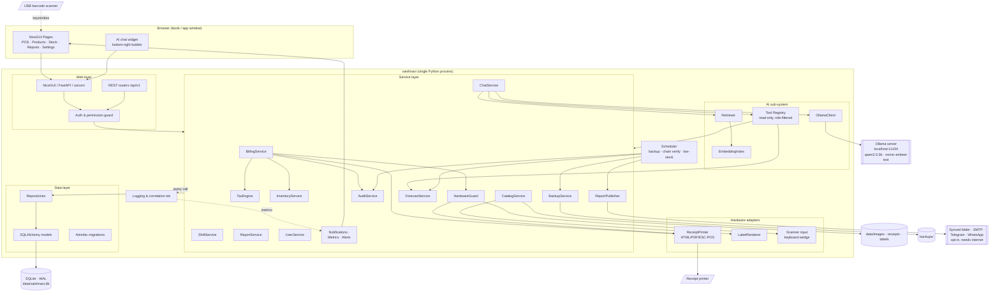
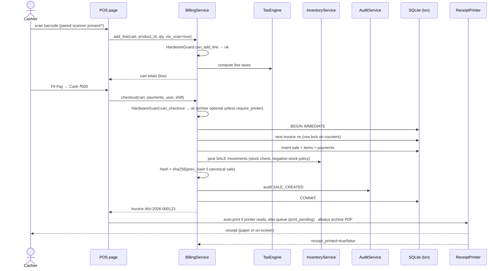
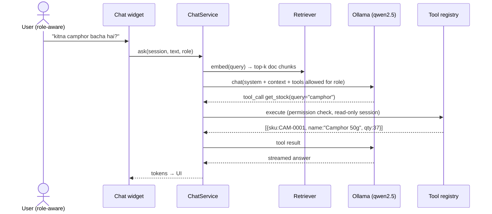

# 03 — Architecture

## 1. Architectural style

A **modular monolith** in one Python process:

- **Presentation** — NiceGUI pages (served by its embedded FastAPI/uvicorn) rendered in the browser.
- **API** — optional FastAPI routers mounted on the same server (`/api/v1`) for future tablet / second-terminal use. UI and API call the *same* services.
- **Services** — all business rules (billing, tax, inventory, shifts, reports, audit, AI). Pure Python, UI-agnostic, fully testable.
- **Repositories** — SQLAlchemy 2.0 ORM queries; the only layer that knows SQL.
- **Infrastructure plug-ins** — Ollama client, ESC/POS printer, barcode/label renderer, backup, scheduler — each behind a small interface with a `Null`/`Disabled` implementation for degraded mode.
- **Bootstrap** — pre-flight doctor and Ollama manager, run *before* the server starts.



## 2. Package layout

```
vaishnavi/
├── pyproject.toml               # deps with OS environment markers
├── main.py                      # THE single entry point: stdlib-only installer + launcher (all OSes) — see 17
├── Start Vaishnavi.bat · Start Vaishnavi.command · start-vaishnavi.sh   # double-click wrappers → main.py
├── bootstrap/                   # stdlib-only stages: cli, stages, console, i18n(+messages/), logsetup, survey, wizard, ai_provider, elevate, pkg_manager, python_env, locations, ollama_install, offline, autostart, tls, minilog, handover, recovery
├── offline/                     # (optional, shipped with a release) wheels + Ollama installer + models for no-internet installs
├── config/
│   ├── settings.toml            # shop profile, tax, receipt, AI, paths, server binding
│   ├── alerts.toml              # alert-rule thresholds → notification centre
│   ├── logging.toml             # handlers, levels per module
│   ├── festivals.toml           # festival calendar for forecasting
│   └── secrets.toml             # (git-ignored) publishing credentials; bank/UPI live encrypted in DB
├── src/vaishnavi/
│   ├── __main__.py              # `python -m vaishnavi [run|doctor|init-db|verify-chain|backup|reset-owner-password|selftest]`
│   ├── commands/                # one module per `python -m vaishnavi` command (registry; stdin JSON secret hand-over)
│   ├── app_services.py             # AppServices: builds every service once per process (stdlib sqlite stores in Phase 1)
│   ├── core/                    # settings, logging, errors + messages/{en,hi}, security, ids, money, time, permissions
│   ├── platform/                # OS adapters: paths, secrets, devices, printing, serial_ports, autostart, browser, elevation, fonts
│   ├── bootstrap/               # doctor checks, ollama_manager, startup orchestrator (runs inside the venv)
│   ├── db/                      # engine, lock, guardian, schema, seed, sqlite_stores (stdlib), models/, repositories/, alembic/
│   ├── services/                # billing, tax, measure, offers, inventory, catalog, price_history, shift, work_session, report, forecast, insights, audit, user, recovery, secure_settings, prompt, backup, print_queue, notifications, metrics_alerts, onboarding, open_item_review
│   ├── ai/                      # ollama_client, fastpath, embeddings, retriever, guardrails, output_filter, tools, chat_service, prompts/
│   ├── hardware/                # printer (escpos/os_print/status), labels, scanner, scale
│   ├── publishing/              # renderer, channels/, outbox
│   ├── api/                     # FastAPI routers: system (logs/doctor/status), data API
│   ├── ui/                      # NiceGUI: layout, pages/, components/, state, i18n
│   └── scheduler/               # APScheduler jobs
├── ~/VaishnaviStore/ (runtime, outside the repo)   data/ · logs/ · backups/ · receipts/ · images/
├── docs/
└── tests/
```

Dependency rule (enforced by import-linter in CI): `commands → bootstrap → ui → api | scheduler →
ai | hardware | publishing → services → db → forecast | platform → core` (modules on one `|` line are
independent of each other); `ai`, `hardware`, `publishing`
may depend on `services` but **not** on `ui`; `platform` depends only on `core`; `app_services.py` is root
wiring (not a layer); nothing outside `platform/` and `bootstrap/` may test `sys.platform`.

## 3. Runtime deployment

```mermaid
flowchart LR
  subgraph PC["Shop PC — Windows · macOS · Ubuntu"]
    direction TB
    TS[OS autostart<br/>Task Scheduler · launchd · systemd --user] --> S1[main.py<br/>stdlib only]
    S1 --> ML[mini log server :8081]
    S1 --> INS{anything missing?}
    INS -- yes --> EL[ask OS admin password<br/>install system parts · Ollama · models]
    INS -- no --> O
    EL --> O[ollama serve :11434]
    S1 --> D[python -m vaishnavi doctor]
    D -- PASS/WARN --> A[python -m vaishnavi run<br/>127.0.0.1:8080 · optional :8443 TLS]
    D -- FAIL --> E[plain-language report<br/>stay on mini log server]
    A --> B[Browser kiosk<br/>http://127.0.0.1:8080]
    A --> LC[/system/logs · /api/v1/system/…]
    A <--> DBF[(~/VaishnaviStore/data/vaishnavi.db)]
    A --> L[(~/VaishnaviStore/logs/)]
    A --> K[(backups/ + optional<br/>USB / cloud folder)]
    A <--> O
  end
  SC[/USB scanner/] --> B
  PR[/ESC-POS printer/] --> A
  WS[/Weighing scale/] -. serial .-> A
  PH[(Owner phone / laptop on LAN)] -. Owner login / token .-> LC
  TAB[(Optional: tablet<br/>second counter)] -. opt-in bind 0.0.0.0 .-> A
```

## 4. Key sequences

### 4.1 Daily start

```mermaid
sequenceDiagram
  participant W as OS logon
  participant S as main.py
  participant O as Ollama
  participant D as doctor
  participant APP as vaishnavi run
  participant BR as Browser
  W->>S: autostart
  S->>S: start install/startup log + mini log server :8081
  S->>S: survey · venv · packages present? (fast path)
  S->>O: is 11434 listening? if not → start "ollama serve"
  S->>D: python -m vaishnavi doctor --json
  D->>D: python ver, venv, packages, system components, dirs, disk
  D->>D: DB exists? integrity_check, alembic head, WAL
  D->>O: GET /api/tags → models present? else pull
  D->>O: warm-up: tiny generate + embed
  D->>D: printer / scanner / scale / backup path / clock / autostart
  D-->>S: report (plain language + technical) + exit code
  alt FAIL
    S-->>W: show what is missing & what to do; mini log server stays up
  else PASS or WARN
    S->>APP: start server
    APP->>APP: verify sales hash chain, schedule jobs, expose /system/logs
    S->>BR: open kiosk window
    BR->>APP: login page
  end
```

### 4.2 Billing a sale (scan → receipt)



### 4.3 AI question with tool-call



## 5. Cross-cutting concerns

| Concern | Approach |
|---------|----------|
| Configuration | `config/settings.toml` (pydantic-settings) + DB `settings` table for owner-editable values; env override `VAISHNAVI_*` |
| Logging | `core/logging.py` configures root + module loggers; `ContextVar` correlation id injected via filter; see [08](08-logging-and-troubleshooting.md) |
| Errors | `VaishnaviError(code, message, hint)` hierarchy; UI maps code → friendly text; code also in log |
| Transactions | `UnitOfWork` context manager wraps a SQLAlchemy session; services never commit partially |
| Time | Always store UTC ISO-8601; display in `Asia/Kolkata`; financial-year helper for invoice series |
| Money | `Decimal` end-to-end; stored as integer paise in SQLite to avoid float drift |
| IDs | Integer PKs + public ULIDs where needed (sale `public_id` for QR / lookup) |
| Permissions | `@requires(Permission.VOID_SALE)` decorator on service methods; UI hides *and* server enforces |
| Scheduling | APScheduler in-process: backup (nightly + shift close), chain verify (hourly), low-stock scan, log cleanup |
| Testing | pytest; services tested against in-memory SQLite; AI client mocked; golden-file tests for receipts |
