# 04 — Data Model

Database: **SQLite** (`<primary>/vaishnavi.db`), `journal_mode=WAL`, `foreign_keys=ON`,
`synchronous=FULL`. ORM: SQLAlchemy 2.0. Migrations: Alembic. Money stored as **integer paise**.
Timestamps stored as UTC ISO-8601 text (`created_at`, `updated_at` on every table).
Durability, backup to the secondary location and recovery are specified in
[14 — Database Protection, Backup & Recovery](14-database-backup-and-recovery.md).

## 1. Entity-relationship diagram

```mermaid
erDiagram
  USER ||--o{ SALE : "billed by"
  USER ||--o{ WORK_SESSION : "works in"
  APP_RUN ||--o{ WORK_SESSION : "during"
  USER ||--o{ SHIFT : "opens"
  USER ||--o{ STOCK_MOVEMENT : "performed by"
  USER ||--o{ AUDIT_LOG : "actor"
  USER ||--o{ CHAT_SESSION : "owns"
  ROLE ||--o{ USER : "has"

  CATEGORY ||--o{ CATEGORY : "parent"
  CATEGORY ||--o{ PRODUCT : "contains"
  PRODUCT ||--o{ PRODUCT : "variant of"
  PRODUCT ||--o{ PRODUCT_BARCODE : "scans as"
  PRODUCT ||--o{ PRICE_HISTORY : "price changes"
  PRODUCT ||--o{ LABEL_PRINT_LOG : "labels printed"
  PRODUCT ||--o{ STOCK_MOVEMENT : "affects"
  PRODUCT ||--o{ SALE_ITEM : "sold as"
  PRODUCT ||--o{ PURCHASE_ITEM : "bought as"
  PRODUCT ||--o{ STOCK_COUNT_LINE : "counted"
  PRODUCT ||--o{ PRODUCT_TAG : "tagged"
  TAG ||--o{ PRODUCT_TAG : "labels"
  PRODUCT ||--o| EMBEDDING : "vector"

  SHIFT ||--o{ SALE : "during"
  SHIFT ||--o{ CASH_EVENT : "cash in/out"
  SALE ||--|{ SALE_ITEM : "lines"
  OFFER ||--o{ SALE_ITEM : "applied to"
  SALE_ITEM ||--o| OPEN_ITEM_REVIEW : "open item review"
  USER ||--o{ CHAT_SECURITY_EVENT : "triggered"
  USER ||--o{ NOTIFICATION : "receives"
  PRODUCT ||--|| PRODUCT_STOCK : "cached qty"
  PRODUCT ||--o{ STOCK_DAILY_BALANCE : "closing qty"
  SALE ||--|{ PAYMENT : "paid via"
  SALE ||--o{ SALE : "refund of / void of"
  SALE ||--o{ STOCK_MOVEMENT : "reference"
  CUSTOMER ||--o{ SALE : "optional"
  HELD_CART ||--o{ HELD_CART_LINE : "lines"

  SUPPLIER ||--o{ PURCHASE : "supplies"
  PURCHASE ||--|{ PURCHASE_ITEM : "lines"
  PURCHASE ||--o{ STOCK_MOVEMENT : "reference"

  STOCK_COUNT ||--|{ STOCK_COUNT_LINE : "lines"
  STOCK_COUNT ||--o{ STOCK_MOVEMENT : "posts"

  CHAT_SESSION ||--o{ CHAT_MESSAGE : "messages"
  DOC_CHUNK ||--o| EMBEDDING : "vector"

  USER {
    int id PK
    string username UK
    string display_name
    int role_id FK
    string password_hash "argon2"
    string owner_pin_hash "OWNER only; for on-counter overrides"
    bool is_active
    bool must_change_password
    int failed_logins
    datetime locked_until
    datetime last_login_at
  }
  ROLE {
    int id PK
    string name UK "OWNER STAFF"
    json permissions
  }
  WORK_SESSION {
    int id PK
    int user_id FK
    int app_run_id FK
    datetime login_at
    datetime logout_at
    string end_reason "LOGOUT WINDOW_CLOSED HEARTBEAT_LOST IDLE_LOCK_TIMEOUT APP_SHUTDOWN FORCED_BY_OWNER FORCED_BY_LOGIN"
    datetime last_seen_at
    datetime confirmed_at
    string confirmed_note
    string owner_note
    string client "browser · device · ip"
    int idle_seconds
    int lock_count
    string correlation_id
  }
  APP_RUN {
    int id PK
    datetime started_at
    datetime stopped_at
    bool clean_stop
    string app_version
    string host
  }
  CATEGORY {
    int id PK
    string name
    string name_hi
    int parent_id FK
    int sort_order
    string icon
  }
  PRODUCT {
    int id PK "permanent Product ID, printed as #1042"
    string sku UK "human code e.g. CAM-0050"
    string internal_barcode UK "EAN-13 derived from id (29 prefix)"
    string name
    string name_hi
    int category_id FK
    int parent_product_id FK
    string unit "pcs g kg ml l m set"
    string sale_mode "PIECE WEIGHT VOLUME"
    string base_unit "pcs g ml m"
    decimal pricing_unit_qty "100 for per-100g, 1000 for per-kg"
    string pricing_unit_label "100 g · kg · 100 ml · L"
    decimal min_qty
    decimal qty_step
    json qty_presets "[50,100,250,500,1000]"
    bool allow_decimal_qty
    int price_paise "per pricing unit"
    int mrp_paise
    int cost_paise
    decimal tax_rate_pct
    bool price_includes_tax
    string hsn_code
    decimal min_stock
    decimal reorder_qty
    string image_path
    bool is_active
    bool quick_pick
    int row_version "optimistic concurrency"
    datetime deleted_at "soft delete"
  }
  PRODUCT_STOCK {
    int product_id PK
    decimal qty "maintained ONLY by trigger AFTER INSERT ON stock_movement"
    datetime updated_at
  }
  STOCK_DAILY_BALANCE {
    date day PK
    int product_id PK
    decimal qty_close
    int value_cost_paise
  }
  TAG {
    int id PK
    string name UK
  }
  PRODUCT_BARCODE {
    int id PK
    int product_id FK
    string barcode UK "any symbology value"
    string kind "INTERNAL MANUFACTURER PACK"
    string symbology "EAN13 UPCA CODE128 QR"
    decimal pack_qty "1 unless PACK"
    bool is_primary
    datetime created_at
  }
  LABEL_PRINT_LOG {
    int id PK
    int product_id FK
    int copies
    string target "ESCPOS PDF TSPL"
    string reason "NEW RESTOCK REPLACEMENT"
    int user_id FK
    datetime at
  }
  PRICE_HISTORY {
    int id PK
    int product_id FK
    string field "PRICE MRP COST TAX_RATE"
    int old_value_paise
    int new_value_paise
    decimal old_pct "for TAX_RATE"
    decimal new_pct
    datetime effective_from
    int changed_by FK
    string reason
    string source "EDITOR IMPORT PURCHASE CONVERSION"
    string correlation_id
  }
  DB_IDENTITY {
    string instance_id PK "ULID of this database"
    datetime created_at
    string app_version
    string schema_version
    datetime last_open_at
    datetime last_clean_close_at
    string backup_id "set only inside snapshots"
    datetime backup_taken_at
    datetime restored_at
    string restored_from
  }
  PRINT_PENDING {
    int id PK
    int sale_id FK
    datetime queued_at
    int attempts
    datetime printed_at
  }
  PRODUCT_TAG {
    int product_id FK
    int tag_id FK
  }
  STOCK_MOVEMENT {
    int id PK
    int product_id FK
    string type "OPENING PURCHASE SALE SALE_VOID RETURN ADJUSTMENT DAMAGE STOCK_TAKE"
    decimal qty_delta "signed"
    decimal qty_after "snapshot"
    int unit_cost_paise
    string ref_type "SALE PURCHASE STOCK_COUNT"
    int ref_id
    string reason
    int user_id FK
    datetime created_at
  }
  SHIFT {
    int id PK
    int user_id FK
    datetime opened_at
    datetime closed_at
    int opening_float_paise
    json opening_denominations
    int expected_cash_paise
    int counted_cash_paise
    json denominations
    int variance_paise
    int closed_by_user_id FK
    string status "OPEN CLOSED"
    string note
    json declared_json "UPI/CARD declared vs system"
    int approved_by_user_id FK "Owner PIN when it did not match"
  }
  CASH_EVENT {
    int id PK
    int shift_id FK
    string type "CASH_IN CASH_OUT"
    int amount_paise
    string reason
    int user_id FK
    int approved_by_user_id FK
  }
  SALE {
    int id PK
    string invoice_no UK "INV-2026-000123"
    string client_txn_id UK "ULID minted by the UI per cart — idempotent checkout"
    string public_id UK "ULID"
    string fin_year "2026-27"
    int seq_no "gap-free within fin_year"
    datetime sold_at
    int user_id FK
    int shift_id FK
    int customer_id FK
    string status "COMPLETED VOIDED REFUND"
    int original_sale_id FK "for refund/void"
    int subtotal_paise "Σ shelf price × qty"
    int item_discount_paise "Σ line offers + ad-hoc"
    int bill_discount_paise
    string bill_discount_reason
    int total_savings_paise
    int approved_by_user_id FK
    int taxable_paise
    int cgst_paise
    int sgst_paise
    int roundoff_paise
    int total_paise
    int reprint_count
    bool receipt_printed "false under paper-less override"
    string prev_hash
    string hash
    string note
  }
  SALE_ITEM {
    int id PK
    int sale_id FK
    int product_id FK
    string name_snapshot
    string hsn_snapshot
    decimal qty "in base unit (pcs, g, ml)"
    string unit
    string qty_source "TYPED PRESET SCALE EMBEDDED_BARCODE BY_AMOUNT"
    decimal pricing_unit_qty_snapshot
    int shelf_price_paise "catalogue price per pricing unit, never overwritten"
    int offer_id FK "nullable"
    string offer_name_snapshot
    decimal discount_pct
    int discount_paise
    string discount_reason "ad-hoc reason code"
    int unit_price_paise "shelf price after discount"
    decimal tax_rate_pct
    int taxable_paise
    int cgst_paise
    int sgst_paise
    int line_total_paise
    int cost_paise_snapshot
    string entry_method "SCAN LOOKUP OPEN_ITEM"
    string entry_reason "LABEL_DAMAGED LABEL_MISSING NOT_LABELLED ..."
    string scanned_barcode "which barcode was scanned"
    bool is_open_item "free-text item, no stock effect"
    string open_item_name
    string open_item_detail
  }
  OFFER {
    int id PK
    string name "Diwali Offer"
    string name_hi
    string type "PCT AMOUNT BUY_X_GET_Y"
    decimal value
    string scope "PRODUCT CATEGORY TAG BILL"
    int scope_id
    decimal min_qty
    date valid_from
    date valid_to
    bool stackable
    bool is_active
    int created_by FK
  }
  OPEN_ITEM_REVIEW {
    int id PK
    int sale_item_id FK
    string status "PENDING CONVERTED DISMISSED"
    int converted_product_id FK
    int reviewed_by FK
    datetime reviewed_at
  }
  PAYMENT {
    int id PK
    int sale_id FK
    string mode "CASH UPI CARD"
    int amount_paise
    int tendered_paise
    int change_paise
    string reference "UPI txn id / card last4"
  }
  CUSTOMER {
    int id PK
    string name
    string phone UK
    string note
  }
  HELD_CART {
    int id PK
    int user_id FK
    string label
    datetime created_at
  }
  HELD_CART_LINE {
    int id PK
    int held_cart_id FK
    int product_id FK
    decimal qty
    int discount_paise
  }
  SUPPLIER {
    int id PK
    string name
    string phone
    string gstin
  }
  PURCHASE {
    int id PK
    int supplier_id FK
    string supplier_invoice_no
    date purchase_date
    int total_paise
    int user_id FK
  }
  PURCHASE_ITEM {
    int id PK
    int purchase_id FK
    int product_id FK
    decimal qty
    int unit_cost_paise
    date expiry_date "optional"
  }
  STOCK_COUNT {
    int id PK
    datetime started_at
    datetime approved_at
    int started_by_user_id FK
    int approved_by_user_id FK
    string status "DRAFT APPROVED CANCELLED"
    string scope "FULL CATEGORY SELECTED"
  }
  STOCK_COUNT_LINE {
    int id PK
    int stock_count_id FK
    int product_id FK
    decimal system_qty
    decimal counted_qty
    decimal variance
    int variance_value_paise
  }
  AUDIT_LOG {
    int id PK
    datetime at
    int user_id FK
    string action "LOGIN SALE_CREATED SALE_VOIDED PRICE_CHANGED ..."
    string entity
    int entity_id
    json before
    json after
    string correlation_id
    string ip
    string prev_hash
    string hash "audit log is hash-chained like sales"
  }
  NOTIFICATION {
    int id PK
    int user_id FK "null = all owners"
    string severity "INFO WARN HIGH"
    string kind "LOW_STOCK BACKUP PRINTER PRINT_QUEUE CHAT_FLAG SESSION INTEGRITY SETUP ALERT"
    string title
    string body
    string deep_link
    datetime created_at
    datetime read_at
    string source_ref "rule name / event id"
  }
  RECOVERY_KEY {
    int id PK
    string key_hash "argon2 of the 12-word phrase"
    datetime issued_at
    datetime acknowledged_at
    datetime used_at
  }
  SETUP_STEP {
    string step PK "shop tax payments staff products labels opening scanner printer backup recovery"
    datetime done_at
    int done_by FK
  }
  SETTING {
    string key PK
    string value
    string type
    datetime updated_at
    int updated_by
  }
  COUNTER {
    string name PK
    int value "invoice seq per fin_year"
  }
  CHAT_SESSION {
    int id PK
    int user_id FK
    string title
    datetime created_at
  }
  CHAT_MESSAGE {
    int id PK
    int session_id FK
    string role "system user assistant tool"
    text content
    json tool_calls
    int tokens
    string provider "ollama openai huggingface fastpath"
    string model
    string language "en hi hinglish"
    string guardrail_decision "ALLOW REFUSE REFUSE_AND_FLAG"
    datetime created_at
  }
  AI_USAGE {
    int id PK
    date day
    string provider
    string model
    int prompt_tokens
    int completion_tokens
    int embed_tokens
    int requests
    int errors
  }
  CHAT_SECURITY_EVENT {
    int id PK
    datetime at
    int user_id FK
    string category "SECRETS FINANCIAL_PII APP_INTERNALS SECURITY_BYPASS VULN_DISCOVERY FRAUD_ASSIST ..."
    string severity "LOW MED HIGH"
    text message_excerpt
    string layer "INTENT OUTPUT"
    bool owner_alerted
  }
  DOC_CHUNK {
    int id PK
    string source "docs/09-frontend-guide.md#pos"
    text content
    string content_hash
  }
  EMBEDDING {
    int id PK
    string owner_type "PRODUCT DOC_CHUNK"
    int owner_id
    string provider "ollama openai huggingface"
    string model "nomic-embed-text"
    blob vector
    int dim
  }
  BACKUP_LOG {
    int id PK
    datetime at
    string path
    int size_bytes
    bool verified
    string trigger
  }
  INTEGRITY_CHECK {
    int id PK
    datetime at
    string kind "CHAIN GAPS"
    bool ok
    json details
  }
  FESTIVAL {
    int id PK
    string name "Diwali Navratri ..."
    date start_date
    date end_date
    json category_uplift "learned or default factors"
    string source "config learned"
  }
  FORECAST_SNAPSHOT {
    int id PK
    datetime computed_at
    int product_id FK
    int horizon_days
    decimal point
    decimal low
    decimal high
    string method
    string confidence
    json caveats
  }
  PUBLISH_QUEUE {
    int id PK
    string channel "folder email telegram whatsapp"
    string document "daily_digest weekly_report adhoc"
    string file_path
    string status "PENDING SENT FAILED"
    int attempts
    datetime next_retry_at
    string last_error
  }
  HARDWARE_OVERRIDE {
    int id PK
    string kind "PRINTER SCANNER"
    int owner_user_id FK
    datetime started_at
    datetime expires_at
    string reason
  }
  SECURE_SETTING {
    string key PK "payments.upi_id payments.bank_account ..."
    blob ciphertext "Fernet; key in OS secret store via keyring"
    string masked_preview "XXXX1234"
    int updated_by FK
    datetime updated_at
  }
  PROMPT_VERSION {
    int id PK
    int version
    text editable_instructions "owner-edited part"
    string core_hash "hash of locked guardrail core in use"
    string default_language
    json extra_blocked_phrases
    bool is_active
    bool redteam_passed
    int created_by FK
    datetime created_at
    string note
  }
```

## 2. Design notes per table

### `product` / `product_barcode`
- **Identity triangle:** `id` (permanent numeric Product ID, printed `#1042`), `sku` (human code), and one or more rows in `product_barcode`. The internal EAN-13 is generated on insert from the ID (`29` + 10-digit ID + check digit) and stored both in `product.internal_barcode` (fast path) and as a `product_barcode` row of kind `INTERNAL`. Manufacturer and pack barcodes are additional rows; scan resolution is `product_barcode.barcode → product_id`.
- **Stock is not a column.** It is `SUM(stock_movement.qty_delta)`; a cached `qty_after` snapshot on the latest movement gives O(1) reads. A materialised `product_stock` view / cache table is refreshed in the same transaction.
- `price_includes_tax` lets the owner show MRP-style inclusive prices (common for puja items) while the receipt still back-calculates CGST/SGST.
- **Weighed / measured items:** `sale_mode` (`PIECE` / `WEIGHT` / `VOLUME`), `base_unit` (stock unit: `g`, `ml`), `pricing_unit_qty` + `pricing_unit_label` ("₹60 per 100 g" → `price_paise=6000`, `pricing_unit_qty=100`), `min_qty`, `qty_step`, `qty_presets`. All stock movements and `sale_item.qty` are in the base unit; `qty_source` records how the quantity was obtained (typed, preset, scale, weight-embedded barcode, by-amount).
- `quick_pick` marks items shown as image tiles on the POS.
- Soft delete via `deleted_at` so historical sales keep their FK.
- **`price_history`** — append-only; one row per changed field (price / MRP / cost / tax rate) with old → new, `effective_from`, user, reason and source. Written in the same transaction as the product update (and by CSV import, purchase-entry cost updates and open-item conversion). Powers the 1 month / 6 months / 1 year / custom price charts; billing never reads it (sales carry their own price snapshot).

### `db_identity` / `backup_log` / `print_pending`
- `db_identity` is a single-row table that lets the app recognise *which* database file it opened (normal, unclean shutdown, restored snapshot, foreign DB) — see [14 §5](14-database-backup-and-recovery.md#6-how-the-app-knows-which-database-it-is-running-on--db_identity).
- `backup_log` records every snapshot (path, size, verified, trigger, chain head) and every restore drill.
- `print_pending` queues receipts that could not be printed (no printer / offline) so they can be printed once a printer is available.

### `cashier_day_record` (migration 0004)
- The **cashier day book**: one row per bill or credit note (`sale_id` UNIQUE, invoice, `business_day` in shop time, `sold_at`, cashier id + name snapshot, shift, status, line count, quantity, total, payment modes, `items_json` = name · qty · unit · rate · amount · entry method per line). Written by `CashierRecordService` on `SaleCommitted`, in its own transaction after the sale has committed — a failure here never touches the bill.
- Unlike `sale` it is **not** append-only: the nightly `day_book_prune` job deletes rows whose `business_day` is older than `billing.day_record_retention_days` (90; audited `CASHIER_RECORDS_PRUNED`), and the Owner may delete earlier from Reports → Cashier day book after re-entering the password (`CASHIER_RECORDS_PURGED` with the cut-off day, row count and reason). The permanent ledger and the hash chain are unaffected because nothing here is hashed or referenced.

### `stock_movement.unit_cost_paise`
- Snapshotted on every **inbound** movement (`OPENING`, `PURCHASE`, positive `ADJUSTMENT` / `STOCK_TAKE`): the purchase line's cost when there is one, else the product's `cost_paise` on that day. The *Investment in stock* report and the assistant's `investment_summary` sum `qty_delta × unit_cost_paise` over these rows (falling back to the product's current cost, then its selling price, flagged "estimated"), so a later price change never rewrites what was already spent.

### `stock_movement` / `product_stock` / `stock_daily_balance`
- **`product_stock`** is the O(1) read cache and is written **only** by `trg_product_stock_after_insert` (`INSERT … ON CONFLICT DO UPDATE SET qty = qty + NEW.qty_delta`); application code has no write path to it, so cache and ledger cannot diverge. **`stock_daily_balance`** is written by the nightly job (closing qty and cost value per product) and powers stock-as-of-date reports and the three-way reconciliation.
- **CHECK constraints:** `qty_delta <> 0`, `qty >= 0` on sale/purchase lines, all `*_paise >= 0` except signed discount/refund columns, enumerated `type`/`status` values — invariants hold even for raw inserts.
- Append-only (enforced by `BEFORE UPDATE/DELETE` triggers). `qty_after` is the running balance at insert time (computed under the transaction lock).
- **Role trigger** `trg_stock_movement_role` ([05 §5a](05-billing-and-anti-theft.md#5a-who-can-change-stock--the-mutation-rules-enforced-twice)): `SALE` rows must reference a `COMPLETED` sale; `SALE_VOID`/`RETURN` must reference an approved void/refund; every other type is rejected unless `user_id` belongs to an `OWNER`. This is the database-level guarantee that a staff login can only change stock by selling with a bill.
- Negative stock policy from settings: `BLOCK` (default for cashier), `WARN`, `ALLOW` (Owner).

### `sale` / `sale_item` / `payment`
- **Idempotency:** `client_txn_id` is minted by the POS when a cart is created and sent with the checkout; `UNIQUE` on the column means a double-click or websocket retry hits the constraint and the service returns the existing invoice (`E-BILL-080`, INFO) instead of creating a second sale.
- `seq_no` is taken from `counter` (`invoice:2026-27`) inside `BEGIN IMMEDIATE` → **gap-free** and crash-safe.
- Snapshots (`name_snapshot`, `hsn_snapshot`, `cost_paise_snapshot`, `offer_name_snapshot`, `shelf_price_paise`) freeze what was sold and at what shelf price even if the product or offer is edited later; also enables margin and discount reports.
- Discount chain per line: `shelf_price × qty` → offer → ad-hoc line discount → pro-rated bill discount → tax. All intermediate values are stored so the receipt can be re-rendered exactly and the owner can audit "who gave what".
- `is_open_item` lines point to the system product `OPEN-ITEM` (no stock movement) and carry the typed name/detail; `open_item_review` is the Owner queue for converting them into real products.
- `entry_method` records **how** the line entered the bill (`SCAN` with the exact `scanned_barcode`, `LOOKUP` by name/code/ID with a reason such as *label damaged*, or `OPEN_ITEM`), which drives the receipt markers (`†`, `*`) and the *Manual lines* report.
- `prev_hash` / `hash`: SHA-256 of canonical JSON (`invoice_no, sold_at, user_id, items[], payments[], total, prev_hash`). Genesis `prev_hash = "0"*64`. Verifier walks `ORDER BY id`.
- Voids and refunds are **new rows** with `status = VOIDED/REFUND` and `original_sale_id`; the original stays `COMPLETED` but gets flagged via a view (`is_voided`). Both post reversing `stock_movement`s.

### `shift` / `cash_event`
- `expected_cash = opening_float + Σ CASH payments − Σ CASH refunds + Σ CASH_IN − Σ CASH_OUT`.
- `denominations` / `opening_denominations` JSON: `{"500": 4, "200": 3, "100": 10, "50": 2, "20": 5, "10": 8}`.
- `declared_json` (migration 0003): `{"UPI": {"declared": 150000, "system": 150000}}` — the non-cash totals the cashier read off the phone app at close, next to what the system recorded. `approved_by_user_id`: the Owner who entered the PIN because counted cash (beyond `billing.shift_variance_tolerance_paise`) or a declared mode did not match; NULL when everything matched or the Owner closed the shift personally ([05 §6](05-billing-and-anti-theft.md#6-shift--cash-reconciliation)).

### `work_session` / `app_run`
- One row per login; `logout_at` + `end_reason` filled by the End-work popup, the window-close beacon, the heartbeat monitor (60 s without heartbeat → `last_seen_at`), idle-lock timeout, or app shutdown. Unclean ends are confirmed by the user at next login (`confirmed_at`). Append-only for staff; Owner may add `owner_note` or force-end. Derived per-session figures (shifts, bills, sales) are computed from `shift`/`sale` by time window, not stored. See [05 §6a](05-billing-and-anti-theft.md#6a-attendance--login-logout-and-work-history).
- `app_run` records each application start/stop (clean or not) so "PC/app started 09:02" can be shown alongside "first login 09:30".

### `audit_log`
- **Hash-chained** exactly like sales (`prev_hash`/`hash` over the canonical row); verified hourly together with the sales chain so an edited or deleted audit row is detected (`E-LEDGER-001` with `entity=audit_log`).
- Written by `AuditService` from within the same transaction as the change.
- `correlation_id` matches the log line, so **DB audit ↔ log file ↔ UI error code** are all joinable.

### `setting`
- Owner-editable runtime values (shop name, GSTIN, tax labels, discount cap, negative stock policy, receipt footer, UPI ID, AI model names). Typed (`int/str/bool/json`). Cached in memory, invalidated on write.

### AI tables
- `doc_chunk` + `embedding` hold the RAG index; `content_hash` lets re-indexing skip unchanged chunks. Each vector is tagged with `provider` + `model`; when the Owner switches provider the index is marked stale and rebuilt (vectors from different models are never compared).
- Product embeddings use `name + name_hi + category + tags` so Hinglish queries ("kapoor") match "Camphor".
- Vectors stored as `float32` blobs; similarity in NumPy (catalogue ≪ 100k rows). `sqlite-vec` is an optional accelerator.
- `chat_message.provider/model` record which engine answered (incl. `fastpath`) so answers can be compared across providers; `ai_usage` aggregates tokens/requests/errors per day, provider and model — the basis for the monthly cloud budget (`E-AI-030`) and the usage panel in *Settings → Assistant*.
- Cloud API keys are `secure_setting` rows (`ai.openai.api_key`, `ai.huggingface.api_key`), not `setting` rows — same encryption and the same "no accessor from the AI layer" rule as bank details.

### Forecasting, publishing & strict-mode tables
- `festival` — seeded from `config/festivals.toml` per year; `category_uplift` starts with defaults and is overwritten with learned factors once a festival window has real history.
- `forecast_snapshot` — nightly results so the dashboard / digest / AI read precomputed numbers and so forecast accuracy can later be measured against actual sales.
- `publish_queue` — outbox for PDF deliveries; retried while offline.
- `hardware_override` — time-boxed Owner overrides for printer/scanner absence; joined to sales via timestamps in the override report.
- `secure_setting` — Owner-only encrypted values (UPI ID, bank account, publishing credentials). Only the `masked_preview` is ever shown or logged; the AI tool layer has no accessor for this table.
- `prompt_version` — history of the Owner-edited assistant instructions; exactly one active; the locked guardrail core is code, not data, and its hash is recorded so a version can be re-validated after upgrades.
- `notification` — the notification-centre feed (per user or all owners), with severity, kind, deep link and read state; created by the alert rules and by domain events.
- `recovery_key` — hash of the Owner's 12-word recovery phrase, when it was issued/acknowledged/used; never the phrase itself.
- `setup_step` — the onboarding checklist state ("Setup n/11").
- `product.row_version` — incremented on every update; the editor sends the version it loaded and the service rejects a stale write (`E-CAT-010`), so two Owner tabs cannot overwrite each other silently.
- `purchase_item.expiry_date` — optional; feeds the *Expiring soon* report when enabled.
- `sale.receipt_printed` and `sale_item.entry_method` — the strict-mode flags surfaced in reports.

## 3. Indexes

| Table | Index | Reason |
|-------|-------|--------|
| product | `(sku)`, `(internal_barcode)`, `(name COLLATE NOCASE)`, `(category_id, is_active)` | lookup by code / scan / name |
| product_barcode | `UNIQUE(barcode)`, `(product_id)` | scan resolution (any barcode → product) |
| stock_movement | `(product_id, id DESC)`, `(created_at)`, `(ref_type, ref_id)` | balances, history |
| sale | `(sold_at)`, `(user_id, sold_at)`, `(shift_id)`, `(status)`, `UNIQUE(fin_year, seq_no)` | reports, gap check |
| sale_item | `(product_id, sale_id)` | item history |
| audit_log | `(at)`, `(entity, entity_id)`, `(user_id)` | investigation |
| embedding | `(owner_type, owner_id)` | re-index |
| sale | `UNIQUE(client_txn_id)` | idempotent checkout |
| price_history | `(product_id, effective_from)`, `(effective_from)` | pop-up ranges, report |
| work_session | `(user_id, login_at)`, `(logout_at)`, partial `(user_id) WHERE logout_at IS NULL` | attendance report, one-active-session rule |
| notification | `(user_id, read_at, created_at)` | bell badge |
| stock_daily_balance | `(product_id, day)` | stock as of date |
| audit_log | `(id)` chain walk | hourly verification |

## 4. Views (SQL, created by migration)

- `v_product_stock` — product + current qty + low-stock flag.
- `v_sale_summary_daily` — per day: bills, gross, discount, tax, net, by payment mode.
- `v_item_sales` — item × day quantities.
- `v_shrinkage` — stock-count variances with value.
- `v_hourly_sales` — bills and ₹ by weekday × hour (heatmap).
- `v_basket_pairs` — co-occurrence counts of product pairs per sale (basket analysis).

## 5. Migration & seed strategy

1. `alembic upgrade head` is run by the doctor (auto-apply configurable; default **ask** on first run, **auto** afterwards).
2. `python -m vaishnavi seed` (also run by the installer's database stage and on every start — it is **idempotent**, plain SQL in `db/seed.py`) creates the two roles (`OWNER`, `STAFF`), the Owner account — stored with the password **sentinel `!SETUP`** rather than any default password, so login is refused (`E-AUTH-005`) until the first-run wizard on the shop PC sets the Owner password **and** PIN —, default categories for a puja shop (Agarbatti & Dhoop, Camphor & Ghee, Deity Clothes, Idols & Frames, Puja Thali & Metalware, Colours & Kumkum, Flowers & Garlands (artificial), Decoration, Books & Yantras, Festival Specials, with Hindi names), the unit list and tax presets (as `setting` JSON rows `catalog.units` / `tax.presets` — presets to pick from, no rate is assumed per product), counters, the 11 `setup_step` rows, the system product `OPEN-ITEM`, `prompt_version` 1 (default instructions) and the `db_identity` row.
3. Demo data seed (`--demo`) for training staff on a sandbox DB (`data/vaishnavi_demo.db`).
