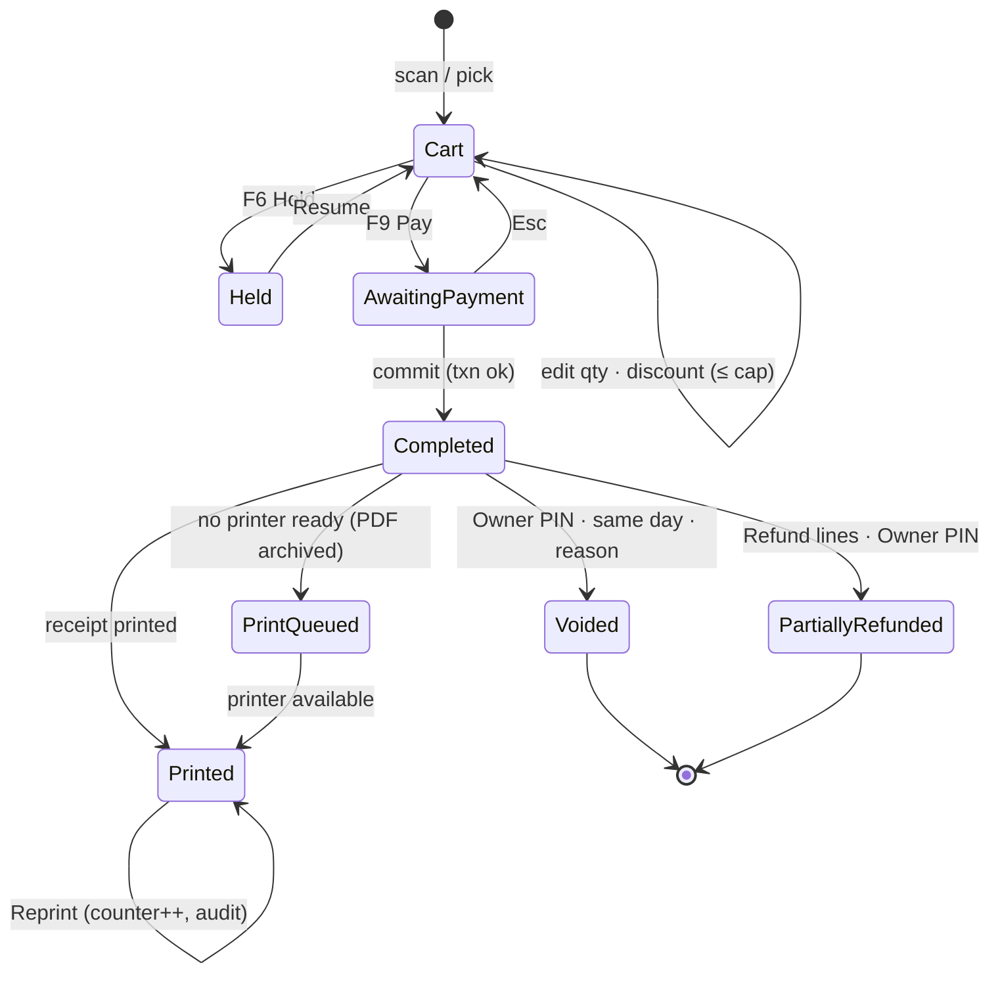
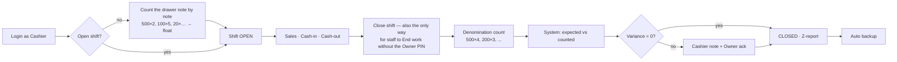
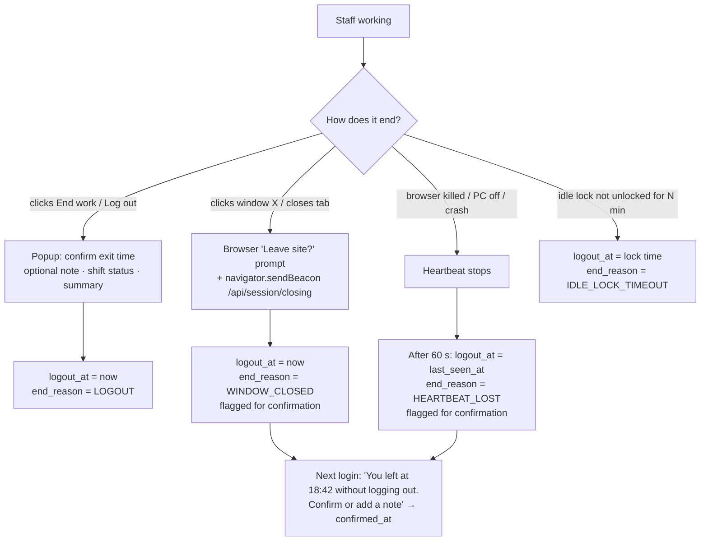
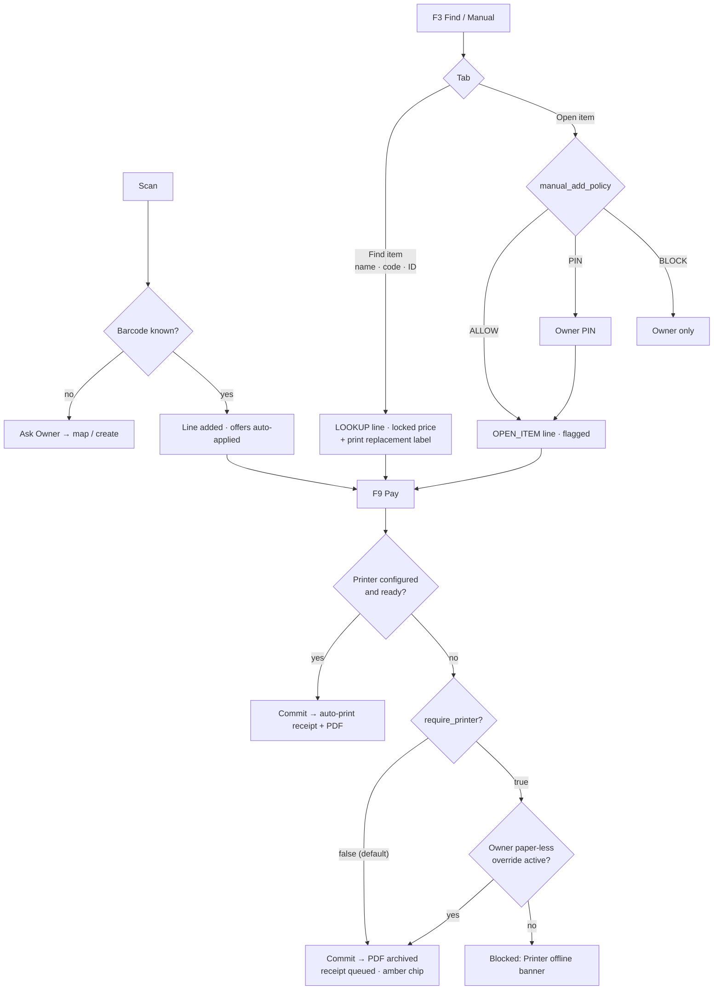

# 05 — Billing & Anti-Theft Controls

## 1. Sale lifecycle



Only **Completed → Voided/Refund** exist as state changes on a sale; nothing is ever edited or deleted.

## 2. Tax engine

Configurable in `setting`:

| Key | Default | Notes |
|-----|---------|-------|
| `tax.enabled` | `true` | `false` for unregistered dealer → receipt shows no tax lines |
| `tax.scheme` | `GST` | `GST` (CGST+SGST), `VAT` (single label), `NONE` |
| `tax.label_1` / `tax.label_2` | `CGST` / `SGST` | printed labels, e.g. owner may want Hindi |
| `tax.default_rate_pct` | `0` | puja samagri is largely nil-rated; per-product rate overrides |
| `tax.price_includes_tax_default` | `true` | MRP-style pricing |
| `tax.rounding` | `NEAREST_RUPEE` | legal "round-off" line |
| `shop.gstin` | — | printed if set; doctor warns if `tax.enabled` but GSTIN empty |

### Algorithm (per line, Decimal, paise)

```
gross        = unit_price × qty − line_discount
if price_includes_tax:
    taxable  = gross × 100 / (100 + rate)
    tax      = gross − taxable
else:
    taxable  = gross
    tax      = taxable × rate / 100
cgst = sgst = tax / 2              (half-up to paise)
line_total   = taxable + cgst + sgst
```

Bill: subtotal = Σ gross; bill discount pro-rated across lines (so tax stays correct); totals summed;
`roundoff = round(total) − total`. Tax summary grouped **by rate** on the receipt (GSTR-1 friendly).

> **Note on "VAT / SAT":** India replaced VAT with GST (CGST + SGST for in-state sales) in 2017. The
> engine is label-driven so the receipt can show whatever the owner's CA advises. Actual rates/HSN for
> each product must be confirmed with the CA; the seed ships them **blank/0** rather than guessing.

## 3. Invoice numbering

- Format `INV-<FY>-<6-digit seq>`, FY = `2026-27` (April–March), configurable prefix.
- `counter` row `invoice:2026-27` incremented inside `BEGIN IMMEDIATE`; SQLite's single writer guarantees no duplicates; the transaction guarantees no gaps even if the process crashes mid-commit.
- Gap detector (`verify-gaps`) runs at start and hourly: `COUNT(*) == MAX(seq_no)` per FY.

## 4. Hash chain

```
canonical = json.dumps({
  "invoice_no", "client_txn_id", "sold_at", "user_id", "shift_id", "status", "original_sale_id",
  "items": [{"product_id","qty","unit","shelf_price_paise","offer_id","discount_paise","unit_price_paise",
             "tax_rate_bp","entry_method","is_open_item","open_item_name"}...],
  "payments": [{"mode","amount_paise"}...],
  "subtotal_paise","item_discount_paise","bill_discount_paise","taxable_paise","cgst_paise","sgst_paise",
  "roundoff_paise","total_paise",
  "prev_hash"
}, sort_keys=True, separators=(",",":"))
hash = sha256(canonical).hexdigest()
```

- `prev_hash` = hash of the previous sale **by id** (genesis = 64 zeros). Quantities are normalised (`"2.00"` → `"2"`) before hashing so SQLite's NUMERIC affinity cannot change the hash; database `id`s are not hashed so a restore that renumbers rows still verifies. Implementation: `services/ledger.py` (`canonical_sale`, `sale_hash`, `LedgerService`), stdlib store `db/ledger_store.py`.
- Verifier recomputes every hash **and** checks every `prev_hash` link (an edited row and a deleted row are both caught); the first mismatch is logged as `INTEGRITY_FAIL check=CHAIN sale_id=… expected=… found=…` (`E-LEDGER-001`) and a red banner appears for Owner. The same pass checks invoice continuity (`E-LEDGER-002`, missing numbers listed), stock reconciliation (`E-LEDGER-003`: Σ movements = cached qty; the day's completed sale lines = SALE movements; open items excluded) and the audit-log chain, and writes `integrity_check` rows.
- Daily hash head is also written into `backup_log` and printed on the Z-report so the owner has an off-system anchor (a photo of the Z-report is enough to later prove tampering).

## 5. Roles & permissions matrix

The application has exactly **two roles**:

| Role | Who | Login | Purpose |
|------|-----|-------|---------|
| **OWNER** | The shop owner (one account; a second owner account can be created for a spouse/partner) | username + **password**; plus a short **Owner PIN** used only for on-counter overrides | Everything: money, prices, offers, stock, reports, profit, users, system, AI configuration |
| **STAFF** (billing staff / "cashier") | Each staff member gets **their own** account so every action is attributable (a shared "staff" login is possible but not recommended) | username + **password** (a 6-digit numeric password is allowed for counter speed) | Sell: scan, bill, print, open/close own shift, look up stock |

Permissions are enforced **server-side in the service layer** (`@requires(Permission.X)`), not just by hiding buttons.

| Capability | OWNER | STAFF |
|------------|:-----:|:-----:|
| **Selling** | | |
| Bill / scan / F3 Find / pay / print receipt | ✔ | ✔ |
| Open item (per `manual_add_policy`) | ✔ | ✔ / PIN / — |
| Ad-hoc discount ≤ cap (with reason) | ✔ | ✔ |
| Ad-hoc discount > cap, price override, remove an offer | ✔ | PIN |
| Hold / resume cart, reprint receipt (≤ limit) | ✔ | ✔ |
| Void / refund | ✔ | PIN |
| Open / close **own** shift, cash-in | ✔ | ✔ |
| Cash-out from drawer | ✔ | PIN |
| View stock level of an item | ✔ | ✔ |
| **Money & pricing** | | |
| Set / change selling price, MRP, cost, tax rate | ✔ | — |
| Create / schedule offers; decide discount values & caps | ✔ | — |
| **Bank / UPI / payment details** (UPI ID for QR, bank account for reference) | ✔ (masked; re-enter password to edit) | — (never visible) |
| **Stock** | | |
| Create / edit products, barcodes, labels | ✔ | print replacement label only |
| **Goods received at the counter** (a delivery arrives while the Owner is away: *add* quantity, note mandatory, time + name recorded, Owner notified) | ✔ | ✔ — add only, never reduce |
| Purchase entry (supplier bill with costs), stock adjustment / damage, stock-take & approval | ✔ | — |
| **Reports** | | |
| Own-shift summary & own bills | ✔ | ✔ |
| Total sales per day / period, sales history (all), item history | ✔ | — |
| Total purchases per day / period | ✔ | — |
| **Profit & margin** (gross profit, margin by item/category/day) | ✔ | — |
| Shrinkage, overrides, discounts, manual lines, cashier performance, chat security, tax summary | ✔ | — |
| Forecast & demand | ✔ | — |
| **System** | | |
| Users (create staff, reset passwords, deactivate), settings, hardware, backups, restore, logs, doctor, support bundle, shut down | ✔ | — |
| Application configuration & codebase-level items (version, migrations, config files, update) | ✔ | — |
| **AI assistant** | | |
| Help & stock questions | ✔ | ✔ |
| Sales / purchase / profit / forecast / cashier questions | ✔ | — |
| **Edit assistant instructions (system prompt), language default, guardrail settings, blocked phrases** | ✔ | — |
| View chat-security report & flagged prompts | ✔ | — |

"PIN" = action allowed only after the **Owner PIN** is entered on the same screen (the owner walks over
and types it); the override is recorded in `audit_log` with both user ids. A third role
(`STOCK_KEEPER`) is deliberately **not** shipped; the permission model supports adding it later if the
shop grows.

## 5a. Who can change stock — the mutation rules (enforced twice)

The inventory list changes **only** through `stock_movement` rows. Every path that can create one is
listed here, with who may trigger it. There is no other way in the application, API, or AI layer.

| Path | Movement type | STAFF | OWNER | Notes |
|------|---------------|:-----:|:-----:|-------|
| Completed customer sale (checkout committed, invoice issued) | `SALE` (−) | **✔** | ✔ | written in the same transaction as the sale; receipt follows |
| Void / refund of a sale | `SALE_VOID` / `RETURN` (+) | only with **Owner PIN** on the same screen | ✔ | reversing movement references the original invoice; both user ids audited |
| **Goods received at the counter** (Stock → "Goods received", or click a row) | `PURCHASE` (+ only) | **✔ — the one stock *increase* staff may make** | ✔ | quantity > 0, note ≥ 3 chars mandatory, audit `STOCK_RECEIVED`, Owner notification; no cost — the Owner books the supplier bill later |
| Opening stock, purchase entry (supplier bill with costs) | `OPENING` / `PURCHASE` (+) | — | ✔ | supplier, invoice no., cost → updates purchase price |
| Manual adjustment (found / lost / correction) | `ADJUSTMENT` (±) | — | ✔ | reason mandatory; appears in override & shrinkage reports |
| Damage / expiry write-off | `DAMAGE` (−) | — | ✔ | reason mandatory |
| Stock-take approval | `STOCK_TAKE` (±) | — (staff may *count*, cannot approve) | ✔ | variance posted only on Owner approval |
| Product create / edit (name, price, barcode, min stock…) | none — does not touch stock | — | ✔ | staff see read-only product cards via F3 Find |
| CSV import of products | none; opening quantities become `OPENING` movements | — | ✔ | |
| AI assistant | none — tools are read-only for both roles | — | — | no write tool exists |
| REST API (if enabled) | same rules as UI, same service layer | per token role | per token role | |

Two independent enforcement layers:

1. **Service layer** — `InventoryService.post_movement()` is the single entry point. It is annotated
   `@requires(Permission.STOCK_WRITE)` for every type except `SALE`, which may only be called from
   inside `BillingService.checkout()` with the sale row already inserted in the same transaction
   (`ref_type='SALE'`, `ref_id=sale.id`). `SALE_VOID`/`RETURN` require an approved void/refund sale
   (`approved_by_user_id` set). Staff sessions therefore cannot reach any other type, through any screen or API.
2. **Database triggers (defence in depth)** — created by the migration so that even a bug, a future
   screen, or someone poking the DB with the app's connection cannot bypass the rule:

```sql
-- staff may only create SALE movements, and only ones attached to a real completed sale
CREATE TRIGGER trg_stock_movement_role BEFORE INSERT ON stock_movement
BEGIN
  SELECT CASE
    WHEN NEW.type = 'SALE' AND NOT EXISTS (
         SELECT 1 FROM sale WHERE id = NEW.ref_id AND NEW.ref_type = 'SALE' AND status = 'COMPLETED')
      THEN RAISE(ABORT, 'E-INV-010 SALE movement without a completed sale')
    WHEN NEW.type IN ('SALE_VOID','RETURN') AND NOT EXISTS (
         SELECT 1 FROM sale WHERE id = NEW.ref_id AND NEW.ref_type = 'SALE'
            AND status IN ('VOIDED','REFUND') AND approved_by_user_id IS NOT NULL)
      THEN RAISE(ABORT, 'E-INV-011 reversal without an approved void/refund')
    WHEN NEW.type NOT IN ('SALE','SALE_VOID','RETURN')
         AND NOT (NEW.type = 'PURCHASE' AND NEW.qty_delta > 0)   -- goods received at the counter: anyone may *add*
         AND (
         SELECT r.name FROM user u JOIN role r ON r.id = u.role_id WHERE u.id = NEW.user_id) <> 'OWNER'
      THEN RAISE(ABORT, 'E-INV-012 only the Owner may post this movement type')
  END;
END;
-- movements and sales are append-only
CREATE TRIGGER trg_stock_movement_no_update BEFORE UPDATE ON stock_movement
BEGIN SELECT RAISE(ABORT, 'E-INV-013 stock movements are append-only'); END;
CREATE TRIGGER trg_stock_movement_no_delete BEFORE DELETE ON stock_movement
BEGIN SELECT RAISE(ABORT, 'E-INV-013 stock movements are append-only'); END;
```

Plus the hourly reconciliation ([14 §2a](14-database-backup-and-recovery.md#2a-sales-always-match-inventory--by-construction-and-by-check))
and the stock-take shrinkage report, which catch the one thing software cannot prevent: an item
leaving the shop with **no** transaction at all.

What a billing-staff login can therefore do to stock: **sell with a bill, and book a delivery in.**
Adding stock cannot hide a theft (the shelf would then show *more* than the system, which the stock-take
reveals as a positive variance), and every receipt carries the cashier's name, the time and a note the Owner
sees in Stock → Movements and as a notification. Trying any other path yields `E-AUTH-010` in the UI and is
audited (`PERMISSION_DENIED`); repeated attempts appear in the *Chat security / Overrides* reports and alert
the Owner.

## 6. Shift & cash reconciliation



Both counts are stored note by note (`shift.opening_denominations`, `shift.denominations`) so the Owner can
see not just "₹1,000" but *which* notes, and staff cannot type a round guess: the opening grid must be filled
(type 0 for an empty drawer); only the Owner has the "just the total" shortcut. Denominations offered:
₹500 · 200 · 100 · 50 · 20 · 10 · 5 · 2 · 1 (₹2000 was withdrawn in 2023 — a stray note goes in the note).

Variance history per cashier is a report; repeated negative variance is the clearest theft signal.

## 6a. Attendance — login, logout and work history

The Owner must be able to see *when each person was in the system*: the PC was switched on at 09:02,
Ramesh logged in at 09:30, ended work at 18:45 — and whether he logged out properly or just closed the
window. This is separate from **shifts** (which are about cash); a work session usually contains one
shift but can contain none (owner doing admin) or several.

### What is recorded — `work_session`
| Field | Meaning |
|-------|---------|
| `login_at` | moment of successful password login (server clock, UTC + shown in IST) |
| `logout_at` | moment the session ended |
| `end_reason` | `LOGOUT` (End-work popup confirmed) · `WINDOW_CLOSED` (X / tab closed — beacon received) · `HEARTBEAT_LOST` (browser or PC died — last heartbeat used) · `IDLE_LOCK_TIMEOUT` (locked and never unlocked) · `APP_SHUTDOWN` (owner shut the app / PC powered off) · `FORCED_BY_OWNER` |
| `last_seen_at` | updated by a **15-second heartbeat** from the browser and by every action; this is the exit time when the end was not a clean logout |
| `confirmed_at`, `confirmed_note` | staff confirmation of an unclean exit time at next login (see below) |
| `client` | browser/device label and LAN address (useful when a tablet is added) |
| `shift_ids`, `bills_count`, `sales_total_paise` (derived) | what happened in the session |
| `idle_seconds`, `lock_count` | time spent locked/idle (from the idle-lock events) |

An `app_run` row records every start and stop of the application itself (start time, stop time,
clean/unclean) so the Owner also sees *"PC/app started 09:02"* next to *"first login 09:30"*.

### How the exit time is captured — three layers



1. **End work button (the intended path)** — always visible in the user badge (and `Ctrl+Q`). Opens a
   popup: *"End work for Ramesh? Exit time 18:45"*, today's summary (login 09:30 · 9 h 15 m · 142 bills ·
   ₹38,420), warning if a **shift is still open** (*Close shift first* button — logout with an open
   shift needs the Owner PIN), optional note ("left early — doctor"), **Confirm**. Only then does the
   session end and the browser return to the login screen. In kiosk/app mode the window itself stays
   open on the login page, ready for the next person.
2. **Window X / tab close** — the page registers `beforeunload`, so the browser shows its *"Leave site?
   Changes you made may not be saved"* prompt (browsers do not allow a custom message or custom UI here);
   whether the user confirms or not, a `sendBeacon` call records `WINDOW_CLOSED` with the exact time
   if they leave. The session is **flagged**: at the next login the staff member sees *"You left at
   18:42 without ending work — confirm?"* and must confirm (optionally with a note) before the POS opens.
   Repeated unclean exits are counted per user and shown to the Owner.
3. **Heartbeat** — every 15 s while a page is open. If it stops for 60 s without a logout or a beacon,
   the server closes the session with `last_seen_at` as the exit time (`HEARTBEAT_LOST`). This covers a
   killed browser, a frozen PC, a power cut, or an app crash (the app also closes all open sessions as
   `APP_SHUTDOWN` on a clean stop and as `HEARTBEAT_LOST` after recovering from an unclean one).

Because of layer 3, **the exit time is always known to within one minute**, no matter how the session
ended; layers 1–2 make it exact and attributable.

### Owner view — *Reports → Staff work history*
- Per user per day: app start, login, logout, duration, end reason (icon: ✔ clean · ⚠ window closed ·
  ✖ heartbeat lost · ⏸ idle), confirmation note, shifts, bills, sales, idle time, lock count, unclean-exit
  streak; week/month calendar view and totals ("Ramesh: 6 days, 52 h 10 m, 3 unclean exits").
- Filters: user, date range, end reason; export CSV / PDF; included in the daily digest ("Staff: Ramesh
  09:30–18:45 ✔, Sunita 10:05–19:02 ⚠ window closed").
- Live: dashboard card *Who is logged in now* (user, since, last activity, current shift).
- Owner can **force-end** a stale session (e.g. tablet left logged in) — audited `FORCED_BY_OWNER`.
- Every row is also in `audit_log` (`LOGIN`, `LOGOUT`, `SESSION_ENDED reason=…`, `SESSION_CONFIRMED`)
  joined to the log console by correlation id.

### Rules
- One active session per user; logging in from a second browser ends the first (`FORCED_BY_LOGIN`,
  shown to the Owner) — prevents "shared" logins hiding who was present.
- Staff cannot edit or delete any session row; the Owner can only add a note.
- Login/logout times come from the **server clock**; the doctor's clock check guards against a
  back-dated PC clock, and any clock jump > 5 min is logged (`E-SYS-030`) and shown in the report.

## 7. Void / refund workflow

1. Cashier opens *Sales History → invoice → Void/Refund* — or **scans the barcode on the customer's receipt**, which opens that invoice directly.
2. Reason (mandatory, dropdown + free text).
3. Owner PIN modal (or Owner already logged in).
4. New `sale` row (`status=VOIDED` for full, `REFUND` for partial) referencing `original_sale_id`.
5. Reversing `stock_movement`s (`SALE_VOID` / `RETURN`).
6. Cash refund becomes negative `CASH` payment → reduces expected drawer cash.
7. Audit entries for both users; receipt prints "CREDIT NOTE".
8. Voids are limited to **same calendar day** by default (`sales.void_window_hours`).

## 8. Receipt layout (80 mm thermal / A4 fallback)

```
            ॐ  VAISHNAVI PUJA STORE
        12, Mandir Road, Varanasi · 98xxxxxx01
               GSTIN: 09XXXXX1234X1ZX
----------------------------------------------
Invoice: INV-2026-27-000123   14-Nov-2026 10:42
Cashier: Ramesh               Shift: #41
----------------------------------------------
Item                 Qty  Price  Disc   Amount
Camphor 50g (कपूर)   2pc  60.00  -1%    120.00
  discount 1% (Diwali Offer)    -1.20  = 118.80
Krishna Dress 6" †   1pc 250.00 -10.00  250.00
  discount 10.00 (regular customer) -10.00 = 240.00
Kumkum (loose)      150g 40.00/100g —   60.00
Agarbatti *          1pc  35.00   —      35.00
----------------------------------------------
Subtotal (shelf price)                 465.00
Item discounts                         -11.20
Extra discount — Premier customer      -10.00
Taxable                                443.80
CGST @ 2.5%                              x.xx
SGST @ 2.5%                              x.xx
Round-off                               +0.xx
TOTAL                               ₹ 4xx.00
**You saved ₹ 11.20 on items**
**You saved another ₹ 10.00 as our Premier customer**
**Happy shopping! Aapka din shubh ho — see you again soon.**
Paid: CASH ₹500  Change ₹xx
† label damaged – looked up   * open item
----------------------------------------------
   [UPI QR]   Pay by UPI: shop@upi
  No bill = item free · Exchange within 3 days
   Thank you · धन्यवाद · Jai Shri Krishna
        [barcode: INV-2026-27-000123]
```

Every discounted line shows the **shelf amount** on the item row and, beneath it, the discount (with the offer
name or the ad-hoc reason) and the **net amount actually charged** — the customer can follow the arithmetic
line by line. Totals then list item discounts and — when the cashier gave one — the **extra discount** on the
whole bill with the customer type; under TOTAL the savings are told in two bold lines ("You saved ₹… on items" /
"You saved another ₹… as our Premier customer") followed by a thank-you (`receipt.savings_message`), so the
customer leaves feeling the seller went beyond the shelf offers. Without a bill discount only the plain
"You saved ₹… today" prints. TOTAL is always the amount actually paid. Lookup lines
carry `†`, open items `*`. The invoice number is also printed as a barcode so a return can be started
by scanning the receipt.

**POS-printer compatibility.** The receipt is designed for 80 mm (48 columns, Font A) and 58 mm
(32 columns) ESC/POS thermal printers: fixed-width layout, native ESC/POS **QR** (`GS ( k`) and
**barcode** (`GS k`) commands, logo as a bitmap, Devanagari via raster rendering, partial cut and
cash-drawer kick at the end. The same view-model renders to HTML/PDF for the archive and A4 fallback.
Details in [11 §3](11-hardware-guide.md#3-receipt-printer).

One receipt view-model → ESC/POS (python-escpos) when a thermal printer is configured, and always → HTML
(Jinja2, CSS `@page` 80 mm / A4) → PDF archived under `<primary>/receipts/YYYY/MM/` (retained two
financial years). The Hindi name in brackets is printed only when `receipt.show_hindi=true`.

## 8a. Discounts & offers

Two kinds of discount exist, both visible as a **Discount column** in the POS cart and on the receipt:

| Kind | Who defines | How applied at POS | Anti-theft property |
|------|-------------|--------------------|---------------------|
| **Offer** (named, pre-approved) | Owner in *Products → Offers*: name ("Diwali Offer"), type (% / ₹ / buy-X-get-Y), scope (item / category / tag / whole bill), validity dates, optional min qty | **Auto-applied** when the item is scanned during the validity window; cashier sees the offer name in the Discount column and cannot remove or change it (Owner can) | Cashier never "invents" the discount; the same offer applies to every customer |
| **Ad-hoc discount** (cashier) | Cashier at the counter, per line or per bill | Enter % or ₹; **reason** from a dropdown (damaged pack, regular customer, bargaining, price match…) | Capped by `billing.max_cashier_discount_pct` (default 5 %); above cap → Owner PIN; all ad-hoc discounts appear in the *Discount audit* report per cashier |

Rules:
- Shelf price (`unit_price_paise`) is **always** the catalogue price; discounts never overwrite it — so the receipt can show "₹10.00 → 1 % → ₹9.90".
- Line discount and offer may stack only if the offer allows (`stackable`); otherwise the higher benefit wins and the receipt names which one applied.
- Bill-level discount is pro-rated across lines **after** line discounts so tax per rate stays correct.
- Each `sale_item` stores `shelf_price_paise`, `offer_id`, `offer_name_snapshot`, `discount_pct`, `discount_paise`, `discount_reason`; each `sale` stores `bill_discount_paise`, `bill_discount_reason`, `total_savings_paise`.
- Offers can be scheduled in advance (Diwali week) and are reported: "Diwali Offer: 312 lines, ₹2,340 given".

## 8b. Product identity, barcode generation and the "Find item" path

### The identity triangle
Every product has three permanent, mutually linked identifiers:

| Identifier | Example | Who uses it | Notes |
|------------|---------|-------------|-------|
| **Product ID** | `1042` | system, cashier lookup | numeric primary key; printed on the label and receipt as `#1042`; never reused |
| **Code (SKU)** | `CAM-0050` | owner, cashier lookup | human-readable, auto-generated from category prefix + sequence; editable by Owner once |
| **Barcode(s)** | `2900000010420` (internal EAN-13) and/or `8901234567890` (manufacturer) | scanner | a product can have **several** barcodes (`product_barcode` table): internal, manufacturer, pack sizes |

### Barcode generation (automatic on product creation)
- Internal barcode = **EAN-13** in the in-store range: `29` + 10-digit zero-padded Product ID + check
  digit (e.g. ID 1042 → `29 0000001042 0`). Numeric-only EAN-13 is read by every cheap scanner, prints
  natively on ESC/POS thermal printers, and is derivable from the ID — a torn label can be recreated
  from the ID alone.
- Owner may also attach the manufacturer's barcode (scan it in the product editor) so either scans.
- Labels: barcode, product name (EN + HI), code, `#ID`, price, optional MRP; printable to **the POS
  thermal printer** (one label per strip, auto-cut), a label printer, or A4 sticker sheets.
  See [11 §2](11-hardware-guide.md#2-barcodes-for-products-that-have-none).
- "Print label" is available from: product editor, product grid (multi-select), purchase entry
  (print N labels for the received qty), the F3 Find dialog (replacement label), and the open-item
  review queue (after conversion).

### Damaged / missing label at the counter → **F3 Find item**
When the barcode is torn, faded or tampered, the cashier presses **F3** and types **any** of: product
name (EN/Hindi, fuzzy), code, or ID. The dialog shows the matching product card with image, price,
stock, its barcode drawn on screen and three actions:

| Action | Effect |
|--------|--------|
| **Add to bill** | Line added with `entry_method = LOOKUP` (reason selectable: *label damaged / label missing / not labelled yet*); catalogue price & tax locked; stock reduced normally; receipt marks the line `†` |
| **Print replacement label** | Sends a label to the POS printer immediately so the shelf stock is fixed on the spot (`LABEL_REPRINTED` audit) |
| **Scan now** | For 2D scanners, the on-screen barcode can be scanned to convert the line into a normal `SCAN` entry |

This is the sanctioned replacement for the disabled free search in strict mode: it exists, it is fast,
but it is **counted** — `LOOKUP` lines per cashier appear in the *Manual lines* report. A healthy shop
shows a falling lookup ratio over time as labels get replaced.

## 8c. Manual entry (open items — nothing in the catalogue)

Some items (loose flowers, a one-off idol, a newly arrived carton not yet catalogued) will not be in
the catalogue at all. The cashier must still be able to bill them — but the owner must be able to see
every such line. Policy setting `billing.manual_add_policy`:

| Value | Behaviour |
|-------|-----------|
| `ALLOW` (**default**) | Cashier uses the **Open item** tab of the F3 dialog. Line is flagged `entry_method = OPEN_ITEM`, printed with `*`, counted in the *Manual lines* report. |
| `PIN` | Same, but Owner PIN per open-item line (for owners who want tighter control). |
| `BLOCK` | Cashier cannot add open items; Owner only. |

The **F3 dialog** therefore has two tabs:

1. **Find item** (default tab) — lookup by name / Hindi / code / ID as described in §8b; price, tax and
   unit come from the catalogue and are **locked**; qty and discount (within cap, with reason) are
   editable; stock is reduced normally; replacement label can be printed.
2. **Open item** — free text **name**, **detail/notes**, **qty**, **unit price**, **discount** (within cap,
   reason), tax rate picked from presets. Stored against a system product `OPEN-ITEM` so stock is not
   affected; the line keeps `open_item_name/detail`. Daily cap `billing.max_open_items_per_shift`
   (default 10) → beyond that Owner PIN. Open items appear in an Owner **review queue** where the
   owner can convert them into real products ("you sold 'Marigold garland' 14 times this week — create
   it?"), which auto-generates the ID / code / barcode and prints the first labels.

Both tabs enforce `price ≥ 0`, `qty > 0`, and (for open items) a **minimum price sanity check**
against similar catalogue items (warn if < 50 % of the nearest match — a classic under-ring trick).

Receipt marks: `†` = lookup line, `*` = open item. The *Manual lines* report shows lookup and open-item
counts, value and ratio per cashier per day — a sudden rise is a theft signal, so the owner routine
includes checking it.

## 8d. Weighed and measured items (ghee by grams, oil by millilitres)

Many puja items are sold loose: ghee, camphor, kumkum, rice, puja oil, rose water. The catalogue
supports **three selling modes** per product:

| `sale_mode` | Example | Qty entry at POS | Price field |
|-------------|---------|------------------|-------------|
| `PIECE` | Krishna dress, matchbox | integer count | ₹ per piece |
| `WEIGHT` | Ghee, camphor, kumkum | grams (decimal allowed, e.g. 125.5 g) | ₹ per **pricing unit** (`per 100 g`, `per kg`) |
| `VOLUME` | Puja oil, rose water | millilitres | ₹ per `100 ml` / `per litre` |

Design:
- **Stock is kept in the base unit** (`g` or `ml`) as a decimal; purchases are entered in kg / L and
  converted (`1 kg = 1000 g`). Stock-take counts in base unit (or kg with conversion).
- **Price per pricing unit** is what the owner thinks in ("₹60 per 100 g"); the engine computes
  `line = qty_base / pricing_unit_qty × price` with half-up paise rounding. Receipt shows
  `Ghee (घी)   100 g @ ₹60/100g   60.00`.
- **Minimum / step quantities** per product (e.g. min 50 g, step 10 g) prevent absurd entries.
- Offers and ad-hoc discounts apply exactly as for pieces (per-line amounts).
- Tax: per product as usual; inclusive/exclusive handled by the same engine.

### How the staff enters the quantity (strict mode compatible)
1. **Scan the shelf label** for the loose item (every loose product has a shelf-edge label with its
   internal EAN-13). The POS recognises `sale_mode ≠ PIECE` and opens the **quantity pad**.
2. Quantity pad shows **preset buttons** configured per product (e.g. `50 g · 100 g · 250 g · 500 g · 1 kg`),
   a numeric field with the unit, a **"by amount"** toggle (customer asks for "₹50 of ghee" → qty =
   50 / price × unit, rounded to the step), and the computed line amount live.
3. If a **weighing scale** is connected ([11 §8](11-hardware-guide.md#8-weighing-scale-optional)), the
   pad shows the live weight with a **stable** indicator and *Use weight* button; **tare** supported.
   Typing remains allowed (scale is a convenience; the shelf-label scan is the control point).
4. **Weight-embedded barcodes** (printed by label-printing scales, EAN-13 prefix `20–29` with weight or
   price encoded, e.g. `21 PPPPP WWWWW C`) are decoded automatically: product from the PLU part,
   quantity or amount from the encoded part → no typing at all. Format configurable
   (`scale_barcode.format`), since Indian scales vary.
5. For pieces nothing changes.

Receipt and reports always show the measured quantity with unit; stock movements are in base units;
the *Manual lines* and *Discount* reports treat weighed lines identically.

## 9. Reports catalogue

| Report | Audience | Key question |
|--------|----------|--------------|
| Z-report (daily) | Owner | What was sold, how paid, taxes, voids, variance, hash head |
| X-report (live) | Owner | How is today going right now |
| Sales history | Both | Find any bill; filter; reprint |
| Item sales history | Owner | How an item sells over time |
| Top sellers / dead stock | Owner | Reorder vs. stop buying |
| Low stock | Both | What to reorder today |
| Shrinkage | Owner | What vanished without a sale |
| Cashier performance | Owner | Bills, avg bill, discounts, voids, variance per staff member |
| **Staff work history** | Owner | Login / logout per person per day, duration, how the session ended (clean / window closed / heartbeat lost / idle / shutdown), confirmations, bills & sales in the session, idle time; who is logged in now |
| **Profit & margin** | Owner | Gross profit = Σ(line final − cost snapshot); margin % by item / category / day / month; lowest-margin items |
| **Purchases** | Owner | Total purchases per day / period / supplier; purchase vs. sales value |
| Override audit | Owner | Every PIN override: who, why, when |
| Discount audit | Owner | Ad-hoc discounts per cashier (count, ₹, reasons); offer usage per offer |
| Manual lines | Owner | Manual catalogue lines & open items per cashier/day; open-item review queue |
| Tax summary by rate | Owner / CA | GSTR-1 totals |
| Seasonal (tag) report | Owner | Festival planning |
| **Price history** | Owner | Every change of selling price / MRP / cost per item: old → new, who, when, reason; pop-up chart with **1 month / 6 months / 1 year / custom dates**; items with most changes; margin impact |
| **Stock reconciliation** | Owner | For a day/period: units sold per item (completed − voided) vs. SALE movements vs. stock on hand; must be zero-difference; any mismatch flagged `E-LEDGER-003` |
| Backup & integrity status | Owner | Last backups, verification, restore drills, chain head, unclean shutdowns, reconciliation results ([14](14-database-backup-and-recovery.md)) |

## 9a. Price history

Prices change (supplier cost up, festival pricing, MRP revision). The app keeps a complete history so
the owner can answer "what did we sell camphor at last Diwali?" or "how often has staff seen a price
jump?":

- Every change to `price_paise`, `mrp_paise`, `cost_paise` or `tax_rate_pct` (via editor, CSV import,
  purchase entry cost update, or open-item conversion) inserts a `price_history` row: product, field,
  old value, new value, `effective_from`, user, reason, source. The product row keeps only the current value.
- **Where to see it:** *Products → product → Price history* button opens a **pop-up window** with range
  chips **1 month · 6 months · 1 year** or **custom From/To dates**, a step line chart (price / MRP /
  cost, offer windows shaded) and the table of changes with export; *Reports → Price history* shows the
  same across all items (filters: category, field, user, min % change).
- Sales already store the price actually charged (`shelf_price_paise` snapshot), so reports never need
  to reconstruct it — history is for **analysis**, not for billing correctness.
- Offers are separate (they are temporary and never alter the shelf price) but the chart overlays
  offer windows so a dip in realised price is explained.
- The AI assistant gets `price_history(sku, range)` (Owner-only) — "camphor ka rate pichhle 6 mahine
  mein kitni baar badla?"
- Purchase cost history also feeds the *Profit & margin* report (margin at the time of each sale uses
  the cost snapshot on the sale line, not today's cost).

## 10. Strict billing mode — scanner mandatory, printer optional (configurable)

The owner's rule: **no scan → no sale.** Printing a receipt is strongly encouraged but **must not stop
the shop** — a printer may not be bought yet, may run out of paper, or may fail mid-day. Two settings:

| Setting | Default | Effect |
|---------|---------|--------|
| `billing.require_scan` | **`true`** | Cashier adds lines by **scanning** (or scanned shelf-label + weight for loose items). Free typing into the scan box is rejected. Damaged/missing labels go through **F3 Find item** (name / code / ID → `LOOKUP` line, replacement label printed on the spot); items not in the catalogue go through the **Open item** tab ([§8b–8c](#8b-product-identity-barcode-generation-and-the-find-item-path)) governed by `billing.manual_add_policy`. Every such line is marked on the receipt and reported. The free search box / quick-pick tiles stay **disabled for STAFF** so these paths are explicit and countable, never a silent habit. Unknown barcode → cashier sees "Ask Owner"; Owner can map/create the product on the spot. |
| `billing.require_printer` | **`false`** | When `false` (default): checkout **always succeeds**. If a printer is configured and ready the receipt auto-prints; otherwise the sale is committed, the receipt PDF is archived as always, the sale is flagged `receipt_printed=false` and added to the **pending-print queue**; the POS shows an amber chip "Printer: not connected — receipts queued". When `true` (owner opts in later): checkout is blocked while the printer is not ready, with an Owner-PIN time-boxed paper-less override as the escape hatch. |

### Printer lifecycle — what happens when there is no printer yet

| Situation | Behaviour |
|-----------|-----------|
| App starts, **no printer configured** | Doctor: `INFO Receipt printer: none set up yet — bills will be saved as PDF; set one up in Settings → Hardware when you have it`. App starts normally; **staff can sell**. |
| Printer configured but **offline / no paper / unplugged** | Doctor `WARN`; POS amber chip; sales continue; receipts queue; `hardware_poll` re-checks every 10 s. |
| **Printer plugged in later** | `hardware_poll` / OS device events detect a new USB ESC/POS device, serial port or OS printer → toast for the Owner: *"New printer detected: TM-T82 (USB). Set it as receipt printer?"* → one click opens *Settings → Hardware → Printer* pre-selected → **Test print** → save. The chip turns green and the POS offers **"Print 7 pending receipts?"** (per-sale reprint also available from *Sales history*). |
| Owner wants strictness | Toggle *Require printed receipt* in *Settings → Billing rules*; the app refuses to enable it unless a printer is configured and ready at that moment. |
| Customer wants a bill while printer is down | Staff can **show the receipt on screen** / save PDF; Owner can send it via publishing channel if enabled. |

*Settings → Hardware → Printer* always shows a **live list of detected printers** (USB ESC/POS by
VID:PID, serial ports, network printers found by probing `:9100` on the LAN, and OS printers from the
spooler/CUPS) with a *Refresh* button, the chosen one highlighted, its status, and *Test print*.



Consequences for the rest of the system:
- **Scanner becomes a doctor check.** HID scanners look like keyboards, so the owner **pairs** the scanner once in *Settings → Hardware → Pair scanner* (the app records USB VID:PID and the product string via the platform device adapter). The doctor then checks the paired device is present; missing → `WARN` at startup and the POS shows "Scanner not detected" until it appears (hot-plug re-check every 10 s). Billing is blocked for cashiers until detected (Owner override as above). *Settings → Billing rules* can relax this too (`require_scan=false`) — not recommended.
- **Printer is never a start-up blocker.** It is an `INFO`/`WARN` doctor item and a POS chip; unprinted receipts are tracked (`receipt_printed=false`, `print_pending` queue) so the owner can see how many bills went out without paper and print them later.
- `sale.receipt_printed`, `sale.print_count`, `sale_item.entry_method` columns are in the data model; they appear in the override / manual-lines reports.
- Loose items (by weight): the shelf label carries the product's internal EAN-13; after scanning, the quantity pad is the only typed input.

## 11. Remote monitoring & report publishing (nice-to-have)

The owner wants to see how the shop is doing from home. Internet is **not** assumed to exist in the
shop, so this is an opt-in `ReportPublisher` with pluggable channels:

| Channel | How | Needs |
|---------|-----|-------|
| **PDF to synced folder** (simplest) | Z-report / daily digest PDF written to e.g. `OneDrive\Vaishnavi Store Manager\Reports\2026-11\` — phone's OneDrive/Google Drive app shows it | cloud-drive client on the PC |
| **Email (SMTP)** | PDF attached; Gmail app password or any SMTP | internet, credentials in `secrets.toml` |
| **Telegram bot** | PDF + 5-line summary to the owner's chat; also lets the owner *ask* the assistant from the phone (`/sales today`, `/low`) | internet, free bot token |
| **WhatsApp** | via Meta Cloud API or Twilio sandbox (official, reliable); browser-automation libraries are deliberately avoided | internet, API account |

Published documents (all rendered from the same report view-models via Jinja2 → PDF):
- **Daily digest** (at shift close / 21:30): sales, bills, payment split, taxes, voids & overrides, shift variance, low/out-of-stock list, AI insights, hash head.
- **Weekly owner report** (Sunday): top/dead stock, demand ranking, forecast & reorder plan, cashier comparison, shrinkage.
- **Any report on demand**: every report screen and every AI answer has *Export PDF* → *Send*.

Delivery is queued in `publish_queue` and retried when internet is available; failures are logged
`E-PUB-xxx` and shown on the Backup/Publish status chip. Secrets never go into `settings.toml` or logs.

## 12. Recommended owner routine (operational control)

| When | Action |
|------|--------|
| Every morning | PC on → app starts itself; confirm chips green; open the **bell** (notification centre) |
| Every shift close | Read variance; ask about anything ≠ 0 |
| Every evening | **Day-close wizard**: close shifts → Z-report (print/photo; hash head) → backup → digest → shut down |
| Weekly | Cycle-count 10 high-value / fast items in *Stock-take → Selected* |
| Monthly | Full stock-take; review shrinkage & override reports |
| Always | Keep Owner PIN private; cashier must never log in as Owner |
