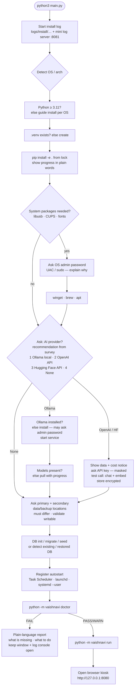

# 07 — Installation, Startup & Health Checks (Windows · macOS · Ubuntu)

The shop PC is switched off every night. Every morning the system must come up **by itself**,
**verify itself**, and **tell a non-technical person exactly what is wrong** if anything is — on
**Windows, macOS or Ubuntu/Debian Linux** with the same code and the same experience.

## 1. Principles

1. **One entry point on every OS:** `python3 main.py` (stdlib only — runs before anything is installed).
   It is the *only* program the owner ever runs: OS check → Python check → packages → system components →
   Ollama → models → data locations → database → backup → autostart → doctor → start. Double-clickable
   wrappers (`Start Vaishnavi.bat`, `Start Vaishnavi.command`, `start-vaishnavi.sh`) just call it.
   The operator's step-by-step guide is [17 — How to Install and Run](17-install-and-run.md).
2. **The application installs its own dependencies.** Nobody is asked to "pip install" or "download
   Ollama" by hand. The bootstrapper detects what is missing, explains it in plain language, asks for
   the **OS administrator password only when a system-level install is required**, and does it.
2a. **The installer is an interactive wizard.** Every decision the owner must make is a numbered
   question with a recommended default, a plain-language explanation (EN/HI), and `b`ack / `s`kip /
   `q`uit (resumable). Questions: language · **AI provider** (local Ollama, OpenAI API, Hugging Face
   API, or none — with a recommendation from the hardware survey) · primary and secondary data
   locations · autostart · optional LAN access. Everything else is detected, not asked. Answers (minus
   secrets) are saved to `config/install-answers.toml` for unattended re-installs (`--answers`, `--yes`).
3. **Least privilege.** Only the system-package steps run elevated (UAC on Windows, `sudo` on
   macOS/Linux); the app itself always runs as the normal user.
4. **Messages are for the shop owner, not a developer.** Every check prints *what it means* and
   *what to do*; the technical detail goes to the log file and the log console.
5. **Everything is logged from the very first second**, including the installer, and every log is
   viewable in a browser ([08 §9](08-logging-and-troubleshooting.md#9-log-console-over-http--rest)).

## 2. Entry points

| Command | When | What |
|---------|------|------|
| `python3 main.py` (or the OS wrapper) | Every start — first run installs, later runs verify & launch | survey → install missing → doctor → start app → open browser |
| `python3 main.py --install-only` | Setup day / after an update | same, but stops before launching |
| `python3 main.py --doctor [--fix] [--lang hi]` | Any time, without the venv being known to the user | wrapper around `python -m vaishnavi doctor` using the app's venv |
| `python3 main.py --offline <folder>` | Shop PC without internet | stages that download (packages, Ollama, models) read from a prepared bundle ([17 §8](17-install-and-run.md#8-installing-without-internet-offline-bundle)) |
| `python3 main.py --restore` · `--update <path>` · `--selftest` · `--logs` · `--where` · `--no-ai` · `--no-browser` · `--uninstall-autostart` | See the full command table in [17 §5](17-install-and-run.md#5-all-mainpy-commands) | |
| `python -m vaishnavi doctor [--json] [--fix] [--lang hi]` | Any time; also *Settings → System → Run checks* | the checklist in §5 |
| `python -m vaishnavi run` | Used by the bootstrapper / service | starts the server (runs a light doctor first) |
| `python -m vaishnavi selftest` | After install / update | unit tests with fakes + live checks |
| `python3 main.py --reset-owner-password` | Owner forgot the password | asks for the 12-word **recovery key** and OS admin elevation; audited |

## 3. Bootstrap flow



### Platform matrix

| Concern | Windows 10/11 | macOS 12+ | Ubuntu 22.04+ / Debian |
|---------|---------------|-----------|------------------------|
| Python install guidance | `winget install Python.Python.3.12` or python.org | `brew install python@3.12` or python.org pkg | `sudo apt install python3 python3-venv python3-pip` |
| Elevation | re-launch helper via UAC (`ShellExecute runas`) | `sudo` prompt in Terminal (`-S` via askpass dialog if GUI) | `pkexec` / `sudo` |
| System packages | none usually (libusb via `pyusb` wheels / Zadig only for raw USB printers) | `brew install libusb` | `sudo apt install libusb-1.0-0 cups fonts-noto-devanagari` |
| Ollama | `winget install Ollama.Ollama` or official installer | `brew install ollama` or official `.dmg` | official install script → systemd service |
| Autostart | Task Scheduler *At log on* + watchdog task | `~/Library/LaunchAgents/com.vaishnavi.store.plist` | `~/.config/systemd/user/vaishnavi.service` (+ `loginctl enable-linger`) |
| Secrets store | DPAPI (`keyring` Windows backend) | Keychain (`keyring`) | SecretService/libsecret (`keyring`), file-backed fallback with warning |
| Printer | USB (pyusb/libusb) · Network · Windows spooler (`pywin32`) | USB · Network · CUPS (`pycups` / `lp`) | USB (udev rule installed) · Network · CUPS |
| Scanner detection | PnP via `pywin32`/WMI | IOKit via `hidapi` | `pyudev` / `hidapi` |
| Browser kiosk | Edge/Chrome `--app=` | Chrome/Safari `open -a` | Chromium `--app=` |
| Fonts (Devanagari) | Nirmala UI present | Devanagari Sangam present | install Noto Sans Devanagari |

All of this is behind `vaishnavi/platform/` adapters ([10 §9](10-backend-components.md#9-platform--os-adapters-the-only-place-that-knows-the-os)); the rest of the
code never checks the OS.

### What the owner sees during first install (example, English; Hindi available with `--lang hi`)

```
Vaishnavi Store Manager Setup                                             (log: logs/install/2026-11-14_0801.log)
──────────────────────────────────────────────────────────────────────────────────────────────
 ✔  Computer: Ubuntu 24.04, 16 GB memory, no graphics card → AI model: qwen2.5:3b (good fit)
 ✔  Python 3.12 found
 ✔  Private Python environment created (.venv)
 ⟳  Installing 41 software packages … 23/41  (first time only, about 2–4 minutes)
 ✔  Packages installed
 !  Two system components are missing: USB library (libusb), printer system (CUPS)
    Vaishnavi Store Manager needs your computer's administrator password to install them. Nothing else is changed.
    Password: ********
 ✔  System components installed
 ?  Which AI engine should the assistant use?   (you can change this later in Settings → Assistant)
      This computer: 16 GB memory, no graphics card → local AI will work (answers in ~5–10 s).
      [1] Local — Ollama on this PC         · private, free, needs ~3 GB download once      (recommended)
      [2] OpenAI API (internet)             · fastest and best quality; pay per use; data sent to OpenAI
      [3] Hugging Face API (internet)       · open models hosted remotely; free tier is limited
      [4] No AI assistant for now           · stock/price questions still answered from the database
    Choice [1]: 1
 !  Ollama (the local AI engine) is not installed → installing (about 1 minute)
 ✔  Ollama installed and running
 ⟳  Downloading AI models … qwen2.5:3b 1.9 GB  ■■■■■■■■□□ 78 %   (one time, needs internet)
 ✔  Models ready
 ?  Where should Vaishnavi Store Manager keep its data?
      Primary (live database):   [C:\Users\Shop\VaishnaviStore\data]            ✔ 187 GB free
      Secondary (backups):       [E:\Vaishnavi-Backups]  (USB drive)       ✔ different disk · 58 GB free
    Tip: keep the backup drive plugged in; backups run automatically at every shift close and at night.
 ✔  Shop database created · Owner account created (you will set the password on first login)
 ✔  Recovery key generated — it will be shown once after your first sign-in; write it down
 ✔  First backup written to E:\Vaishnavi-Backups and verified
 ✔  Vaishnavi Store Manager will now start automatically when you log in to this computer
 ──  Running health checks …
 ✔  22 checks passed · 1 note: no receipt printer set up yet — bills will be saved as PDF and can be printed later
 ▶  Opening Vaishnavi Store Manager in your browser … Logs: http://127.0.0.1:8080/system/logs
```

Every `!` line has a matching entry in the log with the full command output and exit codes.

If the owner picks **[2] OpenAI** or **[3] Hugging Face** instead, the AI block reads:

```
 ?  Choice [1]: 2
 i  What will be sent to OpenAI: your questions and the figures the assistant looks up (item names,
    quantities, totals). Never sent: passwords, bank/UPI details, customer numbers, your database.
    Cost: pay per use — normal daily use is usually a few rupees per day. Monthly limit: 2 M tokens (changeable).
 ?  Paste your OpenAI API key (it will not be shown; stored encrypted on this PC): ********
 ⟳  Testing the key … chat OK (gpt-4o-mini, 1.1 s) · embeddings OK (text-embedding-3-small)
 ✔  AI assistant will use OpenAI
```

A failed test shows the reason in plain words (wrong key · no billing on the account · no internet) and
offers: try again · pick another provider · continue without AI.

## 4. Elevation policy (asking for the administrator password)

- Requested **only** for: installing system packages (libusb/CUPS/fonts), installing Ollama when the
  official installer needs it, adding a udev rule (Linux) or Zadig driver hint (Windows), and
  creating a system-level autostart if the user-level one is unavailable.
- The prompt always states **why** and **what command** will run; the command and its output are logged
  (`ELEVATED_CMD`), the password is never logged.
- If the owner declines, the bootstrapper continues with whatever can be done unprivileged and the
  doctor reports the consequence in plain words ("USB printer cannot be used until libusb is installed").
- The app's own files live in the user's home (`~/VaishnaviStore` by default) so **no elevation is needed
  for daily use, updates of Python packages, backups or logs**.

## 5. Pre-flight doctor — ordered checks

Each check returns `PASS`, `WARN`, `FAIL` or `SKIP`, a one-line **plain-language message**, a
**"What to do"** hint, a technical detail line (log only), an error code, and elapsed ms.

```mermaid
flowchart TD
  S([start]) --> P1[Python ≥ 3.11 and venv active]
  P1 --> P2[Required packages importable<br/>versions match lock]
  P2 --> P3[Folders exist and writable<br/>data/ logs/ backups/ images/]
  P3 --> P4[Disk free ≥ 2 GB]
  P4 --> P5[Config loads · required keys<br/>shop.name · tax scheme]
  P5 --> P6[System components<br/>libusb · CUPS/spooler · fonts]
  P6 --> P7[Code integrity<br/>installed files match release manifest<br/>dependencies match hash lock]
  P7 --> D1{vaishnavi.db in primary?}
  D1 -- no --> D1b[Offer restore from secondary<br/>or create new]
  D1 -- yes --> D2[PRAGMA quick_check = ok<br/>else quarantine + offer restore]
  D1b --> D2
  D2 --> D2b[db_identity: normal · unclean close ·<br/>restored copy · foreign DB]
  D2b --> D3[Alembic at head<br/>else dry-run on temp copy → pre-migrate snapshot → upgrade]
  D3 --> D4[WAL mode · foreign_keys ON]
  D4 --> D5[Owner account exists]
  D5 --> D6[Sales hash chain valid]
  D6 --> D7[Invoice sequence gap-free]
  D7 --> B1[Primary & secondary locations<br/>present · writable · free space]
  B1 --> B2[Last backup under 24 h and verified<br/>else run one now]
  B2 --> K1[Secrets store available<br/>keyring backend]
  K1 --> A1{ai.provider?}
  A1 -- none --> H1
  A1 -- ollama --> A2[ollama binary found]
  A2 --> A3[Service on :11434<br/>else start]
  A3 --> A4[chat_model present<br/>else pull]
  A4 --> A5[embed_model present<br/>else pull]
  A5 --> A6[Warm-up generate + embed]
  A1 -- openai / huggingface --> C1a[Internet reachable]
  C1a --> C2a[API key present in secure_setting]
  C2a --> C3a[Test chat + embed<br/>key valid · model available · latency]
  C3a --> C4a[Monthly budget < 100 %]
  C4a --> A7
  A6 --> A7[Embedding index fresh<br/>and built with the active provider]
  A7 --> H1[Printer configured and ready?<br/>INFO/WARN only · receipts queue if not]
  H1 --> H2[Paired scanner present<br/>strict: billing paused if not]
  H2 --> H3[Weighing scale port<br/>if configured]
  H3 --> H4[Publish channels reachable<br/>if enabled]
  H4 --> C1[System clock sane<br/>≥ last sale time]
  C1 --> C2[Ports 8080 / 8443 free]
  C2 --> C3[Autostart registered]
  C3 --> R([report + exit code])
```



### Severity rules
- **FAIL** (exit 2): app must not start — Python/packages, **code-integrity mismatch**, DB integrity (after restore offer declined), migrations, config, primary location, port.
- **WARN** (exit 1): app starts but something needs attention — AI, backup age / secondary drive missing, clock, GSTIN missing,
  publish channel, secrets backend fallback, **printer not configured / not ready** (receipts queue; selling continues).
  **Scanner not detected** is WARN at startup (so the Owner can log in and fix hardware) but the POS stays **paused for staff** until it is detected (strict mode).
- **PASS** (exit 0).

### Example doctor output (daily run)

```
Vaishnavi Store Manager Health Check — 14-Nov-2026 08:01  (ref 01JCXYZ…)           Language: English | हिंदी
──────────────────────────────────────────────────────────────────────────────────────────
 ✔ Software            All 41 components present · application files intact              212 ms
 ✔ Folders & disk      187 GB free                                                     5 ms
 ✔ Shop database       OK · clean shutdown last night · 1 238 bills verified · no gaps      445 ms
 ✔ Backup              Last backup 21:30 yesterday on E:\Vaishnavi-Backups · verified          12 ms
 ✔ AI engine           Ollama running · models ready · answered test in 1.9 s      4 400 ms
                        (cloud provider: "OpenAI reachable · key valid · 12 % of monthly budget used · 0.9 s")
 !  Receipt printer     Not set up yet → bills saved as PDF; 0 waiting to print              1 ms
 ✔ Barcode scanner     Paired scanner connected                                       12 ms
 ✔ Weighing scale      Not configured (skipped)
 !  Reports to phone   Internet not available → reports will be sent when online     410 ms
 ✔ Clock, ports, autostart
──────────────────────────────────────────────────────────────────────────────────────────
 RESULT: Ready to open the shop (2 notes).   Details: http://127.0.0.1:8080/system/logs?ref=01JCXYZ
```

The same report is available as JSON (`--json`, `/api/v1/system/doctor`) and in *Settings → System*.

## 6. Daily start (after installation)

1. OS autostart runs the wrapper → `main.py` (fast path: nothing to install → < 3 s).
2. Mini log server starts on `:8081` so logs are visible even if the main app fails to start.
3. AI provider checked (Ollama service started, or key + internet verified); doctor runs; on PASS/WARN the app starts and the browser opens in
   kiosk/app mode on `http://127.0.0.1:8080`. The mini log server hands over to the app's `/system/logs`.
4. **Watchdog** (Task Scheduler task / launchd `KeepAlive` / systemd `Restart=on-failure`) restarts the
   app if the process dies **or hangs**: `/healthz` must answer within 5 s and includes a heartbeat
   timestamp from the request loop and from the scheduler thread; if either is stale for 60 s the
   watchdog logs `E-SYS-020 app hung`, dumps thread stacks to `logs/errors/`, terminates and restarts
   the server. Browsers reconnect automatically; held carts are in the DB; the cart being typed is kept
   in browser session storage for 2 h. Nothing already saved is affected ([14 §2](14-database-backup-and-recovery.md#2-what-a-crash-or-hang-can-and-cannot-lose)).
5. After an unclean stop the next start shows a one-line note — *"Vaishnavi Store Manager did not close properly last
   time — all saved data is intact"* — and runs `quick_check` before login; crash counts appear in
   *Reports → Backups & integrity* so a recurring bug is noticed.
6. Top bar shows status chips: **DB**, **Integrity**, **Scanner**, **Printer**, **AI**, **Backup**, **Publish**.

## 7. Scheduled jobs (APScheduler, in-process)

| Job | Schedule | Notes |
|-----|----------|-------|
| `backup` | on start (if stale), on shift close, daily 21:30, before migrate/update/restore, optional every 15 min | SQLite backup API → `integrity_check` → manifest → secondary (queue locally if drive absent) → prune per retention ([14](14-database-backup-and-recovery.md)) |
| `restore_drill` | weekly (Sunday 20:30) | restore latest snapshot into a temp DB, verify integrity + chain, delete; failure → red chip + alert |
| `db_maintenance` | nightly 21:40 / monthly | full `integrity_check`; monthly `VACUUM` + `PRAGMA optimize` after a backup |
| `verify_chain` | hourly | hash chain + invoice gaps + **stock reconciliation** (Σ movements == cached qty; day's sale lines == SALE movements); logs `INTEGRITY_OK/FAIL`, writes `integrity_check` |
| `low_stock_scan` | 08:30 & 17:00 | updates dashboard badge |
| `ai_keepalive` | every 10 min | keeps model resident during hours |
| `ai_reindex` | nightly 22:00 | docs/products changed since last run |
| `insights` | nightly 21:45 | ForecastService + ReportService → dashboard notes & digest bullets |
| `publish_digest` | at last shift close or 21:50; weekly Sunday 20:00 | render PDF → outbox; retry every 15 min |
| `hardware_poll` | every 10 s (POS open) | printer ready? **new printer appeared?** paired scanner present? scale responding? |
| `session_monitor` | every 15 s | closes work sessions whose heartbeat is > 60 s old (`HEARTBEAT_LOST`), applies idle-lock timeout, updates "who is logged in" |
| `print_pending` | every 30 s while a printer is ready | prints queued receipts (oldest first), updates `receipt_printed` |
| `alerts` | every 60 s | evaluates `config/alerts.toml` against metrics/state → notification centre (+ digest/Telegram) |
| `stock_daily_balance` | nightly 21:35 | writes end-of-day qty per product; feeds stock-as-of-date and reconciliation |
| `log_prune` | daily | per retention in `logging.toml`; receipts PDF > 2 FY and quarantined DB files > 90 d |

## 8. Updates

*Settings → System → Check for update* reads a release folder/USB or a URL; the bootstrapper applies it
(`main.py --update <path>`): backup → replace package → `pip install` → migrate → selftest →
restart. Rollback to the previous version if selftest fails. All logged under `logs/install/`.

## 9. Shutdown

Closing the browser does not stop the server; *Settings → System → Shut down app* (Owner) or OS
shutdown stops it. On `SIGTERM`/console close: flush logs, `wal_checkpoint(TRUNCATE)`, write
`last_clean_close_at` + fingerprint, final backup if sales happened since last backup. The autostart
unit registers a shutdown hook (Windows: `CTRL_CLOSE/SHUTDOWN` handler; launchd/systemd: `SIGTERM` with
a 20 s stop timeout) so the nightly power-off always goes through this path.
