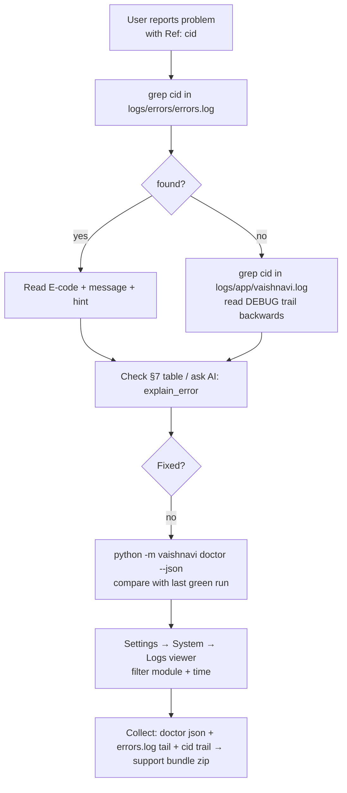

# 08 — Logging & Troubleshooting

Goal: **any failure can be traced from what the user saw → log line → root cause** in under five
minutes, by someone who did not write the code.

## 1. Principles

1. Logging is configured **before anything else** runs (`core/logging.py` called first in `__main__`).
2. Every module gets `logger = logging.getLogger(__name__)` → hierarchical names (`vaishnavi.services.billing`).
3. **DEBUG to file always**; INFO to console; levels per module adjustable in `config/logging.toml` without code changes.
4. Every request / UI action / job carries a **correlation id** (ULID) stored in a `ContextVar` and injected into each record; the same id is written to `audit_log` and shown in UI error toasts as `Ref: 01JCX…`.
5. **Error codes** (`E-<AREA>-<NNN>`) on every raised `VaishnaviError`; codes are documented in §5 and understood by the AI assistant (`explain_error`). Every code has a **plain-language message and "What to do" hint in English and Hindi** (`core/messages/{en,hi}.toml`) — the UI, the doctor and the log console show those; the technical detail stays in the log line.
6. Never log PINs, password hashes, full card refs; a redaction filter masks keys named `pin`, `password`, `secret`.
7. Log the *decision*, not just the event: `negative_stock policy=BLOCK product=CAM-0001 have=0 want=2 → E-INV-003`.

## 2. Files & rotation

```
logs/
├── install/    2026-11-14_0801.log     # bootstrapper: survey, installs, elevated commands, model pulls
├── app/        vaishnavi.log             # everything, DEBUG, daily rotation, 30 days
│               vaishnavi.jsonl           # same events as JSON lines (feeds the log console API)
├── errors/     errors.log              # WARNING+, 90 days — first place to look
├── audit/      audit.jsonl             # one JSON per audit event, 365 days (mirror of DB table)
├── ai/         ai.log                  # prompts (truncated), tool calls, latency, guardrail decisions, 14 days
├── hardware/   hardware.log            # printer/scanner/scale status polls & commands, 14 days
├── doctor/     doctor_YYYYMMDD_HHMMSS.json + .txt
├── startup/    start_YYYYMMDD_HHMMSS.log   # daily start wrapper output
└── access/     http.log                # uvicorn access incl. log-console requests, 7 days
```

Paths are OS-neutral (`pathlib`), default root `~/VaishnaviStore/logs` on every OS.

`TimedRotatingFileHandler(when="midnight", backupCount=N, encoding="utf-8")`; a `QueueHandler` +
`QueueListener` keeps logging off the request thread.

## 3. Record format

Text (human):
```
2026-11-14 10:42:17.318 IST | INFO  | vaishnavi.services.billing | cid=01JCXQ7V… user=ramesh(STAFF) shift=41 | SALE_COMMITTED invoice=INV-2026-27-000123 total=43000p items=3 pay=CASH ms=41
```

JSON (`logs/app/vaishnavi.jsonl`, optional, for tooling / AI explain):
```json
{"ts":"2026-11-14T05:12:17.318Z","lvl":"INFO","logger":"vaishnavi.services.billing","cid":"01JCXQ7V…",
 "user":"ramesh","role":"STAFF","shift":41,"event":"SALE_COMMITTED","invoice":"INV-2026-27-000123",
 "total_paise":43000,"items":3,"payment":"CASH","ms":41}
```

Structured fields are passed via `logger.info("SALE_COMMITTED", extra={...})`; a `KeyValueFormatter`
renders them for text, `JsonFormatter` for JSONL.

## 4. What gets logged where (minimum)

| Layer | DEBUG | INFO | WARNING | ERROR |
|-------|-------|------|---------|-------|
| UI pages | page open, button, key (F9), input values (non-secret) | login/logout | validation rejected | unhandled exception (with cid shown to user) |
| Services | method entry/exit with args & ms, computed totals, policy decisions | state changes (SALE_COMMITTED, SHIFT_CLOSED, STOCK_ADJUSTED) | overrides, variance ≠ 0, negative stock WARN | integrity fail, txn rollback |
| Repositories | SQL statement echo (toggle `db.echo`), row counts | migrations applied | slow query > 200 ms | DB errors |
| AI | prompt size, retrieved chunk ids, tool args/results (trimmed), tokens, latency | model load, index rebuild | timeout, circuit open | connection refused, bad tool args |
| Hardware | ESC/POS bytes length, printer status | receipt printed | printer offline → fallback | print failure |
| Bootstrap | each check result with ms | doctor summary | WARN checks | FAIL checks |
| Scheduler | job start/end | backup created & verified | backup stale | job exception |

## 5. Error code areas

| Prefix | Area | Example |
|--------|------|---------|
| `E-CFG` | configuration | `E-CFG-001` settings.toml missing key `shop.name`; `E-CFG-002` unknown setting name sent to `SettingsService` (rejected before storing); `E-CFG-003` *GST registered* switched on without a GSTIN (the wizard / Settings ask for it; nothing stored) |
| `E-UI` | UI shell | `E-UI-001` a page module failed to import → its route is missing (`UI_PAGE_IMPORT_FAILED` with traceback, `UI_ROUTE_MISSING`); `E-UI-002` a browser asked for a path no page serves (`HTTP_404 path=… referer=…` — the address that caused it) |
| `E-DB` | database | `E-DB-002` database file missing (new install → created; else restore); `E-DB-003` integrity_check / quick_check failed (file quarantined); `E-DB-010` migration failed; `E-DB-020` restored copy detected (info banner); `E-DB-021` foreign database refused; `E-DB-022` unclean shutdown recovered; `E-DB-030` another instance already holds the writer lock (second start refused) |
| `E-AUTH` | login/permission | `E-AUTH-001` wrong username *or* password (same message and same timing for both — no username probing); `E-AUTH-002` wrong PIN; `E-AUTH-003` account locked after 5 wrong passwords (15 min, persisted in the DB so a restart does not clear it); `E-AUTH-004` deactivated account; `E-AUTH-005` Owner setup not completed (seeded sentinel still in place — complete the first-run wizard on the shop PC); `E-AUTH-006` last active Owner cannot be deactivated; `E-AUTH-007`/`008` new password / PIN rejected (reason given); `E-AUTH-009` username taken; `E-AUTH-010` permission denied `VOID_SALE`; `E-AUTH-011` action needs the Owner PIN first (staff asked for an over-cap discount / void / cash-out without PIN); `E-AUTH-012` no Owner PIN set up yet; `E-AUTH-020` logout with open shift (needs Owner PIN); `E-AUTH-021` unconfirmed previous exit (must confirm at login); `E-AUTH-030` Owner PIN locked after 3 failures; `E-AUTH-040` recovery key rejected |
| `E-CAT` | catalogue | `E-CAT-004` duplicate barcode; `E-CAT-010` stale edit rejected (`row_version` mismatch — reload and retry) |
| `E-INV` | inventory | `E-INV-003` insufficient stock (policy BLOCK) |
| `E-BILL` | billing | `E-BILL-042` no open shift; `E-BILL-050` payment < total; `E-BILL-060` discount above cap without override; `E-BILL-061` offer not removable by role; `E-BILL-070` manual entry blocked by policy; `E-BILL-071` open-item cap reached; `E-BILL-072` open-item price below sanity threshold (warning); `E-BILL-080` duplicate checkout ignored (idempotent — existing invoice returned) |
| `E-SHIFT` | shifts | `E-SHIFT-002` shift already open for user |
| `E-LEDGER` | integrity | `E-LEDGER-001` hash mismatch; `E-LEDGER-002` invoice gap; `E-LEDGER-003` stock reconciliation mismatch (Σ movements ≠ cached qty, or sale lines ≠ SALE movements) |
| `E-PRN` | printing | `E-PRN-001` printer not configured / unreachable → receipt archived as PDF and queued (selling continues); `E-PRN-002` *Require printed receipt* is on and printer not ready: checkout blocked |
| `E-SCN` | scanner | `E-SCN-001` paired scanner not present; `E-SCN-002` unknown barcode |
| `E-PUB` | report publishing | `E-PUB-003` channel delivery failed (queued for retry) |
| `E-FCST` | forecasting | `E-FCST-001` insufficient history |
| `E-AI` | assistant | `E-AI-001` Ollama unreachable; `E-AI-004` model missing; `E-AI-010` provider disabled (none); `E-AI-011` API key missing (→ Settings → Assistant → Provider); `E-AI-012` API key rejected; `E-AI-020` cloud provider unreachable (no internet); `E-AI-021` provider rate limit; `E-AI-030` monthly token budget 80 % / 100 % |
| `E-SEC` | secrets | `E-SEC-001` keyring backend unavailable (file fallback in use); `E-SEC-005` plain-text secret file `config/secrets.env` still present after import (WARN); `E-SEC-006` API key found inside a TOML config file or sent to the plain `setting` table (FAIL — remove it, use Settings); `E-SEC-010` unknown protected setting name (only the allow-list in `services/secure_settings.py` may be stored encrypted); `E-SEC-011` a stored value no longer decrypts — master key changed (new PC / OS account / restored DB) → re-enter it |
| `E-GRD` | assistant guardrails | `E-GRD-001` prompt refused (category); `E-GRD-002` prompt refused and flagged → owner alert; `E-GRD-003` output blocked (secret pattern / unsupported figure); `E-GRD-004` rate limit |
| `E-BKP` | backup | `E-BKP-001` secondary location unavailable (queued); `E-BKP-002` destination not writable / full; `E-BKP-003` snapshot failed verification; `E-BKP-010` restore drill failed |
| `E-SYS` | installation / platform | `E-SYS-001` Python too old; `E-SYS-002` package install failed; `E-SYS-003` system component missing (libusb/CUPS); `E-SYS-004` elevation declined; `E-SYS-005` autostart registration failed (file written but the launcher did not enable it); `E-SYS-006` secrets backend unavailable (file fallback); `E-SYS-007` install log console port busy; `E-SYS-008` `--yes` cannot answer a question without a default; `E-SYS-009` a question is needed but there is no keyboard (run from a terminal / `--yes` / `--answers`); `E-SYS-010` hardware survey incomplete; `E-SYS-011` Python newer than tested; `E-SYS-012` data and backups on the same disk (WARN, repeated on every start while true); `E-SYS-013` recorded data folder missing/unwritable (FAIL — never re-created silently); `E-SYS-014` recorded backup folder missing (WARN, backups queue); `E-SYS-015` offline bundle does not fit this PC; `E-SYS-016` another installer is already running (single-installer lock); `E-SYS-017` web port already used by **another** program (doctor FAIL; when the listener is Vaishnavi itself the check passes with "already running" and the start stage adopts it); `E-SYS-020` app hung — watchdog restarted it (thread dump saved); `E-SYS-030` system clock jumped > 5 min (attendance/report times flagged); `E-SYS-040` application files differ from the release manifest (start refused); `E-SYS-041` dependencies not hash-verified (`requirements.lock` absent → installed from `pyproject.toml` minimums; WARN) or hash mismatch (FAIL); `E-SYS-050` installer command not available in this build; `E-SYS-090` setup interrupted by the user (Ctrl-C; resumable); `E-SYS-099` unexpected installer error (traceback in `logs/install/`, apology + log path on screen) |
| `E-SCALE` | weighing scale | `E-SCALE-001` port not found; `E-SCALE-002` unstable reading / timeout |
| `E-LOGAPI` | log console | `E-LOGAPI-001` unauthorised; `E-LOGAPI-002` rate limited |
| `E-ALERT` | alert rules | `E-ALERT-001` rule fired (name, value, threshold) — always paired with a notification |

Each code has a row in `docs/08` (this file, §7 table grows per phase) with **symptom → cause → fix**.

## 6. Troubleshooting playbook



*Settings → System → Create support bundle* zips `logs/doctor/latest`, `logs/errors/*`, the cid trail
and `settings.toml` (redacted) — handy for remote help.

## 7. Known symptoms (seeded; grows with each phase)

| Symptom | Likely log line | Cause | Fix |
|---------|-----------------|-------|-----|
| "AI offline" chip | `E-AI-001 connection refused 127.0.0.1:11434` | Ollama not running | the bootstrapper restarts it on next start; or *Settings → AI → Restart AI engine* |
| "AI offline" chip (cloud provider) | `E-AI-020 provider=openai unreachable` / `E-AI-012 key rejected 401` | internet down / key revoked or billing disabled | check the shop internet; verify the key on the provider's site; *Settings → Assistant → Provider → Test*; fast path keeps answering meanwhile |
| "AI limited" chip | `E-AI-030 budget_used=100%` | monthly cloud token budget exhausted | Owner raises `monthly_token_budget` in *Settings → Assistant* or waits for the month to roll over |
| Chat very slow | `ai.chat ms=48000 model=qwen2.5:7b` | Model too big for CPU | set `chat_model=qwen2.5:3b-instruct` |
| Cannot bill: "No open shift" | `E-BILL-042` | Cashier skipped shift open | F11 Open shift |
| Receipt not printing | `E-PRN-001 … fallback=PDF` | Printer off / wrong port | check `printer.port`; receipt still saved as PDF |
| "Printer offline — billing paused" | `E-PRN-002 require_printer=true status=offline` | *Require printed receipt* is on; printer not ready | power/USB/paper; Owner may enable time-boxed paper-less override or switch the setting off |
| Amber "Printer: not connected — 7 receipts queued" | `E-PRN-001 printer=none queued=7` | No printer set up yet / unplugged | selling continues; set up or reconnect the printer in Settings → Hardware, then *Print pending receipts* |
| Banner "Running on backup from 14-Nov 21:30" | `E-DB-020 RESTORE_DETECTED backup_id=… taken_at=…` | A snapshot was copied to the primary folder | expected after recovery; re-enter bills made after that time from paper; re-enter bank/UPI details if on a new PC |
| "This database belongs to a different Vaishnavi Store Manager installation" | `E-DB-021 instance_id mismatch` | Wrong file copied in | copy the correct snapshot from the secondary `backups/` folder |
| Amber "Backup drive not found — 2 backups waiting" | `E-BKP-001 secondary=E:\… missing` | USB/cloud folder unavailable | plug the drive in; queued backups flush automatically |
| "Vaishnavi Store Manager did not close properly last time — all saved data is intact" | `E-DB-022 unclean_close last_open=… quick_check=ok` | Crash, hang-restart or power cut | nothing to do; if it repeats daily, open the log console and send a support bundle |
| App froze; came back by itself after a minute | `E-SYS-020 app hung heartbeat_age=61s → restart` + `threads_*.txt` | Hang (bug / stuck device I/O) | nothing lost; re-scan the cart that was open; report if recurring |
| Red Integrity chip "Stock reconciliation mismatch" | `E-LEDGER-003 product=CAM-0050 sum=37 cached=38` | DB edited outside the app, or a bug | the app recomputes from movements on Owner confirm; investigate audit log |
| "Scanner not detected" on POS | `E-SCN-001 paired=VID_0C2E&PID_0B61 present=false` | Scanner unplugged / different USB port renumbered | re-plug; if replaced, re-pair in Settings → Hardware |
| Digest not received on phone | `E-PUB-003 channel=telegram retry=3` | No internet / bad token | check network; publish queue retries automatically |
| Forecast says "not enough data" | `forecast sku=… days=19 < min_history_days=28` | New item / new shop | expected; wait or lower `forecast.min_history_days` |
| Assistant replies "I can only answer stock/sales questions" | `E-GRD-001 category=OFF_TOPIC user=…` | Question outside scope | rephrase as a stock/sales/how-to question |
| Owner alert "Chat security: 2 flagged prompts by Ramesh" | `E-GRD-002 category=FRAUD_ASSIST excerpt="…no sale but I made 1000…"` | Staff probing for fraud/bypass | review *Reports → Chat security*; talk to staff; evidence is in `audit/` |
| Assistant answer replaced by refusal mid-stream | `E-GRD-003 reason=unsupported_figure` | Model produced a number not in tool output | expected safety behaviour; ask again or open the report screen |
| Offer not applied at scan | `offer id=… not applicable date=… scope=CATEGORY` | Outside validity window / wrong scope | check *Products → Offers* dates and scope |
| "Manual entry blocked" | `E-BILL-070 policy=BLOCK` or `E-BILL-071 cap=10` | Policy or per-shift cap | Owner PIN or adjust *Settings → Billing rules* |
| Red "Integrity" banner | `E-LEDGER-001 sale_id=…` | DB edited outside app / restore from wrong backup | restore last verified backup; investigate audit log |
| Doctor FAIL packages | `ModuleNotFoundError nicegui` | venv damaged / pip failed | re-run `python3 main.py` (it reinstalls what is missing) |
| Startup window closes instantly | `logs/startup/*.log` last lines | script error | open latest transcript or `http://<pc>:8081` (mini log server) |
| "Administrator password needed" during setup | `logs/install/*.log ELEVATED_CMD apt install libusb-1.0-0` | System component missing | enter the computer's admin password; or decline and use network printer only |
| Weighed item: "Enter weight" keeps appearing | `scale port=COM3 status=timeout` | Scale not connected / wrong port | type weight manually (allowed) or fix *Settings → Hardware → Scale* |
| "Application files were modified" at start | `E-SYS-040 file=src/vaishnavi/services/billing.py expected=… found=…` | Someone edited / replaced program files on the PC | re-run *Start Vaishnavi* (re-installs the release); check who had access; audit row recorded |
| "Owner PIN locked for 10 minutes" | `E-AUTH-030 user=ramesh attempts=3` | Wrong Owner PIN typed 3× on a staff screen | wait; Owner is notified; check *Overrides* |
| Same bill appears once although Pay was pressed twice | `E-BILL-080 client_txn_id=… existing=INV-…` | Double-click / retry | expected — idempotent checkout |

## 8. In-app log viewer (Owner)

*Settings → System → Logs* embeds the same log console described below; read-only; never exposes
redacted fields.

## 9. Log console over HTTP / REST

Every log the system writes — from the **first second of installation** to daily operation — can be
watched live from **any browser on the shop network**, e.g. from the owner's phone or a laptop:

```
http://192.168.1.25:8080/system/logs            # live console (Owner login)
https://192.168.1.25:8443/system/logs           # same over TLS (self-signed cert generated by bootstrap)
http://192.168.1.25:8081/                       # mini log server during install / if the app fails to start
```

### Web console (`/system/logs`)
| Feature | Detail |
|---------|--------|
| Live tail | WebSocket/SSE stream of new lines; pause/resume; auto-scroll |
| Sources | tabs for `install`, `startup`, `app`, `errors`, `audit`, `ai`, `hardware`, `access`, `doctor` |
| Filters | level (DEBUG…ERROR), module (`vaishnavi.services.billing`…), user, correlation id (`ref`), time range, free text; URL-addressable (`?ref=01JCX…&level=WARNING`) |
| Plain-language mode | toggles a column that shows the human message/hint for `E-` codes (EN/HI) |
| Download | current view as `.log` / `.jsonl`; **support bundle** zip |
| Doctor & status | `/system/status` dashboard (chips, versions, uptime, last backup, queue sizes) and the last doctor reports |
| Safety | read-only; redaction filter applied before serving; Owner session or API token required; access itself is logged |

### REST API (`/api/v1/system/…`, JSON)
| Endpoint | Purpose |
|----------|---------|
| `GET /api/v1/system/logs/sources` | list log files with size, first/last timestamp |
| `GET /api/v1/system/logs?source=app&level=WARNING&since=…&until=…&module=…&cid=…&q=…&limit=500&cursor=…` | paged, filtered records (JSON lines parsed) |
| `GET /api/v1/system/logs/stream?source=app&level=INFO` | SSE live stream |
| `GET /api/v1/system/logs/download?source=errors&date=2026-11-14` | raw file |
| `GET /api/v1/system/doctor` / `POST /api/v1/system/doctor/run` | last / new health check (plain + technical) |
| `GET /api/v1/system/status` | health chips, versions, uptime, hardware state, AI state |
| `GET /api/v1/system/support-bundle` | zip of doctor + errors + cid trail + redacted config |
| `GET /api/v1/system/metrics` (`?format=prometheus`) | bills/hour, checkout latency p50/p95, errors/min, queue sizes (print/backup/publish), DB size, backup age, AI latency, heartbeat ages, code-integrity status |
| `GET /api/v1/system/notifications` | the notification centre feed (Owner) |
| `GET /healthz` | unauthenticated liveness for the watchdog |

### Access & security
- Bound to `127.0.0.1` by default; *Settings → System → Remote log access* enables LAN binding
  (`0.0.0.0`) and shows the exact URL(s) + a QR code to open on a phone.
- **Owner login** (browser session) or a **personal API token** (created/revoked in Settings; shown once)
  via `Authorization: Bearer …`. Staff cannot access the console.
- Optional HTTPS on `8443` with a self-signed certificate generated by the bootstrapper (fingerprint
  shown in Settings so the owner can trust it on the phone). Rate-limited; all access logged to `access/`.
- Nothing in the console can change state — it is a window, not a control panel.

### Alert rules → notification centre
`config/alerts.toml` defines thresholds evaluated every 60 s by the `alerts` job against the metrics and
state above (backup age > 24 h, integrity failure, errors/min > 5, heartbeat lost, disk < 2 GB, print queue
> 20, flagged prompts ≥ threshold, code-integrity mismatch, scanner absent > 10 min during shop hours).
Each firing creates a **notification** (bell icon in the app, deep link to the right screen, read/unread per
user) and, when publishing is enabled, a line in the digest or an immediate Telegram message for `severity =
HIGH`. Rules are logged `E-ALERT-001` with the measured value so the console and the bell always agree.

### Before the app exists: the mini log server
`main.py` starts a tiny **stdlib-only** HTTP server on `:8081` that tails `logs/install/*.log`
and `logs/startup/*.log` with the same look (auto-refresh page + `/raw` endpoint). It runs during
installation and whenever the main app fails to start, so the owner (or remote support) can always see
*why* — even on a machine where no third-party package is installed yet. It stops once the main app's
`/system/logs` is up.
