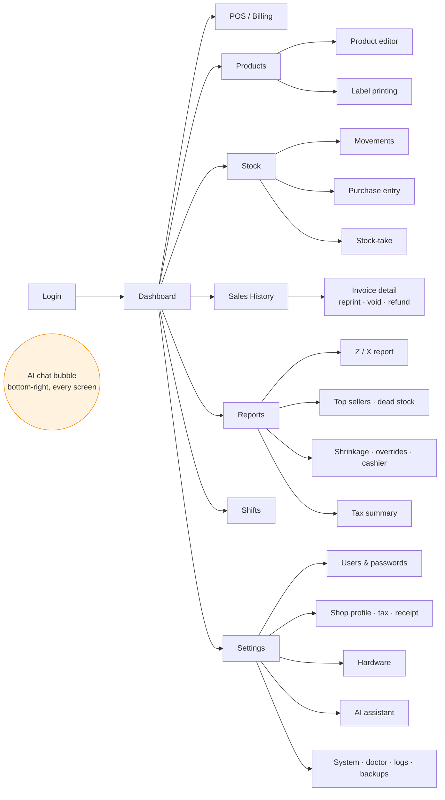

# 09 — Frontend Guide (Screens, Options, Shortcuts)

Framework: **NiceGUI** (Quasar/Material components rendered from Python). Opens in the browser
(app/kiosk mode on Windows, macOS or Linux). Layout: left navigation rail (role-filtered), top status bar,
main content, a **floating AI chat widget** (bubble in the bottom-right corner, like a typical small chat app) available on every screen. A separate, lightweight
**log console** (`/system/logs`) and **status page** (`/system/status`) can be opened in any browser on
the LAN by the Owner.



## 1. Global elements

| Element | Description |
|---------|-------------|
| **Status chips** (top-right) | `DB ●` `Integrity ●` `Scanner ●` `Printer ●` `AI ●` `Backup ●` `Publish ●` — green / amber / red; click → tooltip with last check & hint. Scanner red = billing paused for staff; Printer amber = "not connected — N receipts queued" (billing continues unless *Require printed receipt* is on) |
| **Notification centre** (bell, top-right) | One list of everything that needs attention — low stock, backup drive missing, printer detected, pending receipts, flagged assistant prompts, unconfirmed session, integrity, setup checklist — with read/unread, severity colour and a deep link to the right screen; fed by the alert rules ([08 §9](08-logging-and-troubleshooting.md#9-log-console-over-http--rest)). Staff see only their own items (pending receipts, scanner, own session) |
| **User badge** | Name, role, open shift #, **session since 09:30**, lock button, **End work** button (`Ctrl+Q`) |
| **Global search** (`Ctrl+K`) | Jump to product / invoice / screen |
| **AI chat widget** (`Ctrl+/`) | Saffron **chat bubble in the bottom-right corner**; click → a compact chat window (~380×560) slides up over the page, like a typical small chat app: header with *Sahayak · सहायक*, status dot and **language selector EN / हिंदी / Hinglish**, message list with streamed replies, quick-question chips (staff: "stock of…", "price of…"; owner: "today's sale", "low stock", "forecast"), input box, minimise. Context-aware to the current screen; shows "Source: tool, period" under every figure; refusals short and bilingual; unread badge on the bubble for proactive insights (owner) |
| **Idle lock** | After N minutes → PIN overlay; locked time is counted as idle in the work session; not unlocked for M minutes → session ends `IDLE_LOCK_TIMEOUT` |
| **End work popup** | From the user badge / `Ctrl+Q`: shows exit time, today's summary (login, hours, bills, sales), warns if a shift is still open (*Close shift first*; logout with an open shift needs Owner PIN), optional note, **Confirm** → back to the login screen (kiosk window stays open) |
| **Closing the window / tab** | Browser's own "Leave site?" prompt appears (browsers do not allow a custom dialog here); if the user leaves anyway, the exact time is recorded as *window closed* and they must **confirm that exit time at their next login** before the POS opens. If the browser or PC dies, the server's heartbeat records the last-seen time within a minute |
| **Session banner (next login)** | "You left at 18:42 without ending work — confirm or add a note" with Confirm button |
| **Language toggle** | EN / हिंदी labels (strings in `ui/i18n/*.json`) |
| **Theme** | Light default (bright shop), dark optional; saffron accent |

## 2. Login

Mock-up (approved by the owner on 14-Nov-2026): [mockups/login.html](mockups/login.html) — open in any browser.

Layout: top bar (brand, status chips, EN/हिंदी, server date-time) · **left pane** (saffron): bilingual
welcome, note that login time is recorded for attendance, shop card (**Vaishnavi Puja Store · वैष्णवी पूजा
स्टोर**, address, GSTIN, phone), plain-language *morning health check* summary with `/system/status`
link · **right pane**: sign-in card · bottom-right: the collapsed **AI chat bubble**.

Decisions taken:
- **User tiles** ("Who is signing in?") rather than a plain username box — tap a name tile (Owner tile marked in saffron), an *Other* tile allows a typed username.
- **Numeric keypad only for staff accounts** with numeric passwords; the Owner tile hides it and uses full keyboard entry. Password masked with show/hide. Enter submits. Lockout after N failures.
- Health-check panel visible to everyone (plain language only; technical detail stays in the Owner's console).
- Saffron theme with the ॐ mark kept.
- Primary button reads **"Sign in & start work → 09:28"** (the time that becomes `login_at`).
- If the user's previous session ended uncleanly, an amber **attendance banner** appears on the tile selection and the confirmation step follows sign-in.
- First Owner login forces password + Owner PIN change.

### What each role sees after login

| Area | OWNER | STAFF |
|------|:-----:|:-----:|
| Dashboard | full (sales, purchases, profit, alerts, integrity) | own-shift card only |
| POS | ✔ (+ search & tiles) | ✔ (scan, F3 Find, open item per policy) |
| Products / Offers / Labels / Open-item review | ✔ | Find item (read-only) + replacement label |
| Stock (overview, movements, adjust, purchases, stock-take) | ✔ | stock level of an item (read-only) |
| Sales history | all bills | own bills, own shift |
| Reports (incl. **Profit & margin**, **Purchases**, totals per day) | ✔ | own-shift summary |
| Shifts | all | own |
| Settings (shop, **Payments**, tax, receipt, billing rules, **Users**, hardware, **AI**, publishing, backups, system) | ✔ | — |
| AI chat widget | all tools + instruction editor | stock, price & help only |

Navigation items a role cannot use are **not rendered**, and the server rejects the call anyway.

## 2a. Onboarding wizard (first Owner login)

A full-screen, step-by-step wizard with a progress rail; every step can be skipped and resumed later from
the dashboard's **Setup checklist** card ("Setup 6/11"). Steps: Shop profile → Tax (CA guidance text) →
Payments (UPI ID → live QR preview) → Staff accounts → Products (manual form **or** CSV/Excel import with
preview and error list) → Labels (select all unlabelled → print) → Opening stock (table with quantities →
`OPENING` movements) → Pair scanner → Printer (optional) → Backup drive check → **Recovery key** (shown once,
print/download, tick to confirm). The wizard writes the same records as the normal screens; nothing is special-cased.

## 3. Dashboard

Owner cards: today's sales ₹, bills, avg bill, **today's purchases ₹**, **gross profit today / month**,
cash expected in drawer (if a shift is open), UPI total, low-stock count (click → list), last backup,
integrity status, AI status, flagged chat prompts, **who is logged in now** (name · since · last
activity) and **today's attendance** (login/logout per staff). Mini charts: hourly sales today, last 7 days,
sales vs purchases this month. Staff see only their own-shift card (bills, total, cash expected).

## 4. POS / Billing (the heart of the app)

Mock-up (approved by the owner on 14-Nov-2026): [mockups/pos.html](mockups/pos.html).

Decisions taken:
- **Picture tile grid** on the left (category tabs), not a recent-items list.
- Tiles show **price and live stock count** ("37 left", "4.2 kg", "3 left ⚠", "0 left ✖") for everyone.
- **No Hindi names on the billing screen** — tiles and cart lines show the English name only (plus
  `#ID · code` and, for loose items, the pricing unit). Hindi names remain in the catalogue for F3 search,
  labels, the assistant and the optional bilingual receipt.
- For staff in strict mode the tiles are greyed with a 🔒 (reference only); the Owner can tap them.
- Cart columns **Item · Qty · Shelf ₹ · Discount · Amount ₹**; offers shown green and locked, ad-hoc
  discounts orange with their reason; `†` on lookup lines, `*` on open items.
- **F9 Pay** button shows the amount; payment modes Cash · UPI QR · Card · Split (complete).
- Printer problems appear as an amber notice + chip; billing continues.

```
┌────────────────────────────────────────────────────────────────────────────────────────┐
│ [▮▯▮ Scan the item barcode…      ] [F3 Find / Manual] [F6 Hold] [F7 Resume]   Ramesh · Shift #41 │
│ ⚠ Printer not connected — bills saved as PDF (3 waiting). Billing continues.            │
├──────────────────────────────────┬─────────────────────────────────────────────────────┤
│ All · Camphor & Ghee · Deity …   │ Item                 Qty    Shelf ₹  Discount   Amount ₹ │
│ ┌────────┐ ┌────────┐ ┌────────┐ │ Camphor 50 g #1042   2 pc    60.00  Diwali −1%   118.80 │
│ │🕯 Camph│ │🧨 Match│ │👗 Krish│ │ Matchbox #1107       5 pc     2.00  —             10.00 │
│ │₹60 37 l│ │₹2 240 l│ │₹250 8 l│ │ Krishna Dress 6" † #1210 1 pc 250.00 −₹10 ad-hoc 240.00 │
│ └────────┘ └────────┘ └────────┘ │ Pure Ghee (loose) #1301 150 g 60.00/100 g —     90.00 │
│ ┌────────┐ ┌────────┐ ┌────────┐ ├─────────────────────────────────────────────────────┤
│ │🥛 Ghee │ │🪔 Oil  │ │🌸 Agarb│ │ Subtotal 470.00 · Item discounts −11.20              │
│ │₹60/100g│ │₹45/100m│ │₹35 52 l│ │ Taxable · CGST · SGST · Round-off                    │
│ └────────┘ └────────┘ └────────┘ │ TOTAL ₹ 459.00      Customer saves ₹ 11.20           │
│ 🔒 tiles reference-only for staff │ [F9 Pay ₹459] [F4 Discount] [F8 Customer] [Esc Clear] │
└──────────────────────────────────┴─────────────────────────────────────────────────────┘
```

| Option | Behaviour |
|--------|-----------|
| Scan box (always focused) | Keyboard-wedge scanner types code + Enter → line added, **offers auto-applied**; unknown code → "Create product?" (Owner) or "Ask Owner" (Cashier). **Strict mode:** typed (slow) input is rejected for cashiers |
| **Discount column** | Shows offer name + % (locked for cashier) or ad-hoc % / ₹ with reason; click → line discount dialog (F4). Red if above cap → Owner PIN |
| **F3 Find / Manual** | Dialog, two tabs: **Find item** (default) — type name / Hindi / code / `#ID` → product card with image, price, stock and its **barcode drawn on screen** → *Add to bill* (reason: label damaged / missing / not labelled), *Print replacement label* (POS printer), *Scan now*; **Open item** — name, detail, qty, unit price, discount, tax preset. Lookup lines marked `†`, open items `*`. Open-item tab governed by `billing.manual_add_policy` |
| Search | Fuzzy over name / Hindi / SKU; arrow keys + Enter. **Disabled for STAFF in strict mode** (use F3 Find instead, which is counted) |
| Quick-pick tiles | **Every active item** is a tile (quick picks first, then the rest), filtered by the category pills; emoji icon derived from the name (camphor 🕯, ghee 🥛, dress 👗 … — no image upload needed), English name, price (per unit for weighed items), **live stock** "37 left" / "3 left ⚠" / "✖ out"; tap adds 1 (weighed items open the quantity pad). **Disabled (🔒) for STAFF in strict mode** — still visible for price/stock reference |
| Hardware banner | "Scanner not detected — billing paused" with **Owner override** button (time-boxed). Printer problems show only an amber chip ("receipts queued") unless *Require printed receipt* is on |
| Qty | `+`/`−`, type number; **weighed/measured items open the quantity pad**: preset buttons (50 g · 100 g · 250 g · 500 g · 1 kg), numeric field that understands "500", "0.5 kg", "1.5kg", "250 g", *by amount* toggle ("₹50 of ghee"), live scale weight with *Use weight* / *Tare* when a scale is connected; weight-embedded barcodes fill qty automatically. Whether an item is weighed follows its **unit** in the editor (kg → grams, l → ml, m → cm) |
| Line discount | ₹ or %; reason dropdown; above cap → Owner PIN modal. Offer discounts are shown but locked |
| **Bill discount** (F4 with no line selected) | Dialog: **customer tier** (Regular 2 % · Premier 5 % · Festival · Round-off / bargaining — editable in data key `billing.discount_tiers`), then **% or ₹**; same cap logic (staff above cap → Owner PIN); shown as its own totals row with the reason and at the foot of the bill card; printed on the receipt below the item discounts so the customer sees both |
| Customer | **F8** — mobile number (+ optional name), normalised to `+91 …`, kept in `customer` (one row per number, so a regular is recognised next time) and linked to the sale; shown as a green 📱 chip in the bill header |
| **Bill on WhatsApp** (optional, **off by default** — Settings → Shop & GST → "Offer Send bill on WhatsApp") | When on, the done dialog after Pay shows a phone box (prefilled from F8, or typed now) + **Send bill on WhatsApp**. If the Owner configured the WhatsApp Cloud API (Settings → Publishing: phone-number id + token) the bill text is posted directly (`RECEIPT_SHARED via=api`); otherwise a `https://wa.me/<number>?text=…` **click-to-chat link** opens WhatsApp Desktop/Web with the whole bill pre-filled and the cashier taps *Send*. The message is the 58 mm receipt (32 columns, fits a phone) in a monospace block under the bold shop name. API failure falls back to the link; never affects the sale. When off, nothing WhatsApp-related appears and F8 is plain customer capture |
| **F9 Pay** | Payment dialog changes with the mode: **Cash** quick-note buttons + tendered + change; **UPI** the shop's UPI id and a **QR** (`upi://pay`, amount pre-filled) + optional reference; **Card** slip reference; **Split** three amounts with the live shortfall |
| **F6 Hold / F7 Resume** | Park carts with label (customer name) |
| **F10 Reprint last** | Up to `receipt.max_reprints` |
| **F11 Shift** | Open / cash-in / cash-out / close |
| **F12 Lock** | PIN overlay |
| **Ctrl+Shift+B** | Scanner test dialog |
| After pay | Receipt **auto-prints** if a printer is ready; otherwise it is queued and the PDF archived. Preview shows **Reprint**, **Save PDF**, **Show to customer** (full-screen), **Send (if publishing enabled)**, **New bill** (auto after 3 s) |

## 5. Products

- Grid with image thumbnails, **#ID**, code, barcode(s), name, category, price, stock, tax, status; filters & column chooser; CSV/XLSX import/export; multi-select → **Print labels** (copies per item, target: POS printer / label printer / A4 sheet).
- **Editor** (Owner): **essentials first** — name, category, **Sold as** (pc / pkt / box / dozen = counted · g / 100 g / kg = weighed · ml / l = measured · cm / m = cut; the unit alone decides the selling mode, prices and stock are per this unit), **purchase price**, **selling price**, **opening stock** (typed in that unit: "10" for 10 kg; after the first movement the field shows *Stock now* with a link to Stock → Adjust), **GST %** with the live CGST + SGST split. Everything else sits under **Advanced**: code (auto), MRP, HSN, low-stock alert, usual order quantity (for the reorder list), tags, change reason, barcodes (internal + manufacturer + pack, *Scan to add*, *Regenerate internal*), image, `quick_pick`. No Hindi name field (kept in the data model for CSV import; receipts print English). Price change requires reason → audit + price history. **Archive** asks for confirmation; the grid has a *Show archived* switch and a status column; an archived item's editor shows a banner with **Restore**; a duplicate code names the other item and its state (`E-CAT-005`).
- **Price history** (Owner): the *Price history* button on a product row or in the editor opens a **compact pop-up window** (dialog, ~900×560, also usable on a tablet):
  - top row: range chips **1 month · 6 months · 1 year** and a **Custom** option that reveals *From* / *To* date pickers; the chosen range is remembered per session;
  - middle: **line chart** of selling price, MRP and cost (cost hidden unless the viewer is Owner — it always is here) over the range, step-style so each change is visible, offer windows shaded, hover tooltip shows date · old → new · who · reason;
  - bottom: compact table of the changes in the range (date, field, old → new, % change, user, reason, source) with *Export CSV / PDF* and *Open full report* (jumps to *Reports → Price history* pre-filtered to this item);
  - empty state: "No price changes in this period — price has been ₹60 per 100 g since 12-Mar-2026".
- **Labels**: label designer/preview per target (80 mm strip, 58 mm strip, 50×25 roll, A4 65-up / 40-up); shows name EN/HI, code, #ID, EAN-13, price; batch print queue; history of label prints.
- **Offers** (Owner): list of offers with status (scheduled / active / expired); editor: name (EN/HI), type (% / ₹ / buy-X-get-Y), scope (product / category / tag / whole bill), min qty, validity dates, stackable; preview "Camphor 50g ₹60 → ₹59.40"; usage stats per offer.
- **Open-item review** (Owner): queue of free-text items sold via F3 Find / Manual → Open item; group by similar name; **Convert to product** (pre-fills name/price), **Dismiss**.
- Staff: products are reachable only through F3 Find (read-only card + replacement label).

## 6. Stock (Owner; staff see levels, and may book goods received)

| Sub-screen | Purpose |
|------------|---------|
| **Overview** | Current stock, low-stock filter, value at cost (Owner). **Goods received** button for everyone; Owner row-click → Adjust, staff row-click → Goods received |
| **Goods received** (dialog, Owner + staff) | A parcel arrived: item, quantity **in the item's unit** (2.5 for 2.5 kg), **note required** (who delivered / bill no.); the time and the user's name are shown and recorded; stock can only go **up** here (`PURCHASE`, no cost); the Owner is notified and books the supplier bill later |
| **Movements** | Timeline per product; filter by type/user/date |
| **Adjust / Damage** | Qty ± with mandatory reason |
| **Purchase entry** | Supplier, invoice no., lines (scan to add), cost, optional expiry date → posts `PURCHASE`; prints labels for received qty; feeds the **Purchases** report (total purchases per day / period) |
| **Reorder / purchase order** | From Low stock or Forecast: tick items → quantities pre-filled from the reorder plan → **Purchase-order PDF** (supplier, items, qty, last cost) → Send / print |
| **Stock-take** | Start (Full / Category / Selected) → count by scanning or typing → variance table → Owner approve → posts `STOCK_TAKE` + shrinkage report |

## 7. Sales History

- Table: invoice, time, cashier, items, total, payment, status; filters: date range, cashier, mode, status, item, amount.
- **Invoice detail**: lines, taxes, payments, receipt preview; actions **Reprint**, **Void** (same-day, PIN), **Refund lines** (PIN); shows hash head & verification tick.
- Item drill-down → movements.

## 8. Reports

Each report: date range, filters, table + chart, **Export CSV/XLSX**, **Export PDF**, **Send** (to a
publishing channel), **Print**. Z-report prints 80 mm-friendly. See [05 §9](05-billing-and-anti-theft.md#9-reports-catalogue).

**Reports → Forecast** (Owner, works without AI): horizon selector (7 / 14 / 30 days / next festival),
table per item: avg daily demand, trend arrow, demand class (High / Steady / Slow / Dead / New), stock,
days of cover, stock-out date, suggested reorder qty, confidence; festival banner ("Diwali in 18 days —
uplift applied to Camphor, Diya, Decoration"); chart of history vs forecast band for the selected item;
**Export reorder list PDF**.

**Reports → Demand**: top / bottom sellers by qty and value, dead stock with value at cost, category mix.

**Reports → Overrides** (strict-mode audit): manual lines, paper-less sales, printer/scanner overrides,
discount & void overrides — by Owner, by cashier, by day.

**Reports → Discounts**: offer usage (lines, ₹ given) and ad-hoc discounts per cashier with reasons.

**Reports → Manual lines**: catalogue-manual vs open-item lines per cashier/day, value, under-price warnings.

**Reports → Chat security** (Owner): flagged assistant prompts by user, category, severity; excerpt; whether the owner was alerted.

**Reports → Sales totals** (Owner): total sales per day / week / month with bills, avg bill, payment split; compare periods.

**Reports → Purchases** (Owner): total purchases per day / period / supplier; purchase vs. sales value; cost trend per item.

**Reports → Profit & margin** (Owner): gross profit = Σ(final line amount − cost snapshot) per day / month; margin % by item and category; lowest-margin and loss-making lines (e.g. heavy ad-hoc discounts); profit after offers. Cost data is **never** shown to staff anywhere.

**Reports → Price history** (Owner): all price / MRP / cost / tax-rate changes across items for **1 month · 6 months · 1 year · custom dates**; filters by category, field, user, minimum % change; per-item chart on click; "most frequently changed" and "biggest jumps" lists; export.

**Reports → Backups & integrity** (Owner): snapshot list with location, size, verified ✔, restore drills, chain head per day, unclean-shutdown count.

**Reports → Audit trail** (Owner): every create / update / delete / login / override — filter by user, entity, action, time, correlation id; before → after diff per row; chain verification tick.

**Reports → Hourly heatmap & weekday profile** (Owner): bills and ₹ by hour × weekday for a date range — when to staff the counter, when to open/close.

**Reports → Basket analysis** (Owner): items most often bought together (support/lift), useful for puja kits and shelf placement.

**Reports → Stock as of date** (Owner): quantity and value per item on any past date (from `stock_daily_balance`).

**Reports → Staff work history** (Owner): per user per day — app start, **login**, **logout**, duration, end reason (✔ ended work · ⚠ window closed · ✖ heartbeat lost · ⏸ idle timeout · ⏻ app shutdown · forced), staff confirmation note, shifts, bills, sales, idle time, lock count; week/month calendar; totals per user; unclean-exit streaks; filters by user / range / reason; export CSV / PDF; **Who is logged in now** live panel with *Force end session*; Owner note per row.

## 9. Shifts

**Open**: denomination grid (₹500 … ₹1) with a live total — staff must count note by note (type 0 for an
empty drawer), the Owner may type a total instead. Current shift panel (float, cash in/out, expected cash —
Owner only mid-shift), close wizard with denomination grid, history of shifts with variance colouring.
**End work** for staff while a shift is open: the primary button is *Close shift & count the drawer*;
*Confirm* stays disabled until an Owner PIN is typed.

**Day-close wizard** (Owner, *Shifts → Day close*): closes any open shifts (with variance review) →
Z-report preview with print / PDF → backup now (verified) → send digest (if enabled) → *Shut down app*.
Each step shows ✔ and the whole run is audited `DAY_CLOSED`.

## 10. Settings (Owner)

| Tab | Options |
|-----|---------|
| **Shop & GST** (first tab, `/settings/shop`) | Shop name, address, phone, email; **GST registered** switch (off = composition/unregistered: no CGST/SGST lines), **GSTIN** (15-character pattern; required when registered → `E-CFG-003`; printed on every bill), state code, **default GST %** for new items (0 · 3 · 5 · 12 · 18 · 28), **shelf prices include GST**; live receipt-header preview; **Receipt extras**: "Offer Send bill on WhatsApp" (optional, default off). Per-item CGST/SGST = the item's GST % in Products. Reuses the onboarding wizard's validated submits |
| **Payments** (bank / UPI details) | **UPI ID** (generates the static QR on screen & receipt), payee name, **bank account** (bank, account no., IFSC — for the owner's reference and digest), accepted payment modes. Values shown **masked**; editing requires re-entering the Owner password; stored encrypted; never visible to staff or to the AI |
| **Receipt** | Width (80 mm/58 mm/A4), header/footer text, show Hindi, auto-print, max reprints, QR on receipt |
| **Billing rules** | **Require scan** (default on), **Require printed receipt** (default **off** — can only be switched on while a printer is configured and ready), **Manual add policy** (ALLOW / PIN / BLOCK), max open items per shift, override duration, max cashier discount %, discount reason list, negative stock policy, void window hours, idle lock minutes |
| **Users** | Two roles only (**Owner**, **Billing staff**). Add staff accounts (one per person), set / reset passwords (numeric allowed for staff), deactivate; change Owner password and **Owner PIN**; view per-user last login, failed attempts, overrides received |
| **Hardware** | **Printer**: live list of detected printers (USB ESC/POS, serial, network `:9100`, OS printers) with *Refresh*, pick one as receipt printer, paper width 80/58 mm, code page, Hindi raster mode, cutter, drawer pin; status; **Test print** (sample receipt + sample label); **Print pending receipts (N)**; label target default. New printers plugged in are announced with a toast. **Pair scanner** wizard, paired devices list, scanner suffix; **Weighing scale** (port auto-detect, protocol preset, test reading, tare) and **scale barcode format**. Only options valid for the current OS are shown |
| **AI** | Enable, host, chat model, embed model (dropdown from `ollama list`), default language, rebuild index, purge chats, test; guardrail settings (rate limit, flag alert threshold, off-topic limit, custom blocked phrases); forecast parameters (history days, min history, safety days, lead time); festival calendar editor |
| **AI → Assistant instructions** (system prompt editor) | Two panes: **Locked guardrail core** (read-only, shows what is always enforced) and **Owner instructions** (editable: assistant name, tone, shop description, default language, extra FAQ answers, extra blocked phrases). **Preview** composes the full prompt; **Test** runs 5 sample questions + the red-team quick-check and shows pass/fail; **Activate** saves a new version; **History** lists versions with diff, author, date and **Rollback**; **Reset to default** |
| **Publishing** | Enable; channels: synced folder path, SMTP, Telegram (bot token, owner chat id, allow commands), WhatsApp; schedule for daily digest / weekly report; **Send test**; outbox view with retry |
| **Backups** | **Primary location** (live data) and **Secondary location** (backups — must be a different drive/folder; chosen at install, changeable here), optional third off-site folder; retention; schedule (start / shift close / nightly / optional every 15 min); **Backup now**; snapshot list with verified ✔ and last invoice no.; **Restore** wizard (Owner password, pre-restore snapshot, migrate, verify chain, restart); weekly restore-drill status; plain-language "how to recover manually" card (see [14](14-database-backup-and-recovery.md)) |
| **System** | Run doctor (plain-language report, EN/HI), view report, **Log console** (embedded `/system/logs`), **Status & metrics** (live sparklines from `/api/v1/system/metrics`), **Alert rules** (thresholds, severity, channels), **Remote log access** (enable LAN binding, HTTPS on 8443, show URL + QR, create/revoke API tokens), support bundle (date range), version & changelog, **code-integrity status**, **config files view** (`settings.toml` redacted), migration status, autostart status per OS, **Check for update / apply update**, **Export everything (ZIP)**, **Recovery key** (regenerate — requires password), shut down app |

## 11. Keyboard map (POS)

| Key | Action |
|-----|--------|
| `Enter` in scan box | add scanned/selected |
| `↑/↓` | move in search results / cart |
| `+ / −` | qty of selected line |
| `Del` | remove line |
| `F2` | focus search (Owner) |
| `F3` | **Find item / Manual entry** (damaged label lookup by name / code / ID, or open item) |
| `F4` | line discount |
| `F5` | bill discount |
| `F6 / F7` | hold / resume |
| `F8` | customer |
| `F9` | pay |
| `F10` | reprint last |
| `F11` | shift menu |
| `F12` | lock |
| `Ctrl+K` | global search |
| `Ctrl+/` | open / close AI chat widget |
| `Ctrl+Q` | End work (logout popup) |
| `Esc` | cancel dialog / clear cart (confirm) |

## 11a. Charts

All charts use NiceGUI's ECharts component (pure Python config, touch-friendly, PNG export) through one
`charts.py` helper that applies the saffron palette, Indian number formatting and dark-mode colours; the
same series are rendered with matplotlib for PDF reports and the digest. Catalogue of charts per screen:
[16 §4.4](16-design-review-and-enhancements.md#44-graphs--visual-analytics-charting-strategy--new).

## 12. Accessibility & shop ergonomics

- Minimum 44 px touch targets; high-contrast prices; large totals.
- Works at 1366×768 (typical cheap monitor) and on a 10" tablet via LAN.
- All strings externalised for Hindi; numbers use Indian grouping (₹1,23,456.00).
