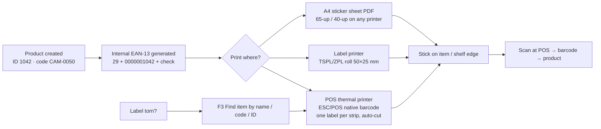

# 11 — Hardware Guide

The **barcode scanner is mandatory for staff billing** in strict mode (the default): cashiers cannot
add items without scanning. Everything else — **receipt printer**, weighing scale, cash drawer, AI,
publishing — is optional: the app runs, and staff can sell, without them. A printer is nevertheless the
most valuable second purchase; until one is set up, receipts are archived as PDF and queued, and the
Owner can switch on *Require printed receipt* once a printer is reliably in place.

## 0. Why the scanner is mandatory and the printer strongly recommended

| Device | Without it a cashier could… | With it… |
|--------|-----------------------------|----------|
| Scanner (mandatory) | type/pick a cheaper item, "forget" to add one | every line is a physical scan of the actual item; manual lines are flagged |
| Printer (optional → recommended) | take cash and skip the bill | customer always receives a bill; the "No bill = free" sign has teeth. Until then the app still records every sale and shows how many went out unprinted |

### What happens with no printer (in detail)
1. **Startup:** doctor says *"Receipt printer: not set up yet — bills will be saved as PDF"* (INFO). App starts; staff log in and sell normally.
2. **Each sale:** committed as usual; PDF archived in `<primary>/receipts/`; sale flagged `receipt_printed=false`; added to the pending-print queue; amber *Printer* chip shows the count. Staff can show the receipt full-screen to the customer.
3. **Printer bought and plugged in:** within 10 s the app detects the new USB/serial/network/OS printer and shows the Owner a toast *"New printer detected: … — set it as receipt printer?"*. The Owner opens *Settings → Hardware → Printer*, picks it from the live list, presses **Test print**, saves. Chip turns green.
4. **Catch-up:** *Print pending receipts (N)* prints the queue (or leave it — PDFs are already archived). From now on receipts auto-print.
5. **Later strictness:** *Settings → Billing rules → Require printed receipt* can be switched on (only while the printer is ready); from then, checkout waits for a ready printer, with an Owner-PIN paper-less override for emergencies.

## 1. Barcode scanner (recommended first purchase, ₹1,000–2,500)

- Buy any **USB "plug-and-play" 1D/2D scanner** that works in **keyboard-wedge (HID) mode** — it
  types the code and presses Enter. No driver, no SDK, works with Python UI instantly.
- 2D (QR-capable) is preferred: it also reads phone screens and damaged labels.
- Configure the scanner (via its manual's config barcodes) to send **Enter (CR)** as suffix.

### How the app handles scans
- The POS scan box keeps focus; characters arriving faster than ~50 ms apart followed by Enter are
  treated as a scan (`hardware/scanner.py`). In strict mode, slow (typed) input into the scan box is
  rejected for cashiers with "Please scan the item".
- `Ctrl+Shift+B` opens the **Scanner test**: scan anything → shows decoded text, length, symbology
  guess, and timing.
- Unknown barcode → cashier sees "Ask Owner"; Owner maps it to an existing product or creates one.

### Pairing the scanner (one-time, Owner)
HID scanners appear to the operating system as keyboards, so the app cannot know "a scanner" exists — unless it is
told which one. *Settings → Hardware → Pair scanner*:
1. App lists current USB HID input devices (`Win32_PnPEntity` / `hidapi`), you unplug & re-plug the
   scanner; the device that disappeared and reappeared is highlighted.
2. Its `VID`, `PID` and product string are stored in `setting` (`scanner.vid_pid`).
3. From then on the doctor (`hardware.scanner`) and the POS (every 10 s) check the device is present.
   Missing → POS banner "Scanner not detected — billing paused" for cashiers (`E-SCN-001`).
Replacing the scanner = re-pair. Two scanners (two counters) can be paired.

## 2. Barcodes for products that have none

### Identity and numbering
- Each product has a permanent numeric **ID**, a human **code** (SKU, e.g. `CAM-0050`) and one or more
  **barcodes**. The internal barcode is derived from the ID (EAN-13, in-store prefix `29`), so it can
  always be regenerated — nothing is lost if a label is destroyed.
- Manufacturer barcodes (EAN-13 / UPC / Code-128) are attached by scanning them once in the product
  editor; both the manufacturer's and the internal code then resolve to the same product.
- Pack variants ("Agarbatti ×12 box") are separate products linked by `parent_product_id`, each with
  its own barcode.

### Label content & sizes
| Target | Size | Content |
|--------|------|---------|
| POS thermal (80 mm) | 72 × ~40 mm strip | name EN · name HI · `CAM-0050 · #1042` · EAN-13 · ₹ price (large) · MRP optional |
| POS thermal (58 mm) | 48 × ~35 mm strip | same, smaller font |
| Label printer roll | 50 × 25 mm | name · code/ID · barcode · price |
| A4 sheet | 38 × 21 mm (65-up) or 52 × 30 mm (40-up) | name · code/ID · barcode · price |

Thermal receipt paper is not adhesive — use transparent tape or a glue stick, or buy a **thermal
label roll** that fits the same printer (many 80 mm printers accept 80 mm continuous label stock).
When a dedicated label printer is bought later, only the adapter changes.

### Printing paths
- `hardware/labels.py` builds one **label model**; renderers: `EscposLabelRenderer` (native `GS k`
  EAN-13 + text + cut), `PdfSheetRenderer` (ReportLab, A4 grids), `TsplRenderer` (label printers, Phase 8).
- "Print label(s)" buttons: product editor, product grid (multi-select → N copies), purchase entry
  (qty received → labels), F3 Find dialog (**replacement label**), open-item review (after conversion).
- Every label print is logged (`LABEL_PRINTED product_id=… copies=… target=escpos`).

For loose items (kumkum by gram) print a **shelf-edge label**; cashier scans the shelf label and types the weight.

## 3. Receipt printer

| Stage | Option | Cost | Notes |
|-------|--------|------|-------|
| Day 1 | **No printer** | ₹0 | App runs; every receipt archived as PDF in `<primary>/receipts/` and queued; show on screen to the customer |
| Interim | Any A4 / inkjet printer the OS knows | ₹0 | Receipt HTML uses `@page` CSS for A4; usable through the OS print system |
| Recommended | **80 mm thermal, USB** (Epson TM-T82 class, or ₹3–6k generic ESC/POS) | ₹3–12k | `hardware/printer/escpos.py` via `python-escpos`; fast, no ink |
| Alt | 58 mm thermal | cheaper | narrower template |
| Alt | Network/Bluetooth ESC/POS | — | IP or serial; network printers are auto-discovered on the LAN |

Setup: *Settings → Hardware → Printer* → pick from the **detected list** (or Refresh) → **Test print**.
The app polls printer status (OS print-system state — Windows spooler / CUPS — for driver printers;
ESC/POS status bytes for thermal). By default a printer that is offline / out of paper / cover open only
turns the chip amber and queues receipts (`E-PRN-001`, selling continues). If the Owner has enabled
*Require printed receipt*, the same condition **pauses checkout** (`E-PRN-002`) until fixed or until the
Owner enables a time-boxed paper-less override. The PDF copy of every receipt is saved regardless.

> "Microsoft Print to PDF"-style virtual printers are listed but marked *virtual* — they cannot
> satisfy *Require printed receipt* (nothing physical reaches the customer).

Devanagari on thermal printers: many ESC/POS printers lack Hindi fonts → the app renders the receipt
as a **raster image** when `receipt.show_hindi=true` (slower but correct), else plain text mode.

### Receipt ↔ POS printer compatibility checklist
| Aspect | How Vaishnavi Store Manager handles it |
|--------|------------------------|
| Paper width | `printer.paper_mm = 80 | 58`; column count 48 / 32 (Font A) or 64 / 42 (Font B); layout engine wraps names and right-aligns amounts |
| Encoding | ASCII text mode by default; `₹` printed as `Rs.` in text mode or as glyph in raster mode; code page selectable (`CP437`, `CP1252`) |
| Hindi | raster rendering (Pillow + Noto Sans Devanagari) of the whole receipt or only Hindi lines |
| Logo | monochrome bitmap, cached, `GS v 0` |
| QR (UPI) | native `GS ( k` QR command, size adjustable; fallback raster |
| Invoice barcode | native `GS k` Code-128 so a return can start by scanning the receipt |
| Cut | partial cut `GS V 1` after feed; configurable for printers without a cutter |
| Cash drawer | `ESC p` pulse on cash payments (pin & duration configurable) |
| Status | `DLE EOT` polling: paper near-end, cover open, offline → strict-mode gate |
| Connection | USB (vendor/product id), Serial/COM, Network (IP:9100), or the OS print system (Windows spooler "Generic / Text Only" raw queue; CUPS raw queue on macOS/Linux) |
| Test | *Settings → Hardware → Test print* prints a sample receipt with all elements + a sample label |

Known-good printer classes: Epson TM-T82/T88, TVS RP 3160/3200, Posiflex, Rongta, and generic
"80 mm POS thermal printer" units sold in India — all speak ESC/POS. Printers that **only** support
proprietary Windows drivers are supported via the spooler path with reduced features (no native barcode/QR).

## 4. Cash drawer (optional)

RJ-11 drawer plugs into the thermal printer; app sends the ESC/POS **kick** pulse on cash payments
and on shift open/close. Logged as `DRAWER_KICK`.

## 5. Customer display / second screen (optional, future)

A `/customer` page can be opened on a second monitor or tablet showing the live cart, total and the
UPI QR — increases transparency (the customer sees what is being billed → harder to under-ring).

## 6. Tablet as second counter (optional)

Set `server.bind=0.0.0.0` and `api.enabled=true`; the tablet browser opens `http://<pc-ip>:8080`.
Same database, same rules. The doctor warns when the app is exposed on LAN and enforces password login.

## 7. UPS

A small UPS for the PC + printer prevents mid-transaction power loss. The DB is crash-safe anyway
(WAL, transactions), but a UPS avoids waiting for the daily restart during a sale.

## 8. Weighing scale (optional)

Loose items (ghee, camphor, kumkum, oil) can be billed by typing the quantity or pressing a preset
button — a scale is a convenience, not a requirement.

| Option | How it connects | Notes |
|--------|-----------------|-------|
| **Serial / USB-serial scale** (most ₹3–8k shop scales: Essae, Phoenix, Contech, generic "RS-232 price computing scale") | `pyserial`; protocol presets (continuous stream / request-response, 9600 8N1 typical); *Settings → Hardware → Scale* with **auto-detect** (listens on each port for weight frames) | live weight + stable flag + tare in the POS quantity pad |
| **Label-printing scale** (prints weight-embedded barcodes) | nothing to connect — the POS decodes the barcode | configure the barcode format once (`scale_barcode.format`, e.g. `21PPPPPWWWWWC` / price-embedded) |
| **Keyboard-wedge scale** (types the weight) | treated as typed quantity | works out of the box |

Cross-platform: serial ports are `COM3` on Windows, `/dev/tty.usbserial-*` on macOS, `/dev/ttyUSB0` on
Linux (bootstrap adds the user to `dialout`). The doctor checks the configured port responds.

## 9. Cross-platform notes for all devices

| Device | Windows | macOS | Ubuntu |
|--------|---------|-------|--------|
| ESC/POS USB printer | `pyusb` + WinUSB (Zadig) **or** Windows spooler "Generic / Text Only" raw | `pyusb` + libusb (`brew install libusb`) or CUPS raw queue | `pyusb` + libusb + udev rule (installed by bootstrap) or CUPS raw queue |
| Network printer (IP:9100) | same code everywhere — **recommended for simplest setup** | | |
| HID scanner | works as keyboard everywhere; presence detection via PnP / IOKit / udev adapters | | |
| Cash drawer | via printer `ESC p` everywhere | | |

The hardware adapters hide these differences; the Settings screens show only what applies to the
current OS.
