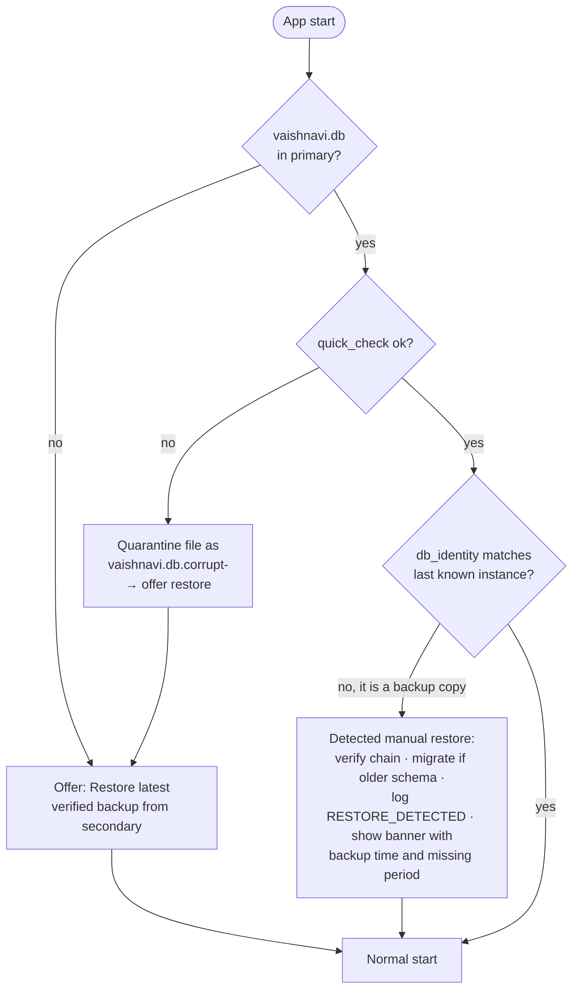

# 14 — Database Protection, Backup & Recovery

The database holds every sale, every stock movement and the audit trail. This document explains how it
is kept safe through daily power-offs, how it is backed up to a **secondary location** automatically,
and exactly what happens when it has to be recovered — including the "I copied the backup file over
the primary" case, which the application is designed to handle.

## 1. Why SQLite is safe for this use-case (and what we must do to keep it so)

| Risk | What SQLite guarantees | What Vaishnavi Store Manager does on top |
|------|------------------------|--------------------------|
| PC switched off every evening / power cut mid-sale | ACID transactions: a sale is either fully written or not at all; the journal (WAL) is replayed automatically on next open | `PRAGMA synchronous=FULL` (fsync on every commit — a few ms, worth it), `BEGIN IMMEDIATE` for writes, **clean shutdown** does `wal_checkpoint(TRUNCATE)` so the DB is a single tidy file at night |
| "Corruption after multiple restarts" | Does not happen from restarts alone; corruption comes from copying the live file, two processes writing, bad disks, or editing with external tools | Single writer process (lock file + port check), **never copies the live `.db`** — backups use the SQLite online-backup API; `PRAGMA quick_check` on every start, full `integrity_check` nightly; external edits detected by the hash chain |
| Disk failure / laptop theft / ransomware | — | Automatic backups to a **secondary location** on another disk/USB/cloud-synced folder; retention; verified copies |
| Someone opens the file in a SQLite tool and changes a sale | — | Hash-chained sales ledger + invoice gap check → red *Integrity* banner, `E-LEDGER-001` |
| Someone copies the file to read it | — | OS file permissions restricted to the app's user account; bank/UPI/credentials encrypted inside the DB (`secure_setting`); optional whole-database encryption (SQLCipher) and encrypted backups as an opt-in ([§8](#8-optional-encryption)) |

Pragmas set on every connection: `journal_mode=WAL`, `synchronous=FULL`, `foreign_keys=ON`,
`busy_timeout=5000`, `temp_store=MEMORY`, `auto_vacuum=INCREMENTAL`. `VACUUM` runs monthly after a backup.

## 2. What a crash or hang can and cannot lose

The owner's priority order is: **catalogue (items, IDs, barcodes, prices) must never be lost** >
**sales must exactly match inventory** > a few minutes of the day's sales would be tolerable.
SQLite's transactional guarantees give us more than that — nothing that was ever *saved* is lost:

| Event | Catalogue (products, IDs, barcodes, prices, price history) | Stock & sales already committed | Cart being typed at that moment | What the owner sees next start |
|-------|---|---|---|---|
| App process crashes (bug, out-of-memory) | **intact** — every edit is committed the moment *Save* is pressed | **intact** — a sale is committed as one transaction before the receipt even prints | lost (it was never a sale; staff re-scan 3 items) | note "Vaishnavi Store Manager did not close properly last time — all saved data is intact" (`E-DB-022`), WAL replayed automatically, `quick_check` ok |
| App hangs (UI frozen) | intact | intact | the browser shows "Reconnecting…"; the watchdog restarts the server when `/healthz` stops answering for 60 s | same note; **held carts** (F6) are persisted and come back |
| Power cut / hard reset mid-sale | intact | intact — the half-written sale is rolled back **together with** its stock movements and payment rows, so inventory and sales stay consistent | lost | same note |
| Browser/tab closed or PC rebooted during the day | intact | intact | the cart is kept in the browser session storage for 2 h and restored on reopen | nothing — normal start |
| Disk dies | restored from the **secondary** snapshot: catalogue complete; sales up to the last snapshot (default: last shift close / night; optional every 15 min) | | | banner naming the backup time ([§5](#5-recovery--the-three-ways)) |

Why this holds:
- **Every catalogue write commits immediately** (`synchronous=FULL` → the OS is told to flush to disk
  before *Save* returns). There is no in-memory cache that could be lost.
- **One sale = one transaction**: invoice counter, `sale`, `sale_item`s, `payment`s, `stock_movement`s,
  audit row and hash are written inside a single `BEGIN IMMEDIATE … COMMIT`. A crash leaves either all
  of them or none of them — there is no state in which a sale exists without its stock deduction or vice
  versa. Receipt printing happens *after* commit and is retried from the `print_pending` queue.
- **WAL journal**: a crash leaves at worst a partially written WAL frame; SQLite discards it on next
  open. `quick_check` on every start confirms the file is sound before the app accepts a login.
- **Single writer**: the lock file + port check prevent two app instances (e.g. a double-click during a
  slow start) from writing concurrently — the classic way to corrupt a SQLite file.

## 2a. Sales always match inventory — by construction and by check

The Owner must be able to trust that *stock sold by staff* in the reports equals what left the shelf
in the system. Three layers:

1. **By construction** — stock on hand is not an editable number; it is the sum of `stock_movement`
   rows (the `product_stock` cache is maintained by a database **trigger**, never by application code, so it
   cannot drift), and the only way a staff member can create a `SALE` movement is through a committed sale (same
   transaction, see above). Voids/refunds post reversing movements in their own single transaction.
2. **By continuous check** — the hourly `verify_chain` job also runs a **reconciliation**: for every
   product, `Σ movements == product_stock.qty == yesterday's stock_daily_balance + today's movements`, and for
   the day, `Σ sale_item.qty (completed − voided) == Σ SALE movements`. Any mismatch (only possible through external DB edits or a bug) is logged
   `E-LEDGER-003`, shown as a red *Integrity* chip and listed in *Reports → Backups & integrity*.
3. **By physical count** — the stock-take flow compares system quantity with the shelf; the difference
   is **shrinkage** (theft, breakage, un-billed sales), reported per item and per period.

The Owner's reports therefore answer, from the same ledger: what was sold (by whom, when), what is
left, what is below minimum / out of stock, what to reorder, and the forecast — all from
`stock_movement`, `sale_item` and `forecast_snapshot`, never from separately maintained counters.

## 3. Two locations, chosen during installation

The bootstrapper asks (and *Settings → Backups* can change later):

| | **Primary location** | **Secondary location** |
|---|---|---|
| Holds | the live database `vaishnavi.db`, images, receipts PDF, logs | **backup snapshots** of the database + images + config |
| Default | `~/VaishnaviStore/data` | none — the installer insists you choose one; it recommends a **different physical disk**: a USB drive left plugged in, a second internal disk, or a cloud-synced folder (OneDrive / Google Drive / Dropbox) |
| Checked by the doctor | exists, writable, free space, DB integrity | exists, writable, free space, **last backup age**, last backup verified |
| If unavailable | app cannot start (FAIL) | app starts (WARN "Backup drive not found"); backups queue locally in `primary/backups_pending/` and flush when the drive returns; the Owner is alerted on the dashboard and in the digest |

The installer refuses to accept the same folder (or the same drive, when it can tell) for both, and
explains why in plain language. A **third, optional** location (e.g. cloud folder) can be added later
for an off-site copy.

## 4. Automatic backup schedule

| Trigger | What | Why |
|---------|------|-----|
| App start (if last backup > 20 h) | full snapshot | catches days when the evening backup did not run |
| Every shift close | full snapshot | the natural "end of money" point |
| Nightly 21:30 (and before shutdown if sales happened after the last backup) | full snapshot + nightly `integrity_check` of the live DB | daily anchor |
| Before any migration / update / restore | full snapshot tagged `pre-<action>` | one-click undo |
| Owner presses *Backup now* | full snapshot | peace of mind |
| Every 15 min while shop is open (opt-in, `backup.hot_interval_min`) | WAL-aware incremental snapshot to secondary | limits loss to minutes if the primary disk dies mid-day |

### How a snapshot is made (never a file copy of the live DB)
```
sqlite3.connect(primary).backup(sqlite3.connect(tmp))   # online backup API: consistent even while billing continues
PRAGMA integrity_check on tmp  → must be "ok"
compute chain head (last sale hash) and row counts
write  <secondary>/vaishnavi/backups/vaishnavi_2026-11-14_2130_shift41.db
write  <secondary>/vaishnavi/backups/vaishnavi_2026-11-14_2130_shift41.json   # manifest: schema version, app version, instance id,
                                                                          # last invoice no, chain head, sha256 of the .db, sizes
copy   images/ (changed files only) and config/settings.toml (redacted secrets)
record backup_log row (path, size, verified=true, trigger)
prune  per retention: keep all of last 14 days, weekly for 3 months, monthly for 2 years, every pre-* snapshot for 90 days
```
Each snapshot is a **complete, standalone, checkpointed single-file database** — that is what makes
manual recovery by copying possible.

## 5. Recovery — the three ways



### 5.1 In-app restore (preferred)
*Settings → Backups → Restore*: list of snapshots from the secondary (date, shift, last invoice no.,
verified ✔). Choose → the app (a) takes a `pre-restore` snapshot of whatever is in primary, (b) copies
the chosen snapshot in with the backup API, (c) runs `integrity_check`, (d) applies migrations if the
snapshot is from an older version — **dry-run first on a temporary copy**, then on the real file —, (e) verifies the hash chains, (f) restarts. Owner password required;
audited `RESTORE`.

### 5.2 Manual restore by copying the file — **yes, this works**
If the PC died and the owner has only the secondary drive:

1. Install Vaishnavi Store Manager on the new/repaired PC (`python3 main.py`), choosing the same or a new primary
   folder. Stop the app if it started (*Settings → System → Shut down*), or just do this before first login.
2. Copy `vaishnavi_<date>_<time>.db` from `<secondary>/vaishnavi/backups/` to the primary data folder and
   rename it to **`vaishnavi.db`**. Also copy the `images/` folder if you want product pictures back.
   Delete any `vaishnavi.db-wal` / `vaishnavi.db-shm` files sitting next to it (they belong to the old DB).
3. Start the app. The doctor will:
   - run `quick_check` (passes — snapshots are verified when made);
   - read the `db_identity` table and notice this is **backup `#…` from 14-Nov 21:30**, not the file it last
     closed → log `RESTORE_DETECTED` and show an Owner banner: *"Running on backup from 14-Nov 21:30. Bills
     after that time (if any) must be re-entered from paper receipts."*;
   - **migrate** the schema forward if the backup came from an older app version (Alembic), after
     taking a `pre-migrate` snapshot;
   - verify the sales hash chain and invoice sequence → *Integrity OK*;
   - re-enter secrets: bank/UPI details are encrypted with a key held in the OS secret store of the
     **old** PC, so on a new PC the Owner is prompted to re-enter them (clearly stated in the banner);
   - re-pair the scanner and re-select the printer if the hardware changed.
4. Billing resumes. Invoice numbers continue from the last one in the backup — the gap detector knows
   about the restore point so the missing period is reported, not flagged as tampering.

What **not** to do: never copy `vaishnavi.db` **while the app is running**, and never copy a live
`.db` without its `-wal` file (you would lose the latest transactions). Use snapshots from the
`backups/` folder — they are self-contained. The *Backups* screen shows these rules, and the doctor's
"What to do" text repeats them when it detects a problem.

### 5.3 Restore from the primary's own local backups
If the secondary is unavailable, the last few snapshots are also kept in `primary/backups_local/`
(short retention, 3 days) so a corrupted live file can still be recovered immediately.

## 6. How the app knows which database it is running on — `db_identity`

| Column | Purpose |
|--------|---------|
| `instance_id` | ULID created when the DB was first created |
| `created_at`, `app_version`, `schema_version` | provenance |
| `last_clean_close_at`, `last_open_at` | detects unclean shutdowns (→ `quick_check` + WAL replay note in log) |
| `backup_id`, `backup_taken_at` | written **into the snapshot** by the backup job (not into the live DB) — so a file that carries a `backup_id` is, by definition, a restored copy |
| `restored_at`, `restored_from` | set by the app on first start after a detected restore |

Combined with `~/VaishnaviStore/state/last_db_fingerprint.json` (chain head + last invoice + instance id written
at each clean close), the app can tell: normal start / unclean shutdown / restored older copy / foreign
database (different `instance_id` — e.g. someone dropped in another shop's file → refuse with a clear message).

## 7. Owner routine & checks

| When | What the app does | What the owner sees |
|------|-------------------|---------------------|
| Daily | backups as per §4; doctor shows age + verification of the last one | *Backup* chip green/amber/red; dashboard card "Last backup 21:30, verified, on USB-DRIVE" |
| Weekly | **restore drill** (automatic): restores the latest snapshot into a temp DB, runs integrity + chain check, deletes it | log `RESTORE_DRILL_OK`; failure → red chip + digest alert |
| Monthly | `VACUUM` + full `integrity_check` + prune | log only |
| On USB unplug | queue backups locally; alert | amber chip "Backup drive not found — 2 backups waiting" |
| Digest (if publishing enabled) | includes backup status and chain head | owner sees it on the phone |

## 8. Optional encryption

- **Secrets** (bank/UPI/credentials) are always encrypted (`secure_setting`).
- **Whole database** encryption with SQLCipher (`sqlcipher3` wheels, key in OS secret store) is an
  opt-in (`db.encrypt=true`) because it makes manual recovery depend on the key being available;
  recommended only if the PC is shared or portable. Backups of an encrypted DB are encrypted too.
- **Encrypted backups** of an unencrypted DB (`backup.encrypt=true`, passphrase chosen by the Owner,
  Fernet): the Owner **must keep the passphrase** — the restore screen and bootstrapper can decrypt
  with it; a lost passphrase means lost backups. Default **off** so that "copy the file back" always works.

## 9. Error codes (added to [08 §5](08-logging-and-troubleshooting.md#5-error-code-areas))

| Code | Meaning | What the owner sees |
|------|---------|---------------------|
| `E-DB-003` | `quick_check`/`integrity_check` failed | "The shop database is damaged. Restore the latest backup (Settings → Backups → Restore)." |
| `E-DB-020` | restored copy detected | banner with backup time and missing period |
| `E-DB-021` | foreign database (different instance) | "This database file belongs to a different Vaishnavi Store Manager installation." |
| `E-DB-022` | unclean shutdown detected (recovered automatically) | log only; counted in doctor summary |
| `E-BKP-001` | secondary location unavailable | "Backup drive not found — plug it in. Backups are waiting." |
| `E-BKP-002` | destination not writable / full | plain instruction |
| `E-BKP-003` | snapshot failed verification | "Last backup could not be verified — a new one will be tried; if this repeats, check the drive." |
| `E-BKP-010` | restore drill failed | red chip + alert |
